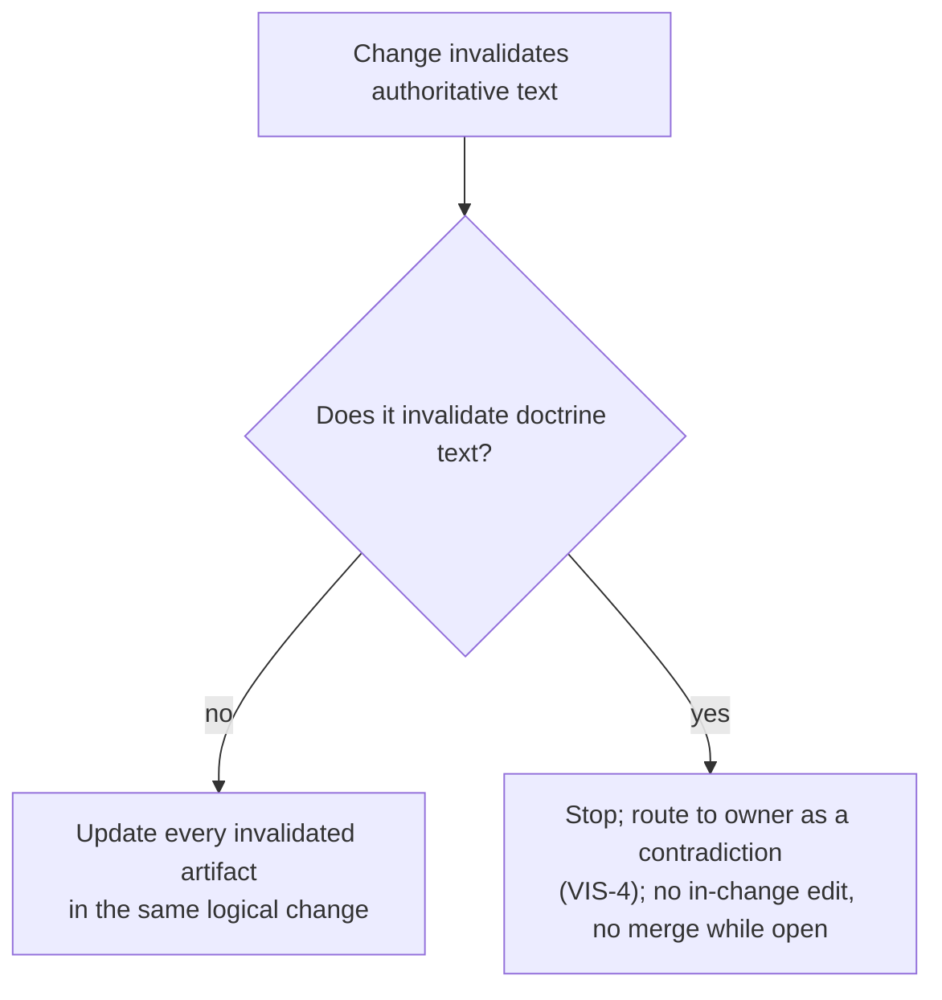

> Curated evidence successor, prepared 2026-10-21. This report describes the
> historical C3 source audit. The sealed original remains outside Git. Five
> performed-argument digest quotations were removed in favor of the adoption
> act path; the byte-receipt route now names the included alias. No source
> conclusion or clause quotation was changed. EVIDENCE-SELECTION.json binds
> parent/output identities and operations. This is authored evidence, not a
> current review verdict, owner act or implementation permission.

# P115 source-decision reconciliation after two failed rounds

[Observed] This is the requested CC-REV-4 upstream source return, authored by the original candidate writer. It is evidence and inferred engineering judgment, **not a third semantic review, confirmation, owner act, adoption or implementation authorization**. R1 and R2 remain actual failed rounds with verdict `REVISE`; their raw bytes and C3 remain preserved. All task writes are confined to this new cache directory. No repository/core/raw/tooling edit, tracker action, observed-project body read, provider call, runtime/test execution, daemon or new reviewer was used.

[Inferred] The source decision is to replace the unchanged-intent/constant/result shortcut with complete-limb consumption assessment. A compatible rule can be affected because the representation it consumes changes. Keep affectedness, normative validity and actual invalidation as distinct judgments. Preserve the **actual final encoded-byte rule**, the original ceilings/refusals and the exact one-local-hop value contract; do not measure a logically expanded or historic inline body as the new served body.

[Observed] The proposed complete result is **15 affected, 115 explicitly unaffected, 0 undecidable requirement occurrences across 8 specifications**. Four specifications are affected. Twelve occurrence classifications change from C3. POC-REQ-014 is the one presently identified block requiring normative text amendment; the other fourteen affected blocks are compatible obligations whose current text remains valid. These are authored classifications pending other-party confirmation. Zero undecidable *classifications* is not a claim of runtime, adapter or external-consumer completeness.

## Exact source and population

[Observed] Baseline: `4504514c019ca0ee0cb4a89ed97445a0bad21915`. Exact candidate under examination: `abd3f6ca2e8e99ad59327fdfc7b38d8bf41b07b5`. Main implementation context: `eba011dfbe254c09a88ccc374b3efe5ff5df1762`. The source corpus is the eight BASE450 `openspec/**/specs/**/spec.md` files. Every complete requirement occurrence, including required behavior, scope, scenarios, cases, observable/oracle/independence/falsifier and warrants, is retained in `BASE450-REQUIREMENT-BLOCKS.json` with original path, ordinal, heading and block SHA256. The C3 proposed POC014 twin and reconstructed proposed spec are preserved separately.

[Observed] Two independently enumerated populations agree: NUL-delimited Git tree/object bytes plus literal header-prefix counting; Git archive pathname/body enumeration plus multiline regex counting. Both enumerate 2,927 baseline tracked files, eight spec bodies and 130 requirement occurrences. All eight spec bodies are byte-identical at the named main checkpoint. The independently rechecked 39 C3 frozen core paths and six adopted POC subjects remain exact. `POPULATION-AND-PRESERVATION.json` records the per-file and per-subject evidence. This is identity/count evidence only, not semantic confirmation.

[Observed] `SOURCE-BINDINGS.json` binds exact Git commits, blobs, byte lengths, SHA256 and cache copies. It includes the adopted impact policy, craft review policy, Oct15 owner direction, RFC0006, doctrine, C3 assessments/delta/design/compatibility artifacts, static implementation context and immutable supplemental receipts. The impact policy's candidate path/banner is not its authority state: the 2026-09-28 specification-policy readability-restyle entry in `ACCEPTANCE-ACT-RECORD.md` binds these exact current CC-IMPACT bytes. The act record is cited for that binding; it is not rewritten or re-performed here.

| Specification occurrence population | Requirements | Proposed affected | Proposed explicitly unaffected |
| --- | ---: | ---: | ---: |
| cap1-trusted-bootstrap-consent | 2 | 0 | 2 |
| polaris-dossier-local-agent-mode | 4 | 0 | 4 |
| polaris-manifesto-generation | 29 | 1 | 28 |
| polaris-manifesto-understanding-amendment | 9 | 1 | 8 |
| polaris-non-governed-narrative-profile | 1 | 0 | 1 |
| polaris-project-wide-butlers-model | 17 | 7 | 10 |
| project-registration-and-honest-shape-visibility | 42 | 0 | 42 |
| three-surface-poc-experience | 26 | 6 | 20 |


[Observed] Every occurrence has its own authored method, nonempty schema-mapped consumption and exact source excerpt in `FULL-130-ASSESSMENTS.json`; `EVIDENCE-EXCERPT-MAP.json` records the exact complete-limb excerpt offsets for all fifteen affected entries and preservation excerpts for the remaining entries. Every excerpt is a literal slice of its bound complete source block. Each method names its complete limbs and owning input/output boundary. Retained source block digests agree with C3. No row is defaulted from an empty warrant/declaration, unchanged headline or unchanged numeric limit. Unaffected rows positively identify their closed input/effect populations and why the transform excludes them. `C3-CHANGED-AND-MISSED-EDGES.json` preserves each changed row's previous reason/method alongside the proposed reasoning.

## In-force clauses and the source criterion

[Observed] The following are exact source quotations, with wrapping and wording preserved. `SOURCE-CRITERIA.json` carries full file/quote digests, line bounds and the remaining contract quotations. Historical amendment explanations are not substituted for the operative clause.


Source: `.syzygy/governance/contracts/candidates/policy-candidates/SHAPE-TO-SPEC-IMPACT-POLICY-CANDIDATE.md` at `4504514c019ca0ee0cb4a89ed97445a0bad21915`, lines 118–136; source identity is bound in SOURCE-CRITERIA.json, with adoption recorded in .syzygy/governance/decisions/SPEC-POLICY-READABILITY-RESTYLE-ADOPTION-ACT.md.

````text
**CC-IMPACT-2 — A shape delta performs a reverse-reference sweep, and the
trigger set is the warrant set.**

> **The identities that can trigger a sweep are exactly the identities that
> can warrant a requirement** — CC-SPEC-2's six classes, and no others.

When an adopted doctrine rule, an accepted contract clause, an approved
craft/policy clause, a recorded owner decision, an accepted topology
identity, or an accepted parent requirement or specification changes, the
change carries a sweep over the specification corpus for every
specification whose CC-IMPACT-1 declarations name the changed identity, or
whose requirements consume its vocabulary. **The sweep is part of the
change, not a follow-up task.**

Stating the trigger set as an *identity* rather than as a second enumeration
is deliberate: two lists drift, and the drift is silent.

- Any class that becomes warrantable becomes sweepable in the same act.
- Any class that cannot trigger a sweep may not warrant a requirement.
````


Source: `.syzygy/governance/contracts/candidates/policy-candidates/SHAPE-TO-SPEC-IMPACT-POLICY-CANDIDATE.md` at `4504514c019ca0ee0cb4a89ed97445a0bad21915`, lines 145–172; source identity is bound in SOURCE-CRITERIA.json, with adoption recorded in .syzygy/governance/decisions/SPEC-POLICY-READABILITY-RESTYLE-ADOPTION-ACT.md.

````text
**CC-IMPACT-3 — The sweep records four sets, with its denominator and its
method.** The sweep's output names:

```text
population              every specification and requirement examined, counted
affected                those a declaration or a consumption ties to the change
explicitly unaffected   those examined and found untied — each with the reason
                        AND the method that established untiedness
undecidable             those whose relationship the sweep could not settle,
                        each with what would settle it
```

**The reason and the method are two different things, and both are
required.**

- "Does not declare the changed identity" is an *observation*; if
  declaration-matching is the whole method, the sweep says so, and
  everything that method cannot decide routes to `undecidable` under
  CC-IMPACT-4 rather than to `explicitly unaffected`.
- A true reason producing a wrong answer, carried by a denominator and full
  compliance, is the failure mode this limb exists to prevent.

A sweep that reports only the affected set has reported a numerator without
a denominator, and satisfies nothing. The denominator discipline itself is
**CC-KNOW-16**'s (candidate, P-12, `CRAFT-KNOWLEDGE-HYGIENE-POLICY.md`) —
cited, not restated; this clause is that rule's application to the
specification corpus, and if CC-KNOW-16 is not approved the discipline still
rests on VIS-2.
````


Source: `.syzygy/governance/contracts/candidates/policy-candidates/SHAPE-TO-SPEC-IMPACT-POLICY-CANDIDATE.md` at `4504514c019ca0ee0cb4a89ed97445a0bad21915`, lines 181–186; source identity is bound in SOURCE-CRITERIA.json, with adoption recorded in .syzygy/governance/decisions/SPEC-POLICY-READABILITY-RESTYLE-ADOPTION-ACT.md.

````text
**CC-IMPACT-4 — Undecidable impact renders as Unknown or contradiction,
never as unaffected.** A specification the sweep could not settle is
rendered `Unknown` with its settling evidence named, or `contradicted`
where the shape change and the requirement now disagree. Silence is not an
answer, and "not listed as affected" is never evidence of being unaffected
(VIS-2, applied to the sweep's own output).
````


Source: `.syzygy/governance/contracts/candidates/policy-candidates/SHAPE-TO-SPEC-IMPACT-POLICY-CANDIDATE.md` at `4504514c019ca0ee0cb4a89ed97445a0bad21915`, lines 188–199; source identity is bound in SOURCE-CRITERIA.json, with adoption recorded in .syzygy/governance/decisions/SPEC-POLICY-READABILITY-RESTYLE-ADOPTION-ACT.md.

````text
**CC-IMPACT-5 — Every required amendment names its actor, and the sweep
names one too.**

- Each affected specification's amendment is owned by a named actor before
  the change lands.
- **The sweep itself has an actor**: the shape change's author performs it,
  and a party other than that author confirms it is adequate — the
  CC-TEST-4 pattern, because a sweeper grading their own denominator is the
  unassigned judgment E5 exists to remove.
- "The author" is a name; "someone" is not.
- Where the actor is the owner (VIS-4), the amendment waits on the owner
  and the wait is visible.
````


Source: `.syzygy/governance/contracts/candidates/policy-candidates/SHAPE-TO-SPEC-IMPACT-POLICY-CANDIDATE.md` at `4504514c019ca0ee0cb4a89ed97445a0bad21915`, lines 206–222; source identity is bound in SOURCE-CRITERIA.json, with adoption recorded in .syzygy/governance/decisions/SPEC-POLICY-READABILITY-RESTYLE-ADOPTION-ACT.md.

````text
**CC-IMPACT-6 — Affected specs move in the same logical change. There is no
exception today.** CC-REV-2's merge invariant governs, unmodified and
uncarved: the shape change and its spec amendments land together, so
mainline never asserts the old truth, and **behavioral specs are the first
population CC-REV-2 names**. CC-REV-2 admits no exception limb of its own;
its only carve-out is doctrine's owner gate.

**This clause creates no alternative.**

- A lagging specification is lawful only if CC-REV-2 is **itself amended**,
  in place, through the craft cluster's own amendment act.
- That amendment is offered separately —
  `CC-REV-2-LAGGING-SPECIFICATION-AMENDMENT-OFFER.md` in this directory,
  queued as **P-44** — and it carries five required elements plus a
  confirmer distinct from the change's author.
- **Until that act is performed, no lawful lag exists**, and a shape change
  whose spec amendments cannot land with it does not merge.
````


Source: `.syzygy/governance/policies/craft-and-care/review-and-documentation.md` at `4504514c019ca0ee0cb4a89ed97445a0bad21915`, lines 71–109; SHA256 `13928819f6573d85e3074bb6d042fef49c2d42d5beece658a3bc5292f1ea97e1`.

````text
## CC-REV-2 — The same-logical-change rule

A change that invalidates any authoritative artifact updates **every**
invalidated authoritative artifact in the same logical change; if doctrine
would be invalidated, the change instead stops, routes to the owner, and
does not merge while the contradiction is open.



- **Authoritative artifacts:** behavioral specs (`openspec/`), declared
  topology, accepted contracts, and the policies in this cluster.
- **"We'll sync the spec later" is a violation, not a plan** (canonical
  bias 7, strengthened to *all* typed authorities). [Observed — FD-020 E1-b
  (done includes same-change spec update, topology when structure moved)
  and E10 (same-change-mandatory sync).]
- **The rule is a merge invariant, not a property of how work is
  packaged.**
  - No merge may leave mainline with an invalidated authoritative artifact
    still asserting the old truth.
  - Splitting one logical change across sequenced merges that pass through
    such a state *is* the violation — an open follow-up PR is "syncing
    later" by another name.

**The one structural carve-out: doctrine** is amended only through the owner
gate (VIS-4).

- When a change would invalidate doctrine text, the change stops and routes
  to the owner as a contradiction.
- It does not edit doctrine in-change, and it does not merge while the
  contradiction is open.
- *Violation:* moving a responsibility between two surfaces, updating code and
  specs, and leaving declared topology asserting the old placement — creating
  exactly the intent-vs-observed drift Syzygy exists to expose.
````


Source: `.syzygy/governance/policies/craft-and-care/review-and-documentation.md` at `4504514c019ca0ee0cb4a89ed97445a0bad21915`, lines 129–144; SHA256 `13928819f6573d85e3074bb6d042fef49c2d42d5beece658a3bc5292f1ea97e1`.

````text
## CC-REV-4 — Fresh-reader review for normative artifacts

Every normative artifact passes fresh-reader review at adoption and on
material amendment (VIS-3).

- **The test:** a reader with no authoring context restates intent and
  constraints correctly.
- **Failures** are recorded on the artifact's surface.
- **Scope, per SDR-14:** material changes and release milestones, not every
  prose correction.
- **Two failed review rounds** signal upstream ambiguity — return to the
  source decision, don't polish prose.
- *Violation:* a contract amended in five successive LLM sessions, each edit
  locally reasonable, none fresh-reader-reviewed, until only its authors can
  parse it.
````


Source: `.syzygy/governance/decisions/OWNER-DIRECTION-MACHINE-CEILING-2026-10-15.md` at `4504514c019ca0ee0cb4a89ed97445a0bad21915`, lines 50–53; SHA256 `e2e3301f8f34302691697a5161ac5a89e5de839dd74a4cb1117b6c3051c9cec3`.

````text
2. **Then governedBy once.** Draft a POC-REQ-014 amendment that serves the
   identical governedBy Unknown once per observation, with items
   referencing it. As of 2026-10-20 its drafting has not started. P-115 is
   reserved for it and is not yet in the register.
````


Source: `.syzygy/governance/decisions/OWNER-DIRECTION-MACHINE-CEILING-2026-10-15.md` at `4504514c019ca0ee0cb4a89ed97445a0bad21915`, lines 56–62; SHA256 `e2e3301f8f34302691697a5161ac5a89e5de839dd74a4cb1117b6c3051c9cec3`.

````text
## What this does not do

It signs neither package; each is offered to the owner after its review.
It authorizes no code change. The daemon hard-codes the ceiling, so the
raise takes effect only under a separate implementation authorization,
asked in the P-114 packet. It changes no check, no recorder and no other
registry field.
````


[Observed] The quoted Oct15 “drafting has not started” sentence is the preserved dated direction's historical statement, not a current assertion. C3 plainly contains a draft. Its Decision ID is exactly `OWNER-DIRECTION-MACHINE-CEILING-2026-10-15`. The direction selects drafting/order and does not sign P115 or authorize code. The later “approve both” in the root session covered the named v4 installation and P114 transaction/Ask2, not P115.

[Inferred] Apply the clauses in this order:

1. Identify the actual change and each complete requirement occurrence, including broad compatibility, resource, sink and oracle limbs. Declaration matching is one possible positive edge; its absence proves no untiedness.
2. Mark **affected** if a limb consumes the changed carrier/reference, its complete representation/field population, or a derived byte/refusal/identity/cache/readiness result. An unchanged obligation can still consume a changed input. The source-established relationship does not wait for a runtime failure.
3. Mark **explicitly unaffected** only after identifying a closed, preserved source/effect/record/query population that excludes the changed fields for every limb, and state the method establishing that separation. Examples include declaration-derived registration facts; recorded status/time fields; the failed work observation branch; and codeStructure observation fields. Common transport or a shared word alone is not a reliance, but a broad full-sink or compatibility clause cannot be narrowed to one familiar reader.
4. If that relationship is not settled, mark **undecidable/Unknown** and name evidence that would settle it. Do not use Unknown runtime conformance to erase a positive source edge, and do not use an untested implementation assertion as evidence of untiedness.
5. Separately decide `normative_block_text_change_required`. Where a compatible existing obligation remains valid, retain the exact adopted block and carry explicit compatibility handling and later verification in the same logical change. Where the behavior invalidates text, amend every invalidated authoritative artifact atomically. This distinction is not a lag exception or permission to land a broken gate.

[Inferred] CC-IMPACT-5 still requires a different party to confirm adequacy. The named author of this source audit is OpenAI Codex `/root/owner_final_review`; coordinator `/root` owns successor integration/recording/offer lifecycle and must arrange independent confirmation. This authored evidence does not supply that confirmation.

## Exact changed relationships

[Observed] C3 recorded 3 affected / 127 explicitly unaffected / 0 undecidable. The proposed result retains POC014, POC020 and POC022 as affected and changes the following twelve occurrences from explicitly unaffected to affected. Each complete row, actual C3 reason/method, source digest, incoming/output boundary, unchanged obligation and later verification is in the comparison JSON.

| Occurrence | Actual consumption missed or over-narrowed by C3 | Text change required? |
| --- | --- | --- |
| REQ-polaris-generation-019 (generator base) [occurrence 25] | Explicit preservation of PWB wire conventions; two current readers do not narrow the normative compatibility limb. | No |
| REQ-polaris-generation-019 (understanding overlay) [occurrence 42] | Same explicit convention-preservation limb in the full understanding overlay, independently of its additional records. | No |
| PWB-REQ-003 [occurrence 48] | Every model/cache/log/HTML/JSON/record sink is scanned for excluded-source sentinel content. | No |
| PWB-REQ-006 [occurrence 50] | Actual final encoded machine bytes determine ceiling/refusal; that result also reaches pre-304 and resource readiness. | No |
| PWB-REQ-007 [occurrence 51] | Effective per-item Unknown state and retained distinct records must still satisfy complete tuple/identity/composition fidelity. | No |
| PWB-REQ-011 [occurrence 54] | No route or sink may carry withheld source bodies; new success/refusal bytes are part of that sink population. | No |
| PWB-REQ-014 [occurrence 57] | Independent own-identity resolution scans the changed machine object/reference graph; refs must not count as own identities. | No |
| PWB-REQ-020 [occurrence 60] | Derived values must be provable from the answer-own bytes, without subtracting facts, under named view ceilings/gates. | No |
| PWB-REQ-021 [occurrence 61] | Any PWB006 resource breach feeds an existing readiness arm, independently of unchanged prompts/answers. | No |
| POC-REQ-002 [occurrence 106] | The complete served bytes of both channels, not just codeStructure fields, are the sentinel oracle denominator. | No |
| POC-REQ-010 [occurrence 109] | Every own/item field is in the observation provenance/capture census; the new objects are inside that population. | No |
| POC-REQ-060 [occurrence 129] | Per-item effective Unknown encoding/count preservation remains required, while distinct entity/relationship records stay outside pooling. | No |


[Inferred] The current concrete generation-source adapter is positively separated: it reads `projectShape` and maps only the declared source/identity/classification fields into GenerationSource. The current PWB narrative anchor retains its own target identity/revision/captured tuple, including the work-*observation* target rather than a governing-intent claim. Those are useful preservation facts. They do **not** eliminate the explicit broader GEN019 obligation to preserve PWB wire conventions through compatibility adaptation. Both full GEN019 occurrences are therefore affected-compatible, with generic implementation conformance still Unknown.

[Inferred] POC060 is also mixed-limb, not a permission to pool records. Its record-shape scope says exactly:

```text
No other epistemic value the machine answer serves is
  in the record-shape population.
```
 The exact scope is every entity/relationship list element, while its encoding and Inferred-count/Unknown-set obligations remain. The shared three-field value is outside the record-shape population; distinct entities, relationships and separately served per-item records retain their full identity, prose reason, provenance and route/action metadata. The human renderer continues to read the existing logical model. Its architecture does not acquire a dependency on the serialized machine wire. Independent machine comparators/consumers perform the closed expansion when deriving effective facts for full-record, encoding, count and Unknown-set comparisons. A positive full-record fixture and a forbidden `governedByCopy` can coexist without weakening either boundary.

## Physical-byte, refusal and cache decisions

[Observed] The full PWB006 block independently establishes final encoded human HTML and machine JSON ceilings, complete sink scans, exact final encoded-byte oracles, bounded typed final-output failure and readiness false. The current static implementation at the named main checkpoint measures UTF-8 bytes in `boundedResponse`, returns a resource failure on excess, and reaches the weak ETag/If-None-Match/304 branch only after the full machine response is eligible. Its response-identity preimage clones the complete model and removes only its self-key and declared capture-time fields; the changed governedBy objects are not excluded. These are source observations, not execution evidence or a claim that current code proves every normative bound.

[Observed] Supplemental independent byte evidence is sealed at `../encoded-byte/FINAL-RECEIPT.json` (SHA256 `a06e2715881c5985700bc0482f90a878c47c2631ee0d7fb163994a41ee31fd76`). The report/source/seed/output hashes were checked before use. Its two independent Python/Node methods read exact C3 synthetic inputs, without product code. Its derived small-N peers are explicitly synthetic, not production models:

| Synthetic item population | Inline bytes | Reference bytes | Reference minus inline | Inclusive ceiling interval with different outcomes |
| --- | ---: | ---: | ---: | --- |
| 0 | 1692 | 1950 | +258 | 1692–1949 |
| 1 | 2612 | 2647 | +35 | 2612–2646 |
| 2 | 3553 | 3365 | −188 | 3365–3552 |

[Inferred] The reference form can grow a small body and shrink a larger one. There is no always-smaller premise, guaranteed headroom, current approximately-2-MB saving, inline fallback or observed-empty exception. A final-byte change can change a resource outcome even when both small examples fit the currently adopted nominal ceiling. Preserve the actual-byte rule in either direction. Equal effective facts do not make physical-byte, refusal or cache inputs equal.

[Inferred] The proposed engineering order is: existing credential admission; captured observation with no added source/read; closed wire projection/validation; complete response identity on the actual carried representation under its existing declared exclusions; actual final serialization and byte gate; only then successful conditional revalidation. A declared invalid form cannot reuse an old complete-body key or borrow a previous observation. This is a bounded design obligation for future implementation, not a new generic reference engine or authorization to modify runtime code. Do not silently normalize the new carrier out of the existing complete-body identity. Evaluation/claim/source identities remain distinct from response-content identity.

[Inferred] Other byte/refusal/cache scopes were examined over their full blocks. Generation asset/provider budgets (occurrences 9/11), scheduler/checkpoint caches (14/19), authored-content and retained-history homes (17/22/35), operator Git/draft/packet limits (3–6), and CAP1 declaration/registration deterministic answer bytes (63–68) own separate explicit populations. They are positively untied as recorded per occurrence; they are not waived. PWB source-body/exclusion sinks, own-byte derived views, whole-channel sentinel scans and current HTTP identity/cache decisions are the affected physical consumers. `CONSUMER-EDGE-MAP.json` records the positive traces, separate refusal scopes and remaining Unknowns without claiming a complete external/dynamic consumer inventory.

## Readiness and act validity boundary

[Observed] PWB021's complete block already includes **any PWB006 resource breach** in readiness false and explicitly keeps its readiness population separate from PWB022. PWB022 defines exactly 84 present-invalid plus 2 absent owner-act/record cases. Neither text allows a wire-validation fault to enlarge that act-validity population.

[Inferred] Keep the candidate's `invalid-governing-intent-reference` as a **response-level refusal**: HTTP503, `served: "nothing"`, unchanged evaluation, explicit resolution text, `readiness: false`, no successful/partial model or numeric replacement count. It is not a new RFC2-24 Unknown reason, PWB006 resource-limit identifier, retained answer field, PWB021 model-readiness predicate or owner-act invalidity arm. It neither scores comprehension nor makes a judgment unlawful. Do not feed it to the resource-breach recorder as if a numeric ceiling had been exceeded.

[Inferred] On that bounded reading, existing source obligations suffice; no PWB021 companion is required merely to return a refusal payload with readiness false. **If** an implementation instead adds/persists a distinct wire-fault predicate in the retained model/walkthrough readiness population, it changes that contract surface and needs an explicit reviewed PWB021 companion in the same logical change. If it alters PWB022's population or invents an Unknown reason, that is a different normative change and cannot be hidden in POC014. No such expansion is proposed here.

## Text validity, authority and next-source boundary

[Inferred] The owner purpose and existing obligations suffice to prepare the bounded successor: identical complete value once per identified observation; exact local references; distinct per-item claims/records and counts; complete served-versus-rendered populations; no title-derived warrants; no additional reads/columns/providers; honest Unknown/empty distinction; existing authentication, actual-byte bounds and refusal; explicit same-change wire compatibility. No new owner preference or ceiling/policy exception is needed to classify consumption or satisfy these obligations.

[Inferred] POC014's explicit wire/failure text is the intended unsigned amendment. The other fourteen affected occurrences can remain exact if the successor and eventual implementation satisfy their existing obligations. Their affected status still requires visible compatibility dispositions and verification responsibilities in the same logical change. No extra normative subject is introduced just to change totals. Conversely, a design that omits an entity/claim state, pools full records, changes an anchor meaning, widens source admission, changes an existing limit metric, or adds a retained readiness arm invalidates its owning block and requires the proper companion; doctrine invalidation stops at VIS-4. This is a condition, not an authorization for those alternatives.

[Observed] The source criterion is RFC6-22 semantic equivalence **alongside**, not instead of, PWB006 actual encoded-byte measurement. RFC6-14 begins exactly:

```text
Every entity and claim instance in a
machine answer carries its epistemic state **verbatim from the RFC 0002
vocabulary**:
```

It then enumerates label/tier/reason/freshness; secondary annotations and sibling states travel too. Full exact clauses are preserved in `SOURCE-CRITERIA.json`. [Inferred] The bounded one-hop effective-value semantics plus separately retained full records is compatible in design; it does not waive verbatim state, create an aggregate claim or prove the product implementation. Any inability to satisfy those semantics must surface before adoption rather than be repaired by a runtime fallback or an owner-facing summary.

[Observed] No P115 signature or code implementation permission has been granted by this audit or by the earlier approve-both response. The original Oct15 direction expressly reserves review and later owner offer. The remaining original gates stay visible; this return does not add an owner question or re-offer a decided variant.

[Inferred] A later coordinator integration needs the complete new 130-row method/dispositions and changed-edge set, not a one-row flip. It must reconcile the impact ledger/sweep/consumption data, four compatibility dispositions/settlement/map, design/delta/coverage and owner preparation snapshot consistently; preserve all immutable predecessors, raw failures, adopted bytes and IDs. The C3 GEN019 “unaffected” compatibility dispositions need their broad-obligation correction while retaining the valid bounded-interface facts. POC020/022 remain affected-compatible. The stale four-undecidable prose in C3 DESIGN line295 and SEMANTIC-DELTA lines424–425 must match the integrated successor's actual disposition set, rather than be patched into a new false current-state assertion. A dated owner-offer preparation snapshot must disclose small-N overhead, unmeasured actual savings, the actual final-byte rule, exact signature scope and absent implementation authority. The coordinator decides any new source freeze/review only after this evidence; no such mutation or review launch occurred here.

## Unknowns and evidence limits

[Unknown] Actual P115 serializer/validator/HTTP304/response identity/byte-bound behavior, complete failure-envelope bounds, both-host runtime output, complete product parity/DOM/record populations, generic canonical-adapter conformance, external/dynamic clients and actual saving/headroom are unverified. Source-established consumption is decidable without pretending these are proven. The exact settling evidence is enumerated in `CONSUMER-EDGE-MAP.json`. No product serializer, daemon, provider or observed repository read was executed to manufacture evidence.

[Observed] This cache's full population, source copies, authored data, comparison, edge map and criterion bindings are retained together. `INVENTORY.json` and `SHA256SUMS` bind the sealed artifact files; their own hashes are reported separately. Independent confirmation of the integrated successor remains outstanding. This is the bounded source-audit stop point.
