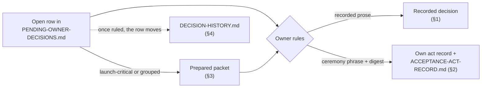

# Decisions — what lives here, and which question each file answers

> **Navigation, never authority.** This page routes; it decides nothing and
> records nothing. Every file it names owns its own content, and where this
> page disagrees with one of them, **that file wins and this page is stale.**
>
> Written 2026-08-13 to close review finding RD-50 f7: `README.md` sends a
> reader to this directory as a destination, and the directory had no door.

This directory holds the owner's recorded decisions and performed acts,
the pending-decision queue with its packets, and their history; this page
says which file answers which question.

## The four questions this directory answers

Find your question in the left column; the middle column names the file that
owns the answer.

| You want to know | Ask | Short answer today |
|---|---|---|
| **Has the owner decided this?** | the **recorded decisions** below | Doctrine, craft, SDR-1…37, and the 2026-08-16 rulings are recorded. The rest is not |
| **Has an act been performed?** | `ACCEPTANCE-ACT-RECORD.md` | **Yes — four original foundational acts, a separate five-row amendment transaction performed 2026-09-01, and the separate eleven-artifact PWB amendment performed 2026-09-02.** The PWB act changed behavioral provenance only; neither amendment granted effect-specific or implementation authority. Nine foundational offerings remain open: four deferred waves, CC-TEST-2, topology, overview, D3, and **P-12 knowledge hygiene** as the ninth |
| **Which decisions are pending?** | [`PENDING-OWNER-DECISIONS.md`](PENDING-OWNER-DECISIONS.md) | **21** rows in the open decision section, plus **5** open acceptance-act rows — **26 total** *(re-derived 2026-09-07 by splitting the register on its `## ` headings and matching, at line start within each, a table row whose first cell is `P-` followed by anything but a cell break: 5 acceptance-act rows, 0 in the reading aid, 21 open. P-1's row stays open for the deferred C/D waves. **Recount rather than reading this figure** — this cell has been wrong twice for two different reasons, both marked here. **Superseded 2026-09-06:** **33** and **38** stood here from the moment P-60…P-65 were added, when the true counts were 32 and 37; adding P-66 later that day made them accidentally correct. **Superseded 2026-09-07:** those same figures then stood through the P-60…P-65 rulings, which removed six rows, and through the P-54…P-59/P-66 rulings, which removed seven more. And every figure this cell has published was additionally one low, because the predicate it named — `| P-nn |` at line start — does not match the sub-lettered open row **`P-25(c)`**)*. The launch-critical ones link a bounded packet; the rest are queue entries only |
| **Which decisions were resolved, and how?** | [`DECISION-HISTORY.md`](DECISION-HISTORY.md) | The resolved rows — the nine 2026-08-16 rulings and the 2026-08-17 act dispositions (P-41/P-42 executed, P-22/P-28 ratified) — and the register's chronology |
| **Where is the history?** | [`launch-gate/HISTORY.md`](launch-gate/HISTORY.md), [`DECISION-HISTORY.md`](DECISION-HISTORY.md), and the round trees under `contracts/candidates/` | Deliberately off the default path |

Decisions and acts are different records, and this directory holds both
kinds. See [`PROCESS-GLOSSARY.md`](../../../PROCESS-GLOSSARY.md).

- A **decision** is recorded prose the owner writes.
- An **act** is a formal transaction with a ceremony phrase and a
  digest-bound argument.

How an open question moves through this directory (the queue path only;
not every decision or act starts as a queue row):



## 1. Recorded decisions — binding

These carry rulings the owner has actually made.

| File | Holds |
|---|---|
| [`SURFACE-DECISION-RECORD.md`](SURFACE-DECISION-RECORD.md) | **SDR-1…37** — the standing body of prior owner rulings (SDR-34…37 record the 2026-08-16 P-31/P-36/P-37/P-40 rulings). The largest single source of settled ground |
| [`OWNER-ANSWERS-2026-08-01.md`](OWNER-ANSWERS-2026-08-01.md) | The owner's answers to the 2026-08-01 question set |
| [`DOCTRINE-AMENDMENT-D1-MAP-HISTORICAL.md`](DOCTRINE-AMENDMENT-D1-MAP-HISTORICAL.md) | Doctrine amendment **D1**, in force |
| [`DOCTRINE-AMENDMENT-D5-READABILITY.md`](DOCTRINE-AMENDMENT-D5-READABILITY.md) | Doctrine amendment **D5**, in force — adopted 2026-09-27; the readability rewrite, closing P-25 and P-25(c) |
| [`DOCTRINE-AMENDMENT-D6-TREE-STYLE.md`](DOCTRINE-AMENDMENT-D6-TREE-STYLE.md) | Doctrine amendment **D6**, in force — adopted 2026-09-27; the tree-style restyle under CC-REV-8, with eight diagrams |
| [`POLARIS-TREE-FORM-AMENDMENT.md`](POLARIS-TREE-FORM-AMENDMENT.md) · [`…-ADOPTION.md`](POLARIS-TREE-FORM-AMENDMENT-ADOPTION.md) | Polaris tree-form and diagram amendment to REQ-polaris-generation-004, in force — adopted 2026-09-28 with implementation authorized; rules sanitized static SVG inert under PWB-REQ-006. [Observed] [Later technical digest reconciliation](../../../docs/evidence/polaris-understanding-reconciliation-2026-09-28/technical-record.json) records its exact REQ-004 subject; it grants no adoption or permission. |
| [`DOCTRINE-AMENDMENT-LOG.md`](DOCTRINE-AMENDMENT-LOG.md) | Every doctrine amendment, one row each |
| [`WAVE-A-INSTALL-SHAPE-DECISION.md`](WAVE-A-INSTALL-SHAPE-DECISION.md) | **P-33 ruled 2026-08-16** — install shape (M), recorded in the packet's own template |
| [`LAUNCH-GATE-AUTHORITY-DECISION.md`](LAUNCH-GATE-AUTHORITY-DECISION.md) | **P-34 ruled 2026-08-16** — launch-gate v2.4 approved as process policy, arm (a), residuals disclosed |
| [`PROJECT-OPERATING-CONSTRAINTS-DECISION.md`](PROJECT-OPERATING-CONSTRAINTS-DECISION.md) | **P-35 ruled 2026-08-16** — the operating-constraints table, Unknowns kept |
| [`HUMAN-ENTRY-DECISION.md`](HUMAN-ENTRY-DECISION.md) | **P-38 ruled 2026-08-16** — human entry as drafted (option a) |
| `../policies/GOVERNANCE-SUBSTRATE-LOCK.yaml` `openspec` block | **P-39 ruled 2026-08-16** — OpenSpec pinned at 1.9.0 |
| [`LICENSE-CHOICE-DECISION.md`](LICENSE-CHOICE-DECISION.md) | **P-14 ruled 2026-08-18, applied 2026-08-19** — MIT, owner-selected; root `LICENSE` created |
| [`TERM-REGISTRY-DRAFTING-VOCABULARY-DECISION.md`](TERM-REGISTRY-DRAFTING-VOCABULARY-DECISION.md) | **P-16 ruled 2026-08-18** — the 31-term registry designated non-binding drafting vocabulary; registry stays candidate |
| [`D4-RULING-DECISION.md`](D4-RULING-DECISION.md) | **P-24 ruled 2026-08-18** — D4: bounded missions sit inside VIS-4's bounds; reviewer's §1.2 wording designated for act 5 |
| [`CC-REV-2-LAGGING-SPEC-EXCEPTION-DECISION.md`](CC-REV-2-LAGGING-SPEC-EXCEPTION-DECISION.md) | **P-44 ruled 2026-08-18** — declined (arm b); the offer is superseded for routing |
| [`CAPABILITY-1-SPECIFICATION-AUTHORING-DECISION.md`](CAPABILITY-1-SPECIFICATION-AUTHORING-DECISION.md) | **Owner launch decision, 2026-08-20** — Capability 1 specification authoring authorized; the Administration 1 `NOT READY` verdict stands unaltered; specification definition only, no implementation |
| [`GENERAL-TRUSTED-BOOTSTRAP-AUTHORIZATION-DIRECTION.md`](GENERAL-TRUSTED-BOOTSTRAP-AUTHORIZATION-DIRECTION.md) | **Owner direction, 2026-08-31** — authorized preparation of the generalized provenance amendment; the exact five-row transaction was separately performed 2026-09-01 and is recorded in `ACCEPTANCE-ACT-RECORD.md` |
| [`PWB-STATE1-AMENDMENT-DIRECTION.md`](PWB-STATE1-AMENDMENT-DIRECTION.md) | **Owner direction, 2026-09-02** — selected profile A and authorized drafting/review of the two-requirement amendment; the exact package was separately signed the same day |
| [`A6-RESOURCE-ENVELOPE-DECISION.md`](A6-RESOURCE-ENVELOPE-DECISION.md), [`A6-SCOPE-VS-CAPACITY-ASSESSMENT.md`](A6-SCOPE-VS-CAPACITY-ASSESSMENT.md) | **P-45 ruled 2026-08-19** — the stated resource envelope, and the assessment of scope against it |
| [`F6-GOVERNANCE-CEILING-DECISION.md`](F6-GOVERNANCE-CEILING-DECISION.md) | **P-46 ruled 2026-08-19** — no governance ceiling; F6 stays `Not met`, disclosed |
| [`F2-GOVERNANCE-REDUCTION-DECISION.md`](F2-GOVERNANCE-REDUCTION-DECISION.md) | **P-47 ruled 2026-08-19** — the governance-reduction plan adopted as directed work |
| [`LAUNCH-REPAIR-STOP-CONDITION-DECISION.md`](LAUNCH-REPAIR-STOP-CONDITION-DECISION.md) | **P-48 ruled 2026-08-19** — the repair cycle bounded at two further administrations |
| [`PWB-CYCLE-OWNER-RULINGS-DECISION.md`](PWB-CYCLE-OWNER-RULINGS-DECISION.md) | **P-60…P-65 ruled 2026-09-07** — A on every row: Butlers page repairs by a dispatched agent on a branch, the Polaris trim first (bead `syzygy-1z3.27`), repair epic closed, walkthrough sentence awaited |
| [`POLARIS-PURSUIT-OWNER-RULINGS-P68-P83-DECISION.md`](POLARIS-PURSUIT-OWNER-RULINGS-P68-P83-DECISION.md) | **P-68…P-83 ruled 2026-09-21** — the recommended option on all seventeen questionnaire items (P-69 on its arm B): lane B proceeds by ceremony, pursuit moves M2–M16 split into slices ready under acts in force and slices behind named gates (registry act, machine-view delta, retention act, CC-REV-2 scenarios); fifty-six beads under `syzygy-dov`; the return path never writes into Butlers |
| [`POLARIS-GATE-PACKAGE-OWNER-VALUES-2026-09-23-DECISION.md`](POLARIS-GATE-PACKAGE-OWNER-VALUES-2026-09-23-DECISION.md) | **Owner values, 2026-09-23** — the drafted value on every item for gates `syzygy-dov.18` (four currency tiers, 20,480-byte briefing ceiling), `.22` (second category and draft route as drafted, narrow RFC6-21 reading), `.21` (OQ-1 via `.26`, OQ-2 under PWB-REQ-010) and `.30` (two modes); landing order `.21` → `.30` → `.22` → lane B. No act performed, no phrase offered |
| [`POLARIS-GATE-PACKAGE-OPEN-QUESTIONS-2026-09-23-DECISION.md`](POLARIS-GATE-PACKAGE-OPEN-QUESTIONS-2026-09-23-DECISION.md) | **Owner answers to the remaining open questions, 2026-09-23** — `.21` OQ-3 (keep PWB-REQ-007; code supplies secondary counts), OQ-4 (POC-REQ-032 clarification inside `.26`), OQ-5 (project-account categories first, then the band: currency probe, then Unknown aggregate); `.18` questions 1, 2, 4 and 5 answered, question 6 held for the `.22` review. No act performed, no phrase offered |
| [`POLARIS-GATE-SITTING-2026-09-26-DECISION.md`](POLARIS-GATE-SITTING-2026-09-26-DECISION.md) | **Owner gate sitting, 2026-09-26** — the recommended option on all six items: a confirmation round with no revise finding clears its bytes, notes dispositioned beside the package (`.22` clears; `.21` needs one round over current bytes; the recorder may be changed under review); PWB-REQ-020 wider reading; the briefing subject is one claim id; `.23` sign-off alone releases M6 slice 4, and its digit stays bundled with a full recount script; N8 container-shape amendment may be drafted. No act performed, no phrase offered |
| [`OPEN-REGISTER-OWNER-RULINGS-2026-09-27-DECISION.md`](OPEN-REGISTER-OWNER-RULINGS-2026-09-27-DECISION.md) | **Six open-register items answered 2026-09-27, applied 2026-10-14** — the recommended option on each: P-50/P-51 closed as CAP1-REQ-002's own rules; PR #5's five open findings routed to one follow-up; P-49 counts 324 with no RFC-0007 amendment; "Claim" compatible with doctrine's frozen nouns (P-18); P-10's matrix review knowingly deferred to three triggers; the P-25 answer overtaken by D5. Register state as of 2026-10-14 in `PENDING-OWNER-DECISIONS.md`. No act performed, no phrase offered |
| [`OWNER-DIRECTION-CONFIRMATION-CYCLE-2026-10-14.md`](OWNER-DIRECTION-CONFIRMATION-CYCLE-2026-10-14.md) | **Owner direction, 2026-10-14** — one fresh confirmation round on each of the ten amendment packets P-84…P-86 and P-96…P-102, repaired where needed first; one repair and one review per packet, and anything still `REVISE` goes to the owner with its findings. P-96 and P-97 cleared (notes only); the other eight `REVISE`, findings open. Plain direction: binds no digest, adds no acceptance-record row, rules no content question |
| [`OWNER-DIRECTION-CONFIRMATION-CYCLE-2-2026-10-14.md`](OWNER-DIRECTION-CONFIRMATION-CYCLE-2-2026-10-14.md) | **Owner direction, 2026-10-14, second cycle** — "One more cycle (Recommended)" for the eight packets the first cycle left `REVISE`: every finding repaired once, notes included, then one fresh review under the same stopping rule. P-86, P-99 and P-100 cleared (notes only); P-84, P-85, P-98, P-101 and P-102 `REVISE`, findings open. Plain direction: binds no digest, adds no acceptance-record row, rules no content question |
| [`OWNER-DIRECTION-IMPLEMENTATION-SIGNED-AMENDMENTS-2026-10-15.md`](OWNER-DIRECTION-IMPLEMENTATION-SIGNED-AMENDMENTS-2026-10-15.md) | **Owner direction, 2026-10-15** — "Authorize all (Recommended)": implementation of exactly the signed text of P-96, P-97, P-86 (its Q8 code change included), P-100 and P-99, and of P-98 when its sign-off record lands; tree framing v1.0 added the same day as a separate item. No new Butlers content class, read or egress; the daemon runs no observed code; shared-model lanes WIP one (P-97 → P-100 → P-86 → P-96 → tree framing). Also quotes the owner's standing autonomy direction. Plain direction: binds no digest, adds no acceptance-record row |
| [`OWNER-DIRECTION-IMPLEMENTATION-SIGNED-AMENDMENTS-2026-10-20.md`](OWNER-DIRECTION-IMPLEMENTATION-SIGNED-AMENDMENTS-2026-10-20.md) | **Owner direction, 2026-10-20** (recorded 2026-10-21), successor batch to the 2026-10-15 one: implementation of exactly the signed text of machine view (P-72/P-76), opening band for M4 slice 3 only (P-71 Q7), container shape (N8), item depth (P-81 Q5) and dismissal (P-79 Q5). Same bounds. Confirmed by the owner 2026-10-21: in force from the owner-confirmation line, which names the commit and the record's SHA-256. Shared-model lanes are appended after tree framing: opening band → container shape → M12 slices 1–2 (position only) → dismissal → item depth (after `syzygy-dov.19`'s act). The machine-view lanes stay outside the chain on a stated reading. Carve-outs:<br>• M4 slices 4–5, M8 limb 5 and slice 2, and the briefing route are excluded.<br>• The status machine route stays under P-78.<br>• For the draft view, record-level fields and anchor relation are fenced.<br>• Dismissal uses the no-home arm only. There is no record home and no write path, nothing changes what is retained, and the retained re-read limb stays unbuilt.<br>• Missing currency (P-69 Q7a) was selected, but M2 slice 5 needs the exact `syzygy-dov.19` act.<br>• No row builds any part of the missing-currency disclosure before that act. Item depth is sequenced after it, and opening band slice 3 carries no no-bound count arm before it.<br>• Exact-source render mode was not selected.<br>Plain direction: binds no digest, adds no acceptance-record row |
| [`OWNER-DIRECTION-IMPLEMENTATION-SIGNED-AMENDMENTS-2026-10-20-CONFIRMATION-NOTES.md`](OWNER-DIRECTION-IMPLEMENTATION-SIGNED-AMENDMENTS-2026-10-20-CONFIRMATION-NOTES.md) | **Sibling record, 2026-10-21** — the owner's confirmation of the 2026-10-20 record (item `sin5-confirm-direction`, option A) and the five round-3 notes of its PR reviewer, copied verbatim with a disposition each; not a direction, authorizes nothing |
| [`OWNER-DIRECTION-P108-IMPLEMENTATION-2026-10-21.md`](OWNER-DIRECTION-P108-IMPLEMENTATION-2026-10-21.md) | **Owner direction, 2026-10-21** — option A of the questionnaire item `p108-implementation`: implementation of exactly the signed text of the POC vocabulary and epistemic-record amendment (P-108 v1.0) through M9 slices 4a, 4b and 8, on the 2026-10-15 bounds, plus one acceptance condition (a non-zero marker count on a fixed fixture, with a delete-every-marker mutant that must fail). Queued in the shared-model chain after the 2026-10-20 rows. Slices 5, 6b and 7, any production Inferred constructor and `syzygy-nw3o` are excluded. Plain direction: binds no digest, adds no acceptance-record row |
| [`POLARIS-RETAINED-EVALUATIONS-CLAIM-STATES-RULING-2026-10-21.md`](POLARIS-RETAINED-EVALUATIONS-CLAIM-STATES-RULING-2026-10-21.md) | **Owner ruling, 2026-10-21** — option A of the item `m12-retention-envelope`, beside the 2026-09-23 retention direction (not edited): the retained evaluation record may carry one added top-level key, `claimStates`, whose entries hold only claim identity, epistemic tuple and challenge state; the six keys and four `evaluation` members are unchanged. Unblocks `syzygy-dov.12.1`, which takes link 3 of the 2026-10-20 chain. Plain direction: binds no digest, adds no acceptance-record row |
| [`PWB-DISMISSAL-RECORDS-AND-RETENTION-RULING-2026-10-21.md`](PWB-DISMISSAL-RECORDS-AND-RETENTION-RULING-2026-10-21.md) | **Owner ruling, 2026-10-21** — option A of the item `dismissal-records-and-retention`, answering Q2 and Q7 of the dismissal package (P-79): no home for dismissal records for now; keeping a dismissal readable from a retained evaluation is a retention change, and none is made now. The no-home arm is built on fixtures and the retained re-read limb stays unbuilt. Plain direction: binds no digest, adds no acceptance-record row |
| [`OWNER-DIRECTION-CONFIRMATION-CYCLE-3-2026-10-14.md`](OWNER-DIRECTION-CONFIRMATION-CYCLE-3-2026-10-14.md) | **Owner direction, 2026-10-14/15, third cycle** — P-84 parked and redrafted narrower as P-108; one more cycle for P-85, P-98 and D7; D8's dismissal dropped from (d2) and one more cycle; P-99 "Carry if review clears". P-98, P-99 and P-102 cleared (notes only); P-85, P-101 and P-108 `REVISE`. Then: P-85 one more cycle, D7 parked until an RFC2-18/19 clarification is drafted, P-108 one cycle, P-98 Q1–Q12 answered with the same carry-over rule. P-99 is signed v1.0 by its own record. Plain direction: binds no digest, adds no acceptance-record row |
| [`DOCUMENTATION-ESTATE-OWNER-RULINGS-DECISION.md`](DOCUMENTATION-ESTATE-OWNER-RULINGS-DECISION.md) | **P-54…P-59 and P-66 ruled 2026-09-07** — the recommended arm on every row: the OpenSpec config trimmed to one setting, the two lifecycle directories ruled intentionally unused and given READMEs, the spent root prompt marked in place, `openspec/` given a navigation index (owner-approved 2026-09-08), the two overview defects folded into unperformed act 4 as one prepared delta, and CC-SPEC's amendment banner ruled a permanent disclosed blemish |
| [`BUTLERS-PROJECT-SHAPE-OBSERVATION-CONSENT.md`](BUTLERS-PROJECT-SHAPE-OBSERVATION-CONSENT.md) | The recorded consent for observing the one Butlers repository's project shape (RFC3-7 consent record) |

Doctrine itself (VIS-1…7, SEC-1…5) is adopted and lives in
[`../doctrine/`](../doctrine/), not here.

## 2. Owner acts

`ACCEPTANCE-ACT-RECORD.md` is the aggregate record of performed acts;
each act's own record, and the files named below, own the details.

```text
ACCEPTANCE-ACT-RECORD.md      exists — created by the Wave A act, 2026-08-17
```

[`ACCEPTANCE-ACT-RECORD.md`](ACCEPTANCE-ACT-RECORD.md) owns the four acts
performed 2026-08-17: Wave A, then Wave B, then craft acts 6 + 7 (CC-SPEC
and CC-IMPACT, one sitting), the separate indivisible five-row general
trusted-bootstrap amendment transaction performed 2026-09-01, and the
separate eleven-artifact PWB behavioral amendment performed 2026-09-02.

- **The PWB act superseded the earlier state-(2)-only PWB behavior:** valid
  state (1) or state (2) human acts may now satisfy PWB-REQ-005 and
  PWB-REQ-022 with exact state visible.
- **Neither amendment granted** consent, observation, write, egress,
  execution, deployment, release, recovery, mission or implementation
  authority.
- **Entries are appended, never edited.**
- **Nine foundational offerings remain unperformed:** four deferred waves,
  CC-TEST-2, topology, overview, D3, and **P-12 knowledge hygiene** as the
  ninth.
- **Where each act's exact terms live:**
  - The original foundational acts themselves — their exact phrases and
    arguments — are owned by
    [`../contracts/candidates/FINAL-FOUNDATIONAL-CONTRACT-ACCEPTANCE-RECORD.md`](../contracts/candidates/FINAL-FOUNDATIONAL-CONTRACT-ACCEPTANCE-RECORD.md).
  - The amendment transaction's exact five-row semantics and manifest live
    under `../contracts/candidates/general-trusted-bootstrap-authorization/`
    and its performed record is
    [`GENERAL-TRUSTED-BOOTSTRAP-AUTHORIZATION-ACT.md`](GENERAL-TRUSTED-BOOTSTRAP-AUTHORIZATION-ACT.md).
  - The PWB amendment's performed record is
    [`PWB-STATE1-AMENDMENT-ACT.md`](PWB-STATE1-AMENDMENT-ACT.md).
  - This page owns neither amendment act.

### Every act and direction recorded here, by date

*Superseded, dated:* this section was headed "four original acts plus two
separate amendments" and named only those six until 2026-09-05. Every act
performed from 2026-08-21 onward — including the two Capability 1 acts and the
PWB implementation authorization that `AGENTS.md` cites as current authority —
was present in this directory and named by no index in it. A reader following
the router could not reach the acts in force.

**None of these rows is authority.** This table says only that the file
exists and what it is about, so that a reader can find it.

- Each act's authority is its own record plus the aggregate entry in
  [`ACCEPTANCE-ACT-RECORD.md`](ACCEPTANCE-ACT-RECORD.md).
- Which acts are *in force* is owned by `PROJECT-STATUS.md`.

| Recorded | File | About |
|---|---|---|
| 2026-08-21 | [`CAPABILITY-1-SPECIFICATION-ADOPTION-ACT.md`](CAPABILITY-1-SPECIFICATION-ADOPTION-ACT.md) | Adoption of the Capability 1 specification |
| 2026-08-21 | [`CAPABILITY-1-IMPLEMENTATION-AUTHORIZATION-ACT.md`](CAPABILITY-1-IMPLEMENTATION-AUTHORIZATION-ACT.md) | Authorization to implement Capability 1 |
| 2026-08-29 | [`THREE-SURFACE-POC-MODE-DIRECTION.md`](THREE-SURFACE-POC-MODE-DIRECTION.md) | The POC's operating mode |
| 2026-08-30 | [`THREE-SURFACE-POC-SPEC-AUTHORIZATION.md`](THREE-SURFACE-POC-SPEC-AUTHORIZATION.md), [`THREE-SURFACE-POC-SPEC-SIGNOFF-ACT.md`](THREE-SURFACE-POC-SPEC-SIGNOFF-ACT.md) | The POC specification: authorized, then signed |
| 2026-08-30 | [`THREE-SURFACE-POC-REDESIGN-DIRECTION.md`](THREE-SURFACE-POC-REDESIGN-DIRECTION.md), [`THREE-SURFACE-POC-IMPROVEMENT-CYCLES-DIRECTION.md`](THREE-SURFACE-POC-IMPROVEMENT-CYCLES-DIRECTION.md) | POC redesign, and the improvement-cycle regime |
| 2026-08-30 | [`OPENSPEC-MULTI-CHANGE-DIRECTION.md`](OPENSPEC-MULTI-CHANGE-DIRECTION.md) | More than one OpenSpec change may be open at once |
| 2026-08-31 | [`BOUNDED-MISSION-DOCTRINE-INTERPRETATION-ACT.md`](BOUNDED-MISSION-DOCTRINE-INTERPRETATION-ACT.md) | The D4 bounded-mission reading of doctrine |
| 2026-08-31 | [`POLARIS-PROJECT-WIDE-SPEC-SIGNOFF-ACT.md`](POLARIS-PROJECT-WIDE-SPEC-SIGNOFF-ACT.md), [`POLARIS-PROJECT-WIDE-POC-EVALUATION-DIRECTION.md`](POLARIS-PROJECT-WIDE-POC-EVALUATION-DIRECTION.md) | The PWB specification signed, and its evaluation directed |
| 2026-08-31 | [`POLARIS-TRUSTED-BOOTSTRAP-OBSERVATION-DIRECTION.md`](POLARIS-TRUSTED-BOOTSTRAP-OBSERVATION-DIRECTION.md), [`POLARIS-POST-CEILING-CORRECTION-AUTHORIZATION.md`](POLARIS-POST-CEILING-CORRECTION-AUTHORIZATION.md) | Trusted-bootstrap observation, and the post-ceiling correction |
| 2026-09-01 | [`GENERAL-TRUSTED-BOOTSTRAP-AUTHORIZATION-ACT.md`](GENERAL-TRUSTED-BOOTSTRAP-AUTHORIZATION-ACT.md) | The indivisible five-row amendment transaction |
| 2026-09-02 | [`PWB-STATE1-AMENDMENT-ACT.md`](PWB-STATE1-AMENDMENT-ACT.md) | The eleven-artifact state-(1) behavioral amendment |
| 2026-09-02 | [`PWB-BUTLERS-OBSERVATION-CONSENT-ACT.md`](PWB-BUTLERS-OBSERVATION-CONSENT-ACT.md), [`PWB-SECRET-CLASSIFICATION-POLICY-ACT.md`](PWB-SECRET-CLASSIFICATION-POLICY-ACT.md), [`PWB-OBSERVER-REGISTRY-ENTRY-ACT.md`](PWB-OBSERVER-REGISTRY-ENTRY-ACT.md) | The three effect-specific acts: consent, secret policy, observer registry entry |
| 2026-09-02 | [`PWB-IMPLEMENTATION-AUTHORIZATION-ACT.md`](PWB-IMPLEMENTATION-AUTHORIZATION-ACT.md) | Authorization to implement PWB tasks §2–§5 |
| 2026-09-05 | [`PWB-TRUTH-READINESS-AMENDMENT-ACT.md`](PWB-TRUTH-READINESS-AMENDMENT-ACT.md) | The truth, inert-Markdown and readiness amendment |
| 2026-09-05 | [`PWB-SECRET-CLASSIFICATION-POLICY-AMENDMENT-ACT.md`](PWB-SECRET-CLASSIFICATION-POLICY-AMENDMENT-ACT.md), [`PWB-OBSERVER-REGISTRY-ENTRY-AMENDMENT-ACT.md`](PWB-OBSERVER-REGISTRY-ENTRY-AMENDMENT-ACT.md) | The two effect-act amendments |
| 2026-09-05 | [`PWB-IMPLEMENTATION-AUTHORIZATION-CONTINUATION-ACT.md`](PWB-IMPLEMENTATION-AUTHORIZATION-CONTINUATION-ACT.md) | Continuation of implementation authority for the 2026-09-05 amendment |
| 2026-09-23 | [`POLARIS-RETAINED-EVALUATIONS-RETENTION-POSTURE-DIRECTION.md`](POLARIS-RETAINED-EVALUATIONS-RETENTION-POSTURE-DIRECTION.md) | Retention posture for retained Polaris evaluation records (P-79 gate `syzygy-dov.28`) |
| 2026-10-05 | [`POLARIS-DOSSIER-LOCAL-AGENT-MODE-DIRECTION.md`](POLARIS-DOSSIER-LOCAL-AGENT-MODE-DIRECTION.md) | Dossiers generated by the operator's own agent session; Syzygy makes no provider call; provider and egress packages parked *(marked 2026-10-15: the owner declined to un-park them; they are not pursued, per `OWNER-DIRECTION-DOSSIER-LOCAL-CLI-SUBPROCESS-2026-10-15.md`)* |
| 2026-10-05 | [`POLARIS-DOSSIER-LOCAL-AGENT-RULINGS-DIRECTION.md`](POLARIS-DOSSIER-LOCAL-AGENT-RULINGS-DIRECTION.md) | RFC7-20 read as governing Syzygy-computed drafts; the operator's agent may run the observed project, disclosed and Inferred |
| 2026-10-05 | [`POLARIS-DOSSIER-LOCAL-AGENT-SCOPE-REVIEW-SIGNOFF-DIRECTION.md`](POLARIS-DOSSIER-LOCAL-AGENT-SCOPE-REVIEW-SIGNOFF-DIRECTION.md) | Local-agent mode usable on any repo (SEC-2 reconciliation left to the amendment); review in a separate session; sign-off by option pick v1.0 |
| 2026-10-05 | [`POLARIS-DOSSIER-LOCAL-AGENT-REVIEW-1-RULINGS-DIRECTION.md`](POLARIS-DOSSIER-LOCAL-AGENT-REVIEW-1-RULINGS-DIRECTION.md) | After the first amendment review: draft a SEC-3 amendment (agent runs on host); governed projects kept, with disclosure; RFC7-20 reading kept |
| 2026-10-05 | [`POLARIS-DOSSIER-LOCAL-AGENT-RECORDS-DIRECTION.md`](POLARIS-DOSSIER-LOCAL-AGENT-RECORDS-DIRECTION.md) | Dossier mode re-derives every Observed claim from re-hashed git objects; stored counts, timestamps and history labelled Inferred |
| 2026-10-06 | [`POLARIS-DOSSIER-LOCAL-AGENT-D9-ROUND-2-DIRECTION.md`](POLARIS-DOSSIER-LOCAL-AGENT-D9-ROUND-2-DIRECTION.md) | After D9's second REVISE: permission through any Syzygy instruction on a per-run recorded choice; credential condition reaches every process the session starts; one confirming round |
| 2026-10-07 | [`REDIS-LOCAL-AGENT-SITTING-DIRECTION.md`](REDIS-LOCAL-AGENT-SITTING-DIRECTION.md) | Redis sitting brief: 10a no ruling, 10b maintainer-stated only, 10c after the first run; `syzygy-4mbu` prints the command and ingests only the result; A–I selections stated, not acts |
| 2026-10-15 | [`OWNER-DIRECTION-DOSSIER-LOCAL-CLI-SUBPROCESS-2026-10-15.md`](OWNER-DIRECTION-DOSSIER-LOCAL-CLI-SUBPROCESS-2026-10-15.md) | Provider routes A and B stay parked and are not pursued; the dossier's model step runs the operator's local `codex` or `claude` binary as a subprocess with explicit inputs. A direction, not a consent |
| 2026-10-15 | [`OWNER-DIRECTION-DOSSIER-CLI-RUNNER-REPAIR-AND-DISCLOSE-2026-10-15.md`](OWNER-DIRECTION-DOSSIER-CLI-RUNNER-REPAIR-AND-DISCLOSE-2026-10-15.md) | One last repair and review of the CLI runner delta; P-111 Q2 answered: disclose, on the run page, content classes the agent-provider statement does not list. A direction, not a consent; signs nothing |
| 2026-10-20 | [`OWNER-DIRECTION-GREENFIELD-PARITY-SIMPLIFICATION-2026-10-20.md`](OWNER-DIRECTION-GREENFIELD-PARITY-SIMPLIFICATION-2026-10-20.md) | Behavior-preserving simplification of the implementation plane from the 2026-10-21 greenfield-parity audit (epic `syzygy-bpyt`); everything touching the governed plane, a security boundary, retention or parked code goes to one owner packet. A direction, not an act; signs nothing |
| 2026-10-21 | [`OWNER-DIRECTION-GREENFIELD-PARITY-ANSWERS-2026-10-21.md`](OWNER-DIRECTION-GREENFIELD-PARITY-ANSWERS-2026-10-21.md) | The owner's answers to the greenfield-parity packet: the 2026-10-20 reading confirmed with a CC-REV-1 review rule; six reserved topics kept at the status quo; seven output-changing beads approved; evidence may leave the working tree under a CI-verified index (GP-Q1); the CC-SEC-3 conforming amendment is to be drafted (GP-Q7). A direction, not an act; signs nothing |
| 2026-10-21 | [`PWB-M2-SLICE-5-IMPLEMENTATION-CONTINUATION-DIRECTION.md`](PWB-M2-SLICE-5-IMPLEMENTATION-CONTINUATION-DIRECTION.md) | Continuation of PWB implementation authority for M2 slice 5 (P-69 gate `syzygy-dov.19`), quoting the cleared packet's built behavior; a plain direction, binds no digest |
| 2026-10-21 | [`OWNER-DIRECTION-GREENFIELD-PARITY-LAUNCHED-MARKER-SCOPE-2026-10-21.md`](OWNER-DIRECTION-GREENFIELD-PARITY-LAUNCHED-MARKER-SCOPE-2026-10-21.md) | The owner's answer to review finding F2 of `syzygy-bpyt.8.8`: the GP-Q0 Part 3 approval of reading the launched-run marker fail-closed covers every reader of the marker (`launch-form` and both of-record counters as well as `allow-execution` and brief issuance), for changes that refuse more; the library-level check is a follow-up bead whose output change returns to the owner. A direction, not an act; signs nothing |

Dates are each file's first-commit date, not a claim about when the owner
acted; the act's own record states that. [Observed — enumerated 2026-09-05 over
every `*-ACT.md`, `*-DIRECTION.md` and `*-AUTHORIZATION.md` in this directory,
dated by `git log --diff-filter=A`. Re-enumerate rather than trusting this
table after any new act.]

## 3. Pending decisions — one bounded packet each

The queue is [`PENDING-OWNER-DECISIONS.md`](PENDING-OWNER-DECISIONS.md); some
rows also have a prepared packet here, and every other row is a queue
entry only.

The rows below have a prepared packet here — the launch-critical ones, and any
group of rows gathered so the owner can answer them in one sitting:

| `P-nn` | Question | Packet |
|---|---|---|
| **P-12** | The knowledge-hygiene craft policy | [`KNOWLEDGE-HYGIENE-DECISION.md`](KNOWLEDGE-HYGIENE-DECISION.md) |
| **P-45…P-48** | The four Administration-1 owner inputs (resource envelope, effort ceiling, F2 disposition, stop condition) | [`ADMINISTRATION-1-OWNER-INPUTS-DECISION.md`](ADMINISTRATION-1-OWNER-INPUTS-DECISION.md) |
| **P-54…P-59, P-66** | *(Ruled 2026-09-07 — record [`DOCUMENTATION-ESTATE-OWNER-RULINGS-DECISION.md`](DOCUMENTATION-ESTATE-OWNER-RULINGS-DECISION.md); the seven rows have left [`PENDING-OWNER-DECISIONS.md`](PENDING-OWNER-DECISIONS.md) for [`DECISION-HISTORY.md`](DECISION-HISTORY.md), which is where a reader checks whether any row in this table is still open.)* Seven questions about the written estate: the OpenSpec config's vendor boilerplate, the two empty OpenSpec lifecycle directories, the spent Capability 1 prompt at the repository root, whether `openspec/` gets a navigation page, the two front doors that name different founding rules, the public overview that still says nothing is implemented, and CC-SPEC's amendment banner naming five of nine phase rules on frozen bytes | [`DOCUMENTATION-ESTATE-DECISION-PACKET.md`](DOCUMENTATION-ESTATE-DECISION-PACKET.md) |
| **P-105…P-107** | The three blockers of the first Redis dossier run (2026-10-08): code files and the HTML check, docs text in agent packets, and hand-started helper sessions. Whether each row is still open is in [`PENDING-OWNER-DECISIONS.md`](PENDING-OWNER-DECISIONS.md) | [`DOSSIER-BLOCKERS-DECISION-PACKET-2026-10-08.md`](DOSSIER-BLOCKERS-DECISION-PACKET-2026-10-08.md) |

Ruled packets stay here as the record or context of their ruling.
Packets whose question the owner has since ruled or executed (P-41's
`SPECIFICATION-ACCEPTANCE-DECISION.md` and P-42's
`SHAPE-TO-SPEC-IMPACT-DECISION.md` — acts 6 and 7 performed 2026-08-17 —
P-14's `LICENSE-DECISION-PACKET.md` — MIT ruled 2026-08-18 —
P-60…P-65's `PWB-CYCLE-REPORT-DECISION-PACKET.md` — ruled 2026-09-07,
record `PWB-CYCLE-OWNER-RULINGS-DECISION.md` —
P-54…P-59 and P-66's `DOCUMENTATION-ESTATE-DECISION-PACKET.md` — ruled
2026-09-07, record `DOCUMENTATION-ESTATE-OWNER-RULINGS-DECISION.md` —
P-31's
`MERGED-UNRECONCILED-DECISION.md`, P-36's `UNKNOWNS-AND-GAPS-DECISION.md`,
P-37's `PROJECT-SHAPE-FACETS-DECISION.md`, P-39's
`OPENSPEC-FORM-AND-VERSION-DECISION.md`, P-40's
`SPECIFICATION-GRANULARITY-DECISION.md`, and the four files listed under
"Recorded decisions" above) remain in this directory as the record or the
context of their ruling — see
[`DECISION-HISTORY.md`](DECISION-HISTORY.md) for what each ruling was.

Rows without a packet in this table are queue entries only, and the register
row is the whole of what exists for them.

## 4. History — kept, and off the default path

History is kept off the default path; a current decision should not need it.

| Where | Holds |
|---|---|
| [`DECISION-HISTORY.md`](DECISION-HISTORY.md) | Resolved decision rows and the register's as-of chronology |
| [`launch-gate/HISTORY.md`](launch-gate/HISTORY.md) | The launch-gate repair chain |
| [`launch-gate/TREND-LOG.md`](launch-gate/TREND-LOG.md) | One row per administration |
| [`PROCESS-LESSONS.md`](PROCESS-LESSONS.md) | The incidents behind the verification rules. **Read before writing or trusting a check** |
| `../contracts/candidates/round-*/` | Each pass's reports and its raw review lane |

Raw review bytes are **preserved and never edited**, and are never default
context. You should be able to make every decision above without opening any
of them.

## What this directory is not

It is not a changelog, not a backlog, and not a place to record work.

- Open questions belong in the register as owner decisions.
- Process housekeeping belongs in `bd`.

---

### A note on this file's own lawfulness

This README sits in tension with accepted clause RFC3-15 and stays here only
on explicit owner instruction, as navigation and never authority.

Accepted clause **RFC3-15**, bound at its current module bytes by the
2026-09-01 contract-amendment manifest, says the `decisions/` category holds
*"Recorded owner decisions: adoptions, dismissals (reason + expiry),
adjudications, consent records (RFC3-7), overrules"* — **exclusively**. This
README is navigation, not a recorded owner decision, so under a strict reading
it remains in tension with the binding clause.

The file remains here on explicit owner instruction, and the tension is
recorded rather than hidden. Neither its location nor the existence of sibling
navigation files is treated as an inferred exception to RFC3-15. A durable
resolution requires an owner amendment or owner direction to move this page;
until then this router remains navigation only and never authority.
