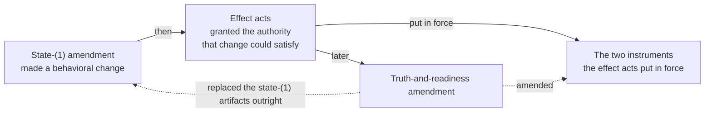

# `docs/` — the implementation plane's working documents

> **Not authority.** Nothing here adopts, accepts, or approves anything, and
> nothing here may be cited as a rule. Authority lives in `.syzygy/**`
> (doctrine, decisions, policies, contracts) and `openspec/**`
> (specifications); current state lives in `PROJECT-STATUS.md`. Where a page
> here disagrees with one of those, **the owning record wins and this page is
> stale** — report the disagreement rather than resolving it here.

This directory is the **implementation plane's** own working record: how the
work was planned, what was reviewed, and what evidence a run actually
produced. It sits beside the governed planes and is written by and for the
people and agents doing the building.

- `.syzygy/**` says what must be true.
- `openspec/**` says what the software must do.
- `docs/` holds the third thing: plans, reviews and run evidence.

## What is here

Seven homes, each with a named reader and the question it answers. A plan
here is never permission to do the work it describes.

| Path | What it is | Reader, and the question it answers |
|---|---|---|
| `CAPABILITY-1-IMPLEMENTATION-PLAN.md` | The Capability 1 build plan | An implementer: "what is the next lawful implementation step, and under which act?" |
| `PWB-IMPLEMENTATION-PLAN.md` | The Polaris project-wide Butlers-model build plan | Same, for the PWB pipeline |
| `THREE-SURFACE-POC.md` | How to run the bounded POC | Anyone: "how do I start this thing and see it?" |
| `reviews/` | The review corpus — raw reviewer output and its dispositions | A reviewer or repairer: "what did an independent reader find, and what happened to each finding?" |
| `evidence/` | Machine-produced run records (mutation sweeps, browser and fresh-checkout runs), as JSON | Anyone checking a claim: "what did that run actually output?" |
| `plans/` | Dated design notes for a single bead, written before the work | An implementer picking up that bead: "what shape was already decided, and by whom?" |
| `superpowers/plans/`, `superpowers/specs/` | Spent plans and designs from an external-harness convention, kept as evidence | Someone auditing a past change: "what was the plan the work was actually done against?" |

**A plan here is never permission.**

- Implementation *plans* live here.
- The **authorizing act** for any of that work does not; it lives in
  `.syzygy/governance/decisions/`.
- Find the act first (`AGENTS.md`, "Where authority lives").

## `reviews/` — the corpus, by campaign

Raw reviewer output is stored **verbatim and never edited** (CC-REV-6); the
table routes each campaign to its last verdict of record.

- Files ending `-RAW.md` are that verbatim output.
- `-DISPOSITION.md` and `*-PACKET.md` files are the synthesis over them.
- Correcting a RAW file is never the repair. The repair is a new disposition
  that cites it.

| Campaign | Files | Recorded | What was under review | Last verdict of record, and where the findings landed |
|---|---|---|---|---|
| `R-S2` … `R-S7` | 4 | 2026-08-21 → 2026-08-22 | Capability 1 domain-slice risk floors | S7 ends `CONFIRM WITH EXCEPTIONS` (`R-S7-RISK-FLOOR-REVIEW.md:8`); its retained exceptions route through the named follow-up beads and the local guardrail note. |
| `R-RT-*` | 2 | 2026-08-23 | Capability 1 runtime vertical slice | The confirmation is `CONFIRMED` (`R-RT-CONFIRMATION-REVIEW.md:4`); the repaired bypass and residual note are dispositioned in the same pair. |
| `R-POC-*` | 13 | 2026-08-30 → 2026-09-29 | Three-Surface POC product cycles, owner walkthrough and readability successor | The original cycle closed, but the owner walkthrough records `FAIL — BLOCKER` (`R-POC-OWNER-WALKTHROUGH-POLARIS.md:18`); the readability successor's specification review 4 is `CONFIRM` (`R-POC-READABILITY-SUCCESSOR-REVIEW-4-RAW.md:7`) and its package review is `CONFIRM WITH EXCEPTIONS` (`R-POC-READABILITY-SUCCESSOR-PACKAGE-1-RAW.md:2`), notes only, in the package's `REVIEW-NOTES.md`. |
| Trajectory bounded selection | 3 | 2026-10-20 | Deterministic 200 non-closed plus 50 closed Trajectory selection under POC-REQ-042, timestamp validity, full machine population and count reconciliation | Source repair `CONFIRM` (`R-TRAJECTORY-BOUNDED-SELECTION-2-RAW.md:4`); final receipt audit `CONFIRM` (`R-TRAJECTORY-BOUNDED-SELECTION-3-RAW.md:4`) closes the initial `REVISE` (`R-TRAJECTORY-BOUNDED-SELECTION-RAW.md:4`). P2/P3 dispositions and measurement/mutation/full-gate receipts are in `docs/evidence/syzygy-blbu-trajectory-selection-2026-10-20.json`. |
| Project-wide Polaris specification and observation gate | 15 | 2026-08-31 | Read-boundary incident, observation exception, and project-wide candidate | The post-ceiling disposition is `CONFIRMED` (`R-POLARIS-PROJECT-WIDE-SPEC-REVIEW-DISPOSITION.md:181`); the owner act, not this review, owns sign-off. |
| `R-GENERAL-TRUSTED-*` | 24 | 2026-08-31 → 2026-09-01 | General trusted-bootstrap transaction | The final reader pass is `CONFIRM` (`R-GENERAL-TRUSTED-BOOTSTRAP-POST-ACT-READER-FINAL-CONFIRMATION-RAW.md:1`); findings landed in the two disposition files and performed transaction. |
| `R-PWB-STATE1-*` | 14 | 2026-09-02 | PWB state-(1) amendment | The post-act current-state pass is `EXACT VERDICT: CONFIRM` (`R-PWB-STATE1-ACT-CURRENT-STATE-RAW.md:123`); dispositions landed in the amendment package and act. |
| `R-PWB-EFFECT-*` | 3 | 2026-09-02 | PWB consent, secret-policy, and registry effect acts | The owner-packet review is `EXACT VERDICT: CONFIRM` (`R-PWB-EFFECT-ACTS-OWNER-PACKET-RAW.md:353`); its security finding was repaired before the three acts. |
| `R-PWB-TRUTH-*` | 11 | 2026-09-05 | PWB truth-and-readiness amendment and dependent effects | The final owner-packet review is `EXACT VERDICT: CONFIRM` (`R-PWB-TRUTH-POLICY-OWNER-PACKET-FINAL-RAW.md:19`); findings landed in the amendment and effect-act packages. |
| PWB live exact-head | 5 | 2026-09-05 → 2026-09-06 | Live implementation truth, parity, copy, and comprehension | The last raw lane remains `VERDICT: REVISE` (`R-PWB-LIVE-EXACT-HEAD-UX-RAW.md:445`); all fifteen findings route into the recovery campaign below. |
| PWB recovery reconciliation | 5 | 2026-09-06 | Two reconciliation generations and retained reviews | Gen 2 ends `CONFIRM WITH EXCEPTIONS` (`2026-09-06-pwb-recovery-reconciliation-gen2-packet.md:164`); its four Low/Info residues route to ordinary beads. |
| `R-PWB-P63-*` | 1 | 2026-09-07 | P-63 Polaris response trim | The verdict is `CONFIRMED WITH FINDINGS` (`R-PWB-P63-POLARIS-TRIM-RAW.md:16`); both should-fix items landed in the same branch and evidence record. |
| Orrery height finding | 1 | 2026-09-09 | Orrery bar-height encoding | The retained review says `CONFIRM FINDING` (`R-POLARIS-ORRERY-HEIGHT-FINDING-RAW.md:3`); the repair landed with the Orrery height fix. |
| Polaris editorial repair | 6 | 2026-09-10 | Selection fidelity and editorial passages | The code confirmation is `CONFIRMED` (`R-POLARIS-EDITORIAL-CODE-CONFIRMATION-RAW.md:1`); dispositions are summarized in `2026-09-09-polaris-editorial-repair.md`. |
| Polaris manifesto design and code | 8 | 2026-09-10 | Manifesto structure, navigation, design, and implementation | The final code pass is `CONFIRMED` (`R-POLARIS-MANIFESTO-CODE-FINAL-RAW.md:1`); earlier design and code findings are retained in the same campaign. |
| Polaris reading assets and navigation | 6 | 2026-09-10 | Reading-plan assets, guide navigation, and race repair | The repair confirmation is `PASS` (`R-POLARIS-READING-ASSETS-REPAIR-CONFIRMATION-2026-09-10-RAW.md:9`); RRA-1 is dispositioned there. |
| PWB declared-home repair | 3 | 2026-09-10 | Declared-home mutation and readiness repair | The final review is `CONFIRMED` (`R-PWB-DECLARED-HOME-FINAL-RAW.md:1`); the mutation-fragment finding landed in the repair. |
| PWB owner-walkthrough capture | 3 | 2026-09-10 | Live, semantic-readiness, and final owner-review captures | The final capture says `READY FOR OWNER REVIEW` (`R-PWB-WALKTHROUGH-FINAL-CAPTURE-RAW.md:1`); owner judgment remains a separate state. |
| Polaris visible diagrams | 5 | 2026-09-10 | Diagram visibility, fidelity, and final diff | The final diff confirmation is `PASS` (`R-POLARIS-VISIBLE-DIAGRAMS-FINAL-DIFF-2026-09-10-RAW.md:3`); prior visibility and fidelity findings landed in the same change. |
| Polaris generation kit | 2 | 2026-09-12 | Candidate reusable authoring guidance | The confirmation is `PASS` (`R-POLARIS-GENERATION-KIT-CONFIRMATION-2026-09-12-RAW.md:3`); it explicitly limits the verdict to the documentation handoff. |
| Polaris generator product and scope | 3 | 2026-09-12 | Generator product readiness, fresh product review, and scope | The final scope confirmation is `PASS` (`R-POLARIS-GENERATOR-SCOPE-CONFIRMATION-2026-09-12-RAW.md:3`); remaining authority work is in the adjacent campaign. |
| Polaris generator authority and recorder | 7 | 2026-09-12 | Authority staging, offer, recorder, and final readiness | The last pairing confirmation is `CONFIRMED` for AR-3 (`R-POLARIS-GENERATOR-AUTHORITY-PAIRING-CONFIRMATION-2026-09-12-RAW.md:3`); AR-1 remains the recorded phase/refusal disposition. |
| Polaris understanding amendment | 5 | 2026-09-13 → 2026-10-20 | Product clarification, formal amendment synthesis, the dependency-union successor, and the fresh reconciliation review over the D8 (d2) `vision.md` | The formal synthesis is `ready for formal owner review` (`R-POLARIS-UNDERSTANDING-FORMAL-SPEC-2026-09-13-RAW.md:3`); adoption remains owned by its act. The dependency-union successor's review 1 is `CONFIRM WITH EXCEPTIONS` (`R-POLARIS-UNDERSTANDING-DEPENDENCY-UNION-SUCCESSOR-1-RAW.md:2`), notes only, in the package's `ROUND-1-DISPOSITIONS.md`. The fresh reconciliation review 1 (owner answer Q-A1 to D8) is `CONFIRM WITH EXCEPTIONS` (`R-POLARIS-UNDERSTANDING-RECONCILIATION-1-RAW.md:2`) over `01fa6d66`, notes only, dispositioned in row D8 of `decisions/DOCTRINE-AMENDMENT-LOG.md`; the recorder admits it by the head contract in `docs/evidence/polaris-understanding-reconciliation-2026-09-28/HISTORY-READING.md`. |
| PWB M1 lane A | 1 | 2026-09-13 | Polaris page-size lane-A evidence | The review ends `CONFIRMED WITH FINDINGS` (`R-PWB-M1-POLARIS-LANE-A-RAW.md:477`); its should-fix items landed in the lane-A branch. |
| Surface-routes CI budget | 2 | 2026-09-27 | `surface-routes.test.ts` 13-link exhaustion shares one browser across its two forms, `syzygy-8hr` (PR #126) | `REVISE` (`R-SURFACE-ROUTES-BUDGET-REVIEW-RAW.md:1`): the shared teardown swallowed a `browser.close()` drain failure; repaired so it propagates (mutation-checked), hooks budgeted 60,000ms to match the other browser suites.; confirmation `CONFIRM` (`R-SURFACE-ROUTES-BUDGET-CONFIRMATION-RAW.md:1`). |
| Recorder notes-only verdict | 4 | 2026-09-26 → 2026-10-01 | `record_pwb_behavior_amendment_acts.py` accepts a notes-only `CONFIRM WITH EXCEPTIONS` bound to a disposition record, per the 2026-09-26 gate-sitting direction §1 (PR #118), then hardened (PR #125) | `CONFIRM WITH EXCEPTIONS` (`R-PWB-RECORDER-NOTES-ONLY-REVIEW-RAW.md:1`), notes only; notes 7 and 8 went to `syzygy-qqt`, repaired by PR #125. PR #125: `CONFIRM WITH EXCEPTIONS` (`R-PWB-RECORDER-NOTES-ONLY-HARDENING-REVIEW-RAW.md:1`), notes only; notes 5 (fence corner case) and 9 (whole-document finding scan) are dispositioned to `syzygy-4yr` before any package is wired. Opening-band wiring (PR #166): `REVISE` (`R-PWB-RECORDER-NOTES-ONLY-OPENING-BAND-WIRING-REVIEW-RAW.md:4`), one revise finding (a digest heading inside a code fence), repaired; confirmation `CONFIRM WITH EXCEPTIONS` (`R-PWB-RECORDER-NOTES-ONLY-OPENING-BAND-WIRING-REVIEW-2-RAW.md:4`), notes only, left in place on the cleared bytes. |
| CG-7e bare digest headings | 3 | 2026-09-27 | `check_governance.py` CG-7e checks each bare `<qualifier> SHA-256:` heading in a registered act-copy file against that file's own declared digests, `syzygy-eau` (PR #130) | `REVISE` (`R-CG7E-BARE-DIGEST-REVIEW-RAW.md:1`): the first fix matched only the literal `Manifest SHA-256:` spelling and left 15 qualified bare copies (three live bypasses) unchecked; repaired by generalizing to every `SHA-256:` heading with two checked container exemptions; confirmation `CONFIRM WITH EXCEPTIONS` (`R-CG7E-BARE-DIGEST-CONFIRMATION-RAW.md:1`) with one revise-severity finding (4: lowercase `sha256` and colon-less headings, four more live bypasses), repaired by a case-insensitive, colon-optional heading pattern; second confirmation `REVISE` (`R-CG7E-BARE-DIGEST-CONFIRMATION-2-RAW.md:1`): 12 unlabeled copies of act arguments (act-identity lines, table cells, a checksum row, one owner phrase) still masked by a correct copy elsewhere in the same file. |
| Tree-style restyle (CC-REV-8) | 32 | 2026-09-28 | The answer-first abstraction-tree restyle (CC-REV-8) of presentation and governed prose, meaning unchanged; one campaign for the docs, craft-and-care, topology and contract restyle reviews | Docs review 2 is `CONFIRM WITH EXCEPTIONS` (`R-TREE-STYLE-DOCS-2-RAW.md:2`), notes only, which clears the bytes under the owner's notes-only stopping rule. Review 1 (`REVISE`, `R-TREE-STYLE-DOCS-1-RAW.md:2`) was repaired in the same change, M1 by reverting `openspec/README.md`; its topology-bundle findings travel with the separate topology restyle. Contracts (RFC 0001–0009): five round-1 reviews `REVISE`, repaired; five round-2 reviews `CONFIRM WITH EXCEPTIONS`, notes only; binding review `CONFIRM WITH EXCEPTIONS` (`R-TREE-STYLE-CONTRACT-PACKAGE-1-RAW.md:2`). Successor-chain tooling: review 1 `REVISE`, repaired; review 2 `CONFIRM WITH EXCEPTIONS` (`R-TREE-STYLE-TOOLING-2-RAW.md:2`). The owner adopted the package on 2026-09-28 (`decisions/CONTRACT-READABILITY-RESTYLE-ADOPTION-ACT.md`); notes are in its `REVIEW-NOTES.md`. RFC 0010/0011 review 2 is `CONFIRM WITH EXCEPTIONS` (`R-TREE-STYLE-CONTRACT-0010-0011-2-RAW.md:2`), notes only; the owner adopted the restyle on 2026-09-28, the four deferred-wave offers are re-quoted over the restyled bytes, and the notes are in `RFC-0010-0011-RESTYLE-NOTES.md`. Topology bundle: review 2 `CONFIRM WITH EXCEPTIONS` (`R-TREE-STYLE-TOPOLOGY-2-RAW.md:2`); the owner adopted the restyle on 2026-09-28 (`decisions/OWNER-ADOPTION-2026-09-28-TREE-STYLE-RESTYLES.md`). Craft-and-care: reviews 1–3 `REVISE`, each repaired; review 4 `CONFIRM WITH EXCEPTIONS` (`R-TREE-STYLE-CRAFT-4-RAW.md:2`), notes only; the owner adopted the restyle on 2026-09-28 (`decisions/OWNER-ADOPTION-2026-09-28-TREE-STYLE-RESTYLES.md`). Review-note repairs (syzygy-73e.17/18): `CONFIRM WITH EXCEPTIONS` (`R-TREE-STYLE-FOLLOWUPS-1-RAW.md:2`), notes only, filed as a follow-up bead. Contract chain tooling follow-ups (syzygy-73e.12/13, CG-26 wiring): `CONFIRM WITH EXCEPTIONS` (`R-TREE-STYLE-TOOLING-3-RAW.md:2`), notes only, filed as a follow-up bead. Polaris rendered-design verdict (syzygy-73e.10): code review 1 `REVISE`, repaired; code review 2 `CONFIRM WITH EXCEPTIONS` (`R-TREE-STYLE-POLARIS-RENDERED-2-RAW.md:2`), notes only, filed as a follow-up bead. Route review 3 is `CONFIRM` (`R-TREE-STYLE-ROUTE-3-RAW.md:2`); the route and status pages land under the owner's 2026-09-28 direction. Specification policies (CC-SPEC, CC-IMPACT): prose review 1 `REVISE`, repaired; review 2 `CONFIRM WITH EXCEPTIONS` (`R-TREE-STYLE-SPEC-POLICY-2-RAW.md:2`), notes only; binding review `CONFIRM WITH EXCEPTIONS` (`R-TREE-STYLE-SPEC-POLICY-PACKAGE-1-RAW.md:2`), notes only, in the package's `REVIEW-NOTES.md`; the owner adopted the restyle on 2026-09-28 (`decisions/SPEC-POLICY-READABILITY-RESTYLE-ADOPTION-ACT.md`). |
| Readability successors | 8 | 2026-09-29 → 2026-10-02 | Owner-offered readability restyles of signed specifications: Capability 1, the Polaris generator base and the Polaris understanding amendment (built by `scripts/readability_successor.py`), and the PWB model (built by `scripts/build_pwb_readability_successor.py`); then the reconciliation of all five | Each package's review 1 is `REVISE` (`R-CAP1-READABILITY-SUCCESSOR-1-RAW.md:2`, `R-POLARIS-BASE-READABILITY-SUCCESSOR-1-RAW.md:2`, `R-POLARIS-UNDERSTANDING-READABILITY-SUCCESSOR-1-RAW.md:2`), repaired; each review 2 is `CONFIRM WITH EXCEPTIONS` (`R-CAP1-READABILITY-SUCCESSOR-2-RAW.md:2`, `R-POLARIS-BASE-READABILITY-SUCCESSOR-2-RAW.md:2`, `R-POLARIS-UNDERSTANDING-READABILITY-SUCCESSOR-2-RAW.md:2`), notes only, in each package's `REVIEW-NOTES.md`. The PWB package's review 1 is `CONFIRM WITH EXCEPTIONS` (`R-PWB-READABILITY-SUCCESSOR-1-RAW.md:4`), notes only, in its `ROUND-1-DISPOSITIONS.md`. The reconciliation's exact-head review is `CONFIRM WITH EXCEPTIONS` (`R-SPEC-READABILITY-RECONCILIATION-1-RAW.md:4`), notes only, in `docs/evidence/spec-readability-reconciliation-2026-10-02/ROUND-1-DISPOSITIONS.md`. |
| P-68 scoped-attributes package | 4 | 2026-09-14 | Scoped epistemic-attributes semantic delta | Review 4 ends `CONFIRM WITH EXCEPTIONS` (`R-PWB-SCOPED-ATTRIBUTES-DELTA-4-RAW.md:489`); findings landed in the candidate package, which binds nothing without its act. |
| RFC-0007 scoped-values successor | 3 | 2026-10-02 | Lane B step 1: the RFC7-33 contract successor | The first review is `REVISE` (`R-RFC7-SCOPED-VALUES-SUCCESSOR-RAW.md:4`); both findings were repaired in the candidate paragraph, which binds nothing without its act, and a second round over the repair is also `REVISE` (`R-RFC7-SCOPED-VALUES-SUCCESSOR-2-RAW.md:4`); a third round over the second repair is `REVISE` as well (`R-RFC7-SCOPED-VALUES-SUCCESSOR-3-RAW.md:4`, six revise findings), and the owner decides the lane B direction before a fourth. |
| Polaris M2 funnel | 6 | 2026-09-14 | P-69 evidence-currency funnel | Review 6 ends `CONFIRM WITH EXCEPTIONS` (`R-POLARIS-M2-EVIDENCE-CURRENCY-FUNNEL-6-RAW.md:327`); findings landed in the M2 packet before owner ruling. |
| Polaris M3 funnel | 7 | 2026-09-14 → 2026-09-15 | P-70 honest-encoding funnel | Review 7 ends `CONFIRM WITH EXCEPTIONS` (`R-POLARIS-M3-HONEST-ENCODING-FUNNEL-7-RAW.md:336`); findings landed in the M3 packet before owner ruling. |
| Polaris M4 funnel | 7 | 2026-09-14 → 2026-09-15 | P-71 owner-loop funnel | Review 7 ends `CONFIRM WITH EXCEPTIONS` (`R-POLARIS-M4-OWNER-LOOP-FUNNEL-7-RAW.md:310`); findings landed in the M4 packet before owner ruling. |
| Polaris M5 funnel | 4 | 2026-09-14 → 2026-09-15 | P-72 agent-briefing funnel | Review 4 ends `CONFIRM WITH EXCEPTIONS` (`R-POLARIS-M5-AGENT-BRIEFING-FUNNEL-4-RAW.md:363`); findings landed in the M5 packet before owner ruling. |
| Polaris M6 funnel | 2 | 2026-09-15 | P-73 generator-honesty funnel | Review 2 ends `CONFIRM WITH EXCEPTIONS` (`R-POLARIS-M6-GENERATOR-HONESTY-FUNNEL-2-RAW.md:491`); findings landed in the M6 packet before owner ruling. |
| Polaris M7 funnel | 2 | 2026-09-15 | P-76 generation-loop funnel | Review 2 ends `CONFIRM WITH EXCEPTIONS` (`R-POLARIS-M7-GENERATION-LOOP-FUNNEL-2-RAW.md:550`); findings landed in the M7 packet before owner ruling. |
| Polaris M8 funnel | 2 | 2026-09-15 | P-74 portability funnel | Review 2 ends `CONFIRM WITH EXCEPTIONS` (`R-POLARIS-M8-PORTABILITY-FUNNEL-2-RAW.md:526`); findings landed in the M8 packet before owner ruling. |
| Polaris M9 funnel | 2 | 2026-09-15 | P-75 one-identity funnel | Review 2 ends `CONFIRM WITH EXCEPTIONS` (`R-POLARIS-M9-ONE-IDENTITY-FUNNEL-2-RAW.md:492`); findings landed in the M9 packet before owner ruling. |
| Polaris M10 funnel | 2 | 2026-09-15 | P-77 machine-contract funnel | Review 2 ends `CONFIRM WITH EXCEPTIONS` (`R-POLARIS-M10-MACHINE-CONTRACT-FUNNEL-2-RAW.md:359`); findings landed in the M10 packet before owner ruling. |
| Polaris M11 funnel | 2 | 2026-09-15 | P-78 operability funnel | Review 2 ends `CONFIRM WITH EXCEPTIONS` (`R-POLARIS-M11-OPERABILITY-FUNNEL-2-RAW.md:520`); findings landed in the M11 packet before owner ruling. |
| Polaris M12 funnel | 2 | 2026-09-15 | P-79 retained-evaluations funnel | Review 2 ends `CONFIRM WITH EXCEPTIONS` (`R-POLARIS-M12-RETAINED-EVALUATIONS-FUNNEL-2-RAW.md:380`); findings landed in the M12 packet before owner ruling. |
| Polaris M13 funnel | 2 | 2026-09-15 → 2026-09-16 | P-80 navigation-scale funnel | Review 2 ends `CONFIRMED` (`R-POLARIS-M13-NAVIGATION-SCALE-FUNNEL-2-RAW.md:220`); all review-1 exceptions are dispositioned there. |
| Polaris M14 funnel | 1 | 2026-09-17 | P-81 provenance-depth funnel | Review 1 ends `CONFIRM WITH EXCEPTIONS` (`R-POLARIS-M14-PROVENANCE-DEPTH-FUNNEL-1-RAW.md:189`); findings landed in the M14 packet before owner ruling. |
| Polaris M15 funnel | 1 | 2026-09-17 | P-82 pipeline-truthfulness funnel | Review 1 records `CONFIRM WITH EXCEPTIONS` (`R-POLARIS-M15-PIPELINE-TRUTHFULNESS-FUNNEL-1-RAW.md:3`); findings landed in the M15 packet before owner ruling. |
| Polaris M16 funnel | 1 | 2026-09-17 | P-83 renderer and visual-system funnel | Review 1 records `CONFIRM WITH EXCEPTIONS` (`R-POLARIS-M16-RENDERER-VISUAL-SYSTEM-FUNNEL-1-RAW.md:1`); findings landed in the M16 packet before owner ruling. |
| Polaris SVG graph feature candidate | 4 | 2026-09-23 | P-83 Q5 design-only SVG graph candidate | Review 3 is `CONFIRM` (`R-POLARIS-SVG-GRAPH-DIAGRAMS-FEATURE-CANDIDATE-REVIEW-3-RAW.md:1`); Reviews 1 and 2 are retained and dispositioned in the candidate, whose OWNER HOLD authorizes no implementation. |
| P-79 retention-posture gate | 2 | 2026-09-22 | Retained-evaluations retention decision packet | The confirmation remains `CONFIRM WITH EXCEPTIONS` (`R-POLARIS-RETENTION-POSTURE-PACKET-CONFIRMATION-RAW.md:4`); the candidate packet records its repaired and residual findings. |
| P-81 exact-source gate | 4 | 2026-09-22 → 2026-10-01 | Exact-source render-mode semantic delta | The confirmation is `CONFIRM` (`R-PWB-EXACT-SOURCE-RENDER-MODE-DELTA-CONFIRMATION-RAW.md:4`); repairs landed in the candidate package, which awaits its act. Regenerated over the opening-band base, it was reviewed again: `CONFIRM WITH EXCEPTIONS`, notes only (`R-PWB-EXACT-SOURCE-RENDER-MODE-DELTA-CONFIRMATION-2-RAW.md:4`); a fresh round over the same bytes returned the same verdict with four notes (`R-PWB-EXACT-SOURCE-RENDER-MODE-DELTA-CONFIRMATION-3-RAW.md:4`), dispositioned beside the package. |
| P-81 item-depth gate | 6 | 2026-10-02 | Item-depth PWB-REQ-015 amendment candidate, `syzygy-dov.14.2` (PR #128, regenerated over the signed amendments as a replacement package; binds nothing) | Three reviews, each `REVISE` (`R-PWB-ITEM-DEPTH-AMENDMENT-RAW.md:5`, `R-PWB-ITEM-DEPTH-AMENDMENT-RECHECK-RAW.md:5`, `R-PWB-ITEM-DEPTH-AMENDMENT-REVIEW-3-RAW.md:5`); the third left one blocking finding (compatible plural relations), which the regenerated bytes draft an arm for and route to the owner. A fourth review, over the regenerated bytes at `c1612d3`, is `REVISE` (`R-PWB-ITEM-DEPTH-AMENDMENT-REVIEW-4-RAW.md:4`) with one blocking, four revise and three note findings, dispositioned beside the package in `ROUND-1-DISPOSITIONS.md`. A fifth review, over the repaired bytes at `5ad3efc`, is `REVISE` (`R-PWB-ITEM-DEPTH-AMENDMENT-REVIEW-5-RAW.md:4`) with two revise and three note findings, dispositioned in `ROUND-2-DISPOSITIONS.md`; a sixth review, over the repaired bytes at `13778bd`, is `CONFIRM WITH EXCEPTIONS` with four notes and no revise finding (`R-PWB-ITEM-DEPTH-AMENDMENT-REVIEW-6-RAW.md:4`), dispositioned in `ROUND-3-DISPOSITIONS.md`. |
| P-72 machine-view gate | 7 | 2026-09-22 → 2026-10-02 | Derived read-only machine-view semantic delta | The sixth review, over the round-5 repairs, is `CONFIRM WITH EXCEPTIONS` (`R-PWB-MACHINE-VIEW-DELTA-CONFIRMATION-5-RAW.md:4`) with all twelve brief criteria satisfied and no new finding; its one exception is the `RFC6-21` reading the owner already chose, carried forward from rounds 1–5. Whether that exception still blocks offering the act phrase is an owner question. A seventh review, over the package regenerated onto the render-mode base, is `CONFIRM WITH EXCEPTIONS` with three notes and no revise finding (`R-PWB-MACHINE-VIEW-DELTA-CONFIRMATION-6-RAW.md:4`), dispositioned beside the package.
| P-71 opening-band gate | 12 | 2026-09-22 → 2026-09-27 | Opening-band scenario delta | The eleventh sequential review, over the bytes the 2026-09-26 sitting record names (`3369410`, unchanged at `9162d62`), is `CONFIRM WITH EXCEPTIONS` (`R-PWB-OPENING-BAND-SCENARIO-DELTA-CONFIRMATION-10-RAW.md:4`), four notes and no revise finding, after rounds 8, 9 and 10 returned the same word with six, two and one; under that record's item 1 the round clears those bytes, its notes are dispositioned in `ROUND-11-DISPOSITIONS.md` beside the package and on bead `syzygy-dov.21`, and the package is not edited; a parallel independent round over the round-2 bytes is retained beside it; no act has been performed. |
| P-69/P-72 registry gate | 6 | 2026-09-22 → 2026-10-03 | Currency-bound and briefing-ceiling registry amendment; the behaviour-contract re-pin and its tree-framing successor | The third confirmation is `CONFIRM` (`R-PWB-REGISTRY-CURRENCY-BRIEFING-DELTA-CONFIRMATION-3-RAW.md:5`), over the bytes that repair the second confirmation's F1 and F2; the candidate package awaits its act, with question 6 held for the owner. The behaviour-contract re-pin's review is `CONFIRM WITH EXCEPTIONS` (`R-PWB-BEHAVIOR-CONTRACT-REPIN-RAW.md:5`), notes only, in the package's `ROUND-1-DISPOSITIONS.md`. The tree-framing re-pin's review is `REVISE` (`R-PWB-BEHAVIOR-CONTRACT-REPIN-TREE-FRAMING-RAW.md:4`), one revise finding and six notes, dispositioned and repaired in the package's `ROUND-1-DISPOSITIONS.md`; under the stopping rule no second round was dispatched and the repaired bytes go to the owner unconfirmed. |
| P-69 Q7a missing-currency gate | 5 | 2026-09-23 → 2026-10-02 | Missing-currency-bound disclosure scenario delta | The confirmation is `CONFIRM` (`R-PWB-MISSING-CURRENCY-DISCLOSURE-SCENARIO-DELTA-CONFIRMATION-RAW.md:1`); repairs landed in the candidate package. A review of the package regenerated onto the performed base is `REVISE` (`R-PWB-MISSING-CURRENCY-DISCLOSURE-SCENARIO-DELTA-CONFIRMATION-2-RAW.md:4`) on the aggregate's freshness and a stale description of the registry act; both were repaired in the candidate. The next round is `REVISE` (`R-PWB-MISSING-CURRENCY-DISCLOSURE-SCENARIO-DELTA-CONFIRMATION-3-RAW.md:4`) on the aggregate's freshness wording against RFC2-10 and the ledger's denominators; both were repaired in the candidate, which awaits a fresh round and its version-tagged sign-off. The fourth review, over the second repair, is `CONFIRM WITH EXCEPTIONS` with six notes and no revise finding (`R-PWB-MISSING-CURRENCY-DISCLOSURE-SCENARIO-DELTA-CONFIRMATION-4-RAW.md:4`), dispositioned beside the package. |
| N8 generality measurement | 5 | 2026-09-23 | Slice 1: synthetic second-project corpora and per-class coverage matrix (PR #63); slice 2: `repairFor` narrowed to genuine shape mismatches (PR #73); slice 3: `SourcePopulation` admitted-input port at the generator front door (PR #86); slice 4: body-read authority expectations keyed by observing project, one entry, unknown project fails closed (PR #95) | Slice 1 `CONFIRM` (`R-PWB-N8-SLICE1-REVIEW-RAW.md:19`); slice 2 `REVISE` (`R-PWB-N8-SLICE2-REVIEW-RAW.md:3`), repaired, then `CONFIRM` (`R-PWB-N8-SLICE2-CONFIRMATION-RAW.md:3`). Slice 3 `CONFIRM` (`R-PWB-N8-SLICE3-REVIEW-RAW.md:3`). Slice 4 `CONFIRM` (`R-PWB-N8-SLICE4-REVIEW-RAW.md:3`). |
| N4 page honesty | 2 | 2026-09-23 | Slices 3-4: evaluation-identity footers on Trajectory and Orrery, `--focus`/`--measure-reading` tokens (PR #67) | `REVISE` (`R-PWB-N4-SLICES3-4-REVIEW-RAW.md:1`), repaired; confirmation `CONFIRM` (`R-PWB-N4-SLICES3-4-CONFIRMATION-RAW.md:6`). |
| N11 drift sweep | 3 | 2026-09-23 | Slices 1 and 3: `scripts/check_evidence_currency.py` sha256 drift sweep and the typed pipeline failure code (PR #68); slice 2: scheduled generation-core mutation gate and rule-6 evidence run (PR #82) | Slices 1 and 3 `REVISE` (`R-PWB-N11-SLICES1-3-REVIEW-RAW.md:1`), repaired; confirmation `CONFIRM` (`R-PWB-N11-SLICES1-3-CONFIRMATION-RAW.md:3`). Slice 2 `CONFIRM` (`R-PWB-N11-SLICE2-REVIEW-RAW.md:3`). |
| N3 resource ledger | 6 | 2026-09-23 | Slices 1-2: per-limit ledger summary, declared source-population cost and typed Unknown limit observations (PR #81); `syzygy-u05.17`: population/breach fold tests (PR #94); slice 4: evidence population block and backfill record (PR #96) | `REVISE` (`R-PWB-N3-SLICES1-2-REVIEW-RAW.md:3`), repaired; confirmation `REVISE` (`R-PWB-N3-SLICES1-2-CONFIRMATION-RAW.md:3`), repaired; second confirmation `CONFIRM WITH EXCEPTIONS` (`R-PWB-N3-SLICES1-2-CONFIRMATION-2-RAW.md:3`) — the untested population/breach fold, filed as `syzygy-u05.17`. `syzygy-u05.17` `CONFIRM` (`R-PWB-U05-17-REVIEW-RAW.md:3`). Slice 4 `REVISE` (`R-PWB-N3-SLICE4-REVIEW-RAW.md:3`), repaired; confirmation `CONFIRM WITH EXCEPTIONS` (`R-PWB-N3-SLICE4-CONFIRMATION-RAW.md:3`) — one sub-count in the backfill record, corrected after merge with the superseded text kept. |
| Polaris generation admission validation | 1 | 2026-09-23 | `syzygy-u05.16`: source-population admission in `polaris-generation-core` sharing the provider-draft source-id and length bounds (PR #90) | `CONFIRM` (`R-PWB-U05-16-REVIEW-RAW.md:3`). |
| P-73 edit/repair deletion gate | 5 | 2026-09-23 → 2026-09-26 | Edit/repair deletion scenario candidate package, `syzygy-dov.23` (PR #98; status-page registration PR #107; binds nothing) | `CONFIRM WITH EXCEPTIONS` (`R-POLARIS-EDIT-REPAIR-DELETION-SCENARIO-DELTA-REVIEW-RAW.md:3`), the P-73 quotation not byte-exact, repaired; confirmation `CONFIRM` (`R-POLARIS-EDIT-REPAIR-DELETION-SCENARIO-DELTA-CONFIRMATION-RAW.md:3`). Registration: `REVISE` (`R-POLARIS-EDIT-REPAIR-DELETION-SCENARIO-REGISTRATION-REVIEW-RAW.md:1`), repaired; confirmation `CONFIRM` (`R-POLARIS-EDIT-REPAIR-DELETION-SCENARIO-REGISTRATION-CONFIRMATION-RAW.md:1`). Recount script (PR #119, gate-sitting direction §5): `CONFIRM WITH EXCEPTIONS` (`R-POLARIS-EDIT-REPAIR-DELETION-SCENARIO-RECOUNT-SCRIPT-REVIEW-RAW.md:1`), notes only; 177 at HEAD and 178 with the package applied, both re-derived independently by the reviewer. |
| P-77 Q2 response-ceiling reading gate | 3 | 2026-09-30 | Response-ceiling reading decision packet and its checker, `syzygy-dov.27` (PR #117; binds nothing) | `REVISE` (`R-DOV27-RESPONSE-CEILING-PACKET-RAW.md:105`), one revise finding (F1, the landing order attributed to the owner) and seven notes, every one dispositioned in the packet's review record; confirmation `CONFIRM WITH EXCEPTIONS` (`R-DOV27-RESPONSE-CEILING-PACKET-2-RAW.md:200`), notes only (N1–N5): N1 and N5 left in place on the cleared bytes, N2–N4 routed to `syzygy-dov.31` (`R-DOV27-RESPONSE-CEILING-PACKET-2-DISPOSITIONS.md`). |
| P-79 Q5 dismissal-expiry gate | 7 | 2026-10-02 | Dismissal-with-live-expiry amendment candidate for PWB-REQ-007, `syzygy-dov.29` (PR #121, regenerated over the applied missing-currency text; binds nothing) | `CONFIRM WITH EXCEPTIONS` (`R-DOV29-DISMISSAL-EXPIRY-DELTA-5-RAW.md:2`, over the pre-rebase bytes after four REVISE rounds); a fresh review of the regenerated bytes is pending. A sixth review, over the package regenerated onto the missing-currency base, is `CONFIRM WITH EXCEPTIONS` with eight notes and no revise finding (`R-DOV29-DISMISSAL-EXPIRY-DELTA-6-RAW.md:4`), dispositioned beside the package. |
| N8 container-shape profile gate | 8 | 2026-10-02 | Container-shape profile specification amendment candidate, `syzygy-u05.8` (PR #124, regenerated over the signed amendments as a replacement package; binds nothing) | Round 6 `REVISE` (`R-N8-CONTAINER-SHAPE-PROFILE-6-RAW.md:4`) over the regenerated bytes at `2b7f084`: one revise finding (the oracle) and three notes, repaired in the package's owner-decision packet, "Round 6"; the repaired bytes await a fresh review. Round 5 `CONFIRM WITH EXCEPTIONS` (`R-N8-CONTAINER-SHAPE-PROFILE-5-RAW.md:2`), five notes (N-m to N-q) routed to `syzygy-u05.18` in `R-N8-CONTAINER-SHAPE-PROFILE-5-DISPOSITIONS.md`, read the bytes at `51b82b6`, which the 2026-10-02 regeneration retired (rule 10). Rounds 1-4 each `REVISE` (`R-N8-CONTAINER-SHAPE-PROFILE-RAW.md:2`, `R-N8-CONTAINER-SHAPE-PROFILE-2-RAW.md:2`, `R-N8-CONTAINER-SHAPE-PROFILE-3-RAW.md:2`, `R-N8-CONTAINER-SHAPE-PROFILE-4-RAW.md:2`), dispositioned in the package's owner-decision packet, "Review record". A seventh review, over the repaired package, is `CONFIRM WITH EXCEPTIONS` with three notes and no revise finding (`R-N8-CONTAINER-SHAPE-PROFILE-7-RAW.md:4`), dispositioned beside the package. |
| PWB tree-framing gate | 2 | 2026-10-03 | Tree-framing PWB-REQ-014 amendment candidate, `syzygy-73e.9` (PR #211, repaired #214) | Round 1 `REVISE` (`R-PWB-TREE-FRAMING-AMENDMENT-1-RAW.md:5`) over the bytes at `5092015`, dispositioned in the package's `ROUND-1-DISPOSITIONS.md`; round 2 `CONFIRM WITH EXCEPTIONS` (`R-PWB-TREE-FRAMING-AMENDMENT-2-RAW.md:5`) over the repaired bytes at `8e45097`, five notes, in `ROUND-2-DISPOSITIONS.md`. |
| M9 POC identity amendment gate | 6 | 2026-10-03 → 2026-10-14 | Three-Surface POC identity amendment candidate (P-75 (A): POC-REQ-054, POC-REQ-055, the POC-REQ-060 amendment), `syzygy-dov.26` (binds nothing) | Rounds 1–4 each `REVISE` (`R-M9-POC-IDENTITY-AMENDMENT-1-RAW.md:4`, `R-M9-POC-IDENTITY-AMENDMENT-2-RAW.md:4`, `R-M9-POC-IDENTITY-AMENDMENT-3-RAW.md:4`, `R-M9-POC-IDENTITY-AMENDMENT-4-RAW.md:4`), dispositioned in the package's `ROUND-1-DISPOSITIONS.md` to `ROUND-4-DISPOSITIONS.md`. Rounds 1–3 were repaired. Under the stopping rule set before round 3, round 4's three revise findings and four notes were to go to the owner with the unedited package. On the owner's 2026-10-14 direction they were repaired once that day, mapped in `ROUND-4-DISPOSITIONS.md` §"Repairs, 2026-10-14"; Round 5 `REVISE` (`R-M9-POC-IDENTITY-AMENDMENT-5-RAW.md:4`) over the repaired bytes at `e7fd530`: one revise finding (33) and five notes (34–38), all open in `ROUND-5-DISPOSITIONS.md`. Under the stopping rule in `decisions/OWNER-DIRECTION-CONFIRMATION-CYCLE-2026-10-14.md` the package is not repaired again and goes to the owner (register row P-84). *(Marked 2026-10-14, later the same day: "not repaired again" is no longer true. On the owner's second-cycle direction (`decisions/OWNER-DIRECTION-CONFIRMATION-CYCLE-2-2026-10-14.md`) the round-5 findings were repaired once.)* Round 6 `REVISE` (`R-M9-POC-IDENTITY-AMENDMENT-6-RAW.md:4`) over the repaired bytes at `0ea9b49`: two revise findings (39, 40) and three notes (41–43), all open in `ROUND-6-DISPOSITIONS.md`. Not cleared and not repaired again. *(Marked 2026-10-14, parked: on the owner's direction that day the package is parked and will not be reviewed again; its narrower redraft is `three-surface-poc-vocabulary-epistemic-amendment/` (register row P-108), POC-REQ-055 and the POC-REQ-060 amendment, which has no review yet. Its round-1 raw, when it lands, takes its own row here.)* *(Marked 2026-10-15: "no review yet" is no longer true. Its round-1 raw has landed and has its own row, the next one.)* |
| M9 POC vocabulary and epistemic-record amendment gate | 2 | 2026-10-15 | Three-Surface POC vocabulary and epistemic-record amendment candidate, the narrower redraft of the parked P-84 (POC-REQ-055 and the POC-REQ-060 amendment), register row P-108 (binds nothing) | Round 1 `REVISE` (`R-M9-POC-VOCABULARY-EPISTEMIC-AMENDMENT-1-RAW.md:4`) over the bytes at `6d3923f`: two revise findings (1, 2: RFC2-25's Semantics limbs unlisted for five tiers; the rendering limbs of POC-REQ-055 and POC-REQ-060 name no population) and seven notes (3–9), dispositioned in the package's `ROUND-1-DISPOSITIONS.md`. On the owner's answer "One cycle" (`decisions/OWNER-DIRECTION-CONFIRMATION-CYCLE-3-2026-10-14.md`) all nine were repaired once on 2026-10-15, mapped in that file's "Repairs, 2026-10-15". Round 2 `CONFIRM WITH EXCEPTIONS` (`R-M9-POC-VOCABULARY-EPISTEMIC-AMENDMENT-2-RAW.md:4`) over `a4a864e6`: round-1 findings closed (3 and 7 with residuals), and seven notes (10–16), no revise, which clears the bytes under the notes-only rule; the notes are classified in the package's `ROUND-2-DISPOSITIONS.md` and the package is not edited. Awaiting the owner's Q1 (sign v1.0 by version tag). Register row P-108. |
| PWB release-label gate | 8 | 2026-10-03 → 2026-10-20 | Release-label PWB-REQ-001 amendment candidate, `syzygy-l362` then `syzygy-zeaf` (binds nothing) | Round 1 `REVISE` (`R-PWB-RELEASE-LABEL-AMENDMENT-1-RAW.md:4`) over the bytes at `b7eb7f5`: six revise findings and five notes, all repaired and dispositioned in the package's `ROUND-1-DISPOSITIONS.md`. Round 2 `REVISE` (`R-PWB-RELEASE-LABEL-AMENDMENT-2-RAW.md:4`) over the repaired bytes at `f0ad565`: three revise findings and three notes, all open in `ROUND-2-DISPOSITIONS.md`. On the owner's 2026-10-14 direction (`decisions/OWNER-DIRECTION-CONFIRMATION-CYCLE-2026-10-14.md`) they were repaired once. Round 3 `REVISE` (`R-PWB-RELEASE-LABEL-AMENDMENT-3-RAW.md:4`) over the repaired bytes at `7baea99`: two revise findings and five notes, all open in `ROUND-3-DISPOSITIONS.md`. The bytes are not cleared and are not repaired again *(marked 2026-10-14, later the same day: "not repaired again" is no longer true; on the owner's second-cycle direction (`decisions/OWNER-DIRECTION-CONFIRMATION-CYCLE-2-2026-10-14.md`) the round-3 findings were repaired once)*. Round 4 `REVISE` (`R-PWB-RELEASE-LABEL-AMENDMENT-4-RAW.md:4`) over the repaired bytes at `8acb079`: one revise finding and seven notes, all open in `ROUND-4-DISPOSITIONS.md`. Not cleared and not repaired again *(marked 2026-10-14, cycle 3: "not repaired again" is no longer true; on the owner's direction "One more cycle each" the round-4 findings were repaired once, unconfirmed pending round 5, mapped in `ROUND-4-DISPOSITIONS.md` §"Repairs, 2026-10-14 (cycle 3)")*. Round 5 `REVISE` (`R-PWB-RELEASE-LABEL-AMENDMENT-5-RAW.md:4`) over the repaired bytes at `83b29c9`: one revise finding and seven notes, all open in `ROUND-5-DISPOSITIONS.md`, nothing repaired there. On the owner's answer "One more cycle" after that round (`decisions/OWNER-DIRECTION-CONFIRMATION-CYCLE-3-2026-10-14.md`) the findings go to one more repair and a round 6 *(marked 2026-10-15, cycle 4: repaired once over `c5acaf59`, unconfirmed pending round 6, mapped in `ROUND-5-DISPOSITIONS.md` §"Repairs, 2026-10-15 (cycle 4)")*. Round 6 `REVISE` (`R-PWB-RELEASE-LABEL-AMENDMENT-6-RAW.md:4`) over the repaired bytes at `e661dce`: one revise finding and three notes, all open in `ROUND-6-DISPOSITIONS.md`, nothing repaired; under the stopping rule no round 7 without a new owner instruction *(marked 2026-10-15, cycle 5: on the owner's answer "Weaker wording + review (Rec.)" the round-6 findings were repaired once, unconfirmed pending round 7, mapped in `ROUND-6-DISPOSITIONS.md` §"Repairs, 2026-10-15 (cycle 5)")*. Round 7 `REVISE` (`R-PWB-RELEASE-LABEL-AMENDMENT-7-RAW.md:4`) over the repaired bytes at `decd32d`: two revise findings and three notes, all open in `ROUND-7-DISPOSITIONS.md`, nothing repaired; no round 8 without a new owner instruction *(marked 2026-10-20, cycle 6: on the lead session's "one more P-85 cycle" decision, under the owner's autonomy direction, the round-7 findings were repaired once, unconfirmed pending round 8, mapped in `ROUND-7-DISPOSITIONS.md` §"Repairs, 2026-10-20 (cycle 6)")*. Round 8 `REVISE` (`R-PWB-RELEASE-LABEL-AMENDMENT-8-RAW.md:4`) over the repaired bytes at `00bbd03`: one revise finding and three notes, all open in `ROUND-8-DISPOSITIONS.md`, nothing repaired; no round 9 without a new owner or lead instruction. Register row P-85. |
| PWB class-granular extraction gate | 4 | 2026-10-03 → 2026-10-14 | Class-granular extraction PWB-REQ-002 amendment candidate (P-82 (A), M15), `syzygy-dov.15.1` then `syzygy-418x` (binds nothing) | Round 1 `REVISE` (`R-PWB-CLASS-GRANULAR-EXTRACTION-AMENDMENT-1-RAW.md:4`) over the bytes at `14db1a9`: three revise findings and seven notes; findings 1–9 repaired and finding 10 changing nothing, in the package's `ROUND-1-DISPOSITIONS.md`. Round 2 `REVISE` (`R-PWB-CLASS-GRANULAR-EXTRACTION-AMENDMENT-2-RAW.md:4`) over the repaired bytes at `1701c88`: one revise finding and seven notes, all open in `ROUND-2-DISPOSITIONS.md`. On the owner's 2026-10-14 direction (`decisions/OWNER-DIRECTION-CONFIRMATION-CYCLE-2026-10-14.md`) they were repaired once. Round 3 `REVISE` (`R-PWB-CLASS-GRANULAR-EXTRACTION-AMENDMENT-3-RAW.md:4`) over the repaired bytes at `00e24fd`: one revise finding and four notes, all open in `ROUND-3-DISPOSITIONS.md`. The bytes are not cleared and the package is not edited *(marked 2026-10-14, later the same day: superseded; on the owner's second-cycle direction (`decisions/OWNER-DIRECTION-CONFIRMATION-CYCLE-2-2026-10-14.md`) the round-3 findings were repaired once)*. Round 4 `CONFIRM WITH EXCEPTIONS` (`R-PWB-CLASS-GRANULAR-EXTRACTION-AMENDMENT-4-RAW.md:4`) over the repaired bytes at `c88a621`: four notes, none revise, which clears the manifest under the notes-only rule. The notes are dispositioned, open, in the sibling `ROUND-4-DISPOSITIONS.md`; the package is not edited. Register row P-86. |
| N9 machine-channel amendments gate | 2 | 2026-10-03 → 2026-10-14 | The two N9 packages, `syzygy-u05.9` (bind nothing): the PWB anchor-resolution amendment (PWB-REQ-014) and the Three-Surface POC block-provenance amendment (POC-REQ-001, POC-REQ-010), reviewed in one round | Round 1 `REVISE` for both (`R-N9-MACHINE-CHANNEL-AMENDMENTS-1-RAW.md:5` and `:6`) over the bytes at `41ce0a9`: five revise findings and seven notes, repaired and dispositioned in the PWB package's `ROUND-1-DISPOSITIONS.md`. Round 2, on the owner's 2026-10-14 direction (`decisions/OWNER-DIRECTION-CONFIRMATION-CYCLE-2026-10-14.md`), `CONFIRM WITH EXCEPTIONS` for both (`R-N9-MACHINE-CHANNEL-AMENDMENTS-2-RAW.md:5` and `:6`) over the repaired bytes at `ae8c074`: fourteen notes, none revise, which clears both manifests under the notes-only rule. The notes are dispositioned, open, in the sibling `ROUND-2-DISPOSITIONS.md` beside the PWB package; neither package is edited. Register rows P-96 and P-97. |
| N10 POC governing-intent gate | 3 | 2026-10-03 → 2026-10-14 | Three-Surface POC governing-intent amendment candidate (POC-REQ-014) and owner packet P-100, `syzygy-u05.10` (binds nothing) | Round 1 `REVISE` (`R-N10-POC-GOVERNING-INTENT-1-RAW.md:4`) over the bytes at `5fca445`: seven revise findings and five notes, repaired once and dispositioned in the package's `ROUND-1-DISPOSITIONS.md`. Round 2, on the owner's 2026-10-14 direction (`decisions/OWNER-DIRECTION-CONFIRMATION-CYCLE-2026-10-14.md`), `REVISE` (`R-N10-POC-GOVERNING-INTENT-2-RAW.md:4`) over the repaired bytes at `8f1fbec`: four revise findings and five notes, all open in `ROUND-2-DISPOSITIONS.md`. The bytes are not cleared and are not repaired again *(marked 2026-10-14, later the same day: "all open" and "not repaired again" are no longer true; on the owner's further direction every round-2 finding was repaired once, unconfirmed pending round 3, mapped in that file's §"Repairs, 2026-10-14 (cycle 2)"; round 3 is briefed and not yet run)* *(marked again 2026-10-14: "unconfirmed pending round 3" and "not yet run" are no longer true; see the round-3 sentence that follows)*. Round 3, on the owner's second-cycle direction (`decisions/OWNER-DIRECTION-CONFIRMATION-CYCLE-2-2026-10-14.md`), `CONFIRM WITH EXCEPTIONS` (`R-N10-POC-GOVERNING-INTENT-3-RAW.md:4`) over the repaired bytes at `52c1d0f`: seven notes, none revise, which clears the ten files it read under the notes-only rule. The notes are dispositioned, open, in the sibling `ROUND-3-DISPOSITIONS.md`; no other package file is edited. Register row P-100. |
| PWB opening-index and accessible-name gate | 9 | 2026-10-03 → 2026-10-15 | Opening-index PWB-REQ-010 and accessible-name PWB-REQ-016 amendment candidates (pursuit move N12, slices A and C), `syzygy-u05.12` (binds nothing) | One round over both packages at `0241fb8`, one raw each: opening index `REVISE` (`R-PWB-OPENING-INDEX-AMENDMENT-1-RAW.md:4`), two revise findings and six notes; accessible name `REVISE` (`R-PWB-ACCESSIBLE-NAME-AMENDMENT-1-RAW.md:4`), one revise finding and six notes. Both repaired once, at the coordinator's direction, and dispositioned in each package's `ROUND-1-DISPOSITIONS.md`; Round 2, on the owner's 2026-10-14 direction (`decisions/OWNER-DIRECTION-CONFIRMATION-CYCLE-2026-10-14.md`), one raw each over the repaired bytes at `ae8c074`: opening index `REVISE` (`R-PWB-OPENING-INDEX-AMENDMENT-2-RAW.md:4`), two revise findings and seven notes; accessible name `REVISE` (`R-PWB-ACCESSIBLE-NAME-AMENDMENT-2-RAW.md:4`), one revise finding and six notes; all open in each package's `ROUND-2-DISPOSITIONS.md`. Neither is cleared or repaired again *(marked 2026-10-14, later the same day: "repaired again" is no longer true. On the owner's further direction, both packages' round-2 findings were repaired once, mapped in each `ROUND-2-DISPOSITIONS.md` §"Repairs, 2026-10-14 (cycle 2)"; unconfirmed pending round 3, briefed in `pwb-opening-index-amendment/REVIEW-BRIEF.md` §"Round 3" and not yet run)* *(marked again 2026-10-14: "unconfirmed pending round 3" and "not yet run" are no longer true; see the round-3 sentence that follows)*. Round 3, on the owner's second-cycle direction (`decisions/OWNER-DIRECTION-CONFIRMATION-CYCLE-2-2026-10-14.md`), one raw each over the repaired bytes at `d6b3784`: opening index `REVISE` (`R-PWB-OPENING-INDEX-AMENDMENT-3-RAW.md:4`), one revise finding and nine notes, all open in its `ROUND-3-DISPOSITIONS.md`, not repaired again; accessible name `CONFIRM WITH EXCEPTIONS` (`R-PWB-ACCESSIBLE-NAME-AMENDMENT-3-RAW.md:4`), ten notes, none revise, which clears its manifest under the notes-only rule, the notes dispositioned, open, in its sibling `ROUND-3-DISPOSITIONS.md` and the package not edited *(marked 2026-10-14, cycle 3: "not repaired again" is no longer true for the opening index. On the owner's "One more cycle each" direction, its round-3 findings were repaired once, mapped in its `ROUND-3-DISPOSITIONS.md` §"Repairs, 2026-10-14 (cycle 3)", unconfirmed pending round 4. The accessible-name package was regenerated over the P-86 sign-off, which moved five of its eleven manifest rows with its spec patch byte-identical, so the round-3 clearance does not carry to the regenerated manifest; it awaits a regeneration-confirmation round 4. Both are briefed in `pwb-opening-index-amendment/REVIEW-BRIEF.md` §"Round 4", not yet run)*. Round 4, on the owner's cycle-3 direction (`decisions/OWNER-DIRECTION-CONFIRMATION-CYCLE-3-2026-10-14.md`), one raw each over `83b29c9`: opening index `CONFIRM WITH EXCEPTIONS` (`R-PWB-OPENING-INDEX-AMENDMENT-4-RAW.md:4`), seven notes, none revise, which clears its manifest; accessible name `CONFIRM WITH EXCEPTIONS` (`R-PWB-ACCESSIBLE-NAME-AMENDMENT-4-RAW.md:4`), three notes, none revise, which clears the regenerated manifest. Both sets of notes are open in each package's sibling `ROUND-4-DISPOSITIONS.md`, and neither package is edited. P-99 is signed v1.0 under the owner's carry-over answer (`decisions/PWB-ACCESSIBLE-NAME-AMENDMENT-SIGNOFF-v1.0.md`). P-98 is answered with the same carry-over rule and is not signed: it is regenerated over the signed P-99 first *(marked 2026-10-15: "is not signed" is no longer true; see the round-5 sentence that follows)*. Round 5, a regeneration confirmation of the opening index alone over the P-99 sign-off, at `eda0e34`: `CONFIRM WITH EXCEPTIONS` (`R-PWB-OPENING-INDEX-AMENDMENT-5-RAW.md:4`), four notes, none revise, which clears the regenerated manifest; the notes are in its sibling `ROUND-5-DISPOSITIONS.md`. P-98 is signed v1.0 under the carry-over answer (`decisions/PWB-OPENING-INDEX-AMENDMENT-SIGNOFF-v1.0.md`). Register rows P-98 and P-99, both now in `DECISION-HISTORY.md`. |
| D7 doctrine amendment gate | 4 | 2026-10-03 → 2026-10-15 | D7 doctrine amendment packet (held derived computation; pursuit move N14), `syzygy-u05.14` (binds nothing; no doctrine byte edited) | Round 1 `REVISE` (`R-DOCTRINE-AMENDMENT-D7-1-RAW.md:4`) over the bytes at `fc46ec4`: six revise-level findings and eleven notes, repaired once and dispositioned in the package's `ROUND-1-DISPOSITIONS.md`. Round 2, on the owner's 2026-10-14 direction (`decisions/OWNER-DIRECTION-CONFIRMATION-CYCLE-2026-10-14.md`), `REVISE` (`R-DOCTRINE-AMENDMENT-D7-2-RAW.md:4`) over the repaired bytes at `8f1fbec`: one revise-level finding and seven notes, all open in `ROUND-2-DISPOSITIONS.md`. The bytes are unconfirmed and are not repaired again *(marked 2026-10-14, later the same day: "not repaired again" is no longer true; on the owner's second-cycle direction (`decisions/OWNER-DIRECTION-CONFIRMATION-CYCLE-2-2026-10-14.md`) the round-2 findings were repaired once)*. Round 3 `REVISE` (`R-DOCTRINE-AMENDMENT-D7-3-RAW.md:4`) over the repaired bytes at `7071a74`: one revise-level finding and five notes, all open in `ROUND-3-DISPOSITIONS.md`. Unconfirmed and not repaired again. *(Marked 2026-10-14, cycle 3: "all open" and "not repaired again" are no longer true; on the owner's cycle-3 direction, relayed by the lead session, every round-3 finding was repaired once, Q5 restructured and Q6 added — `ROUND-3-DISPOSITIONS.md` §"Repairs, 2026-10-14 (cycle 3)". Round-3 findings repaired once on 2026-10-14, unconfirmed pending round 4.)* Round 4 `REVISE` (`R-DOCTRINE-AMENDMENT-D7-4-RAW.md:4`) over the repaired bytes at `79f51fd`: one revise-level finding and four notes, all open in `ROUND-4-DISPOSITIONS.md`, nothing repaired. On the owner's answer "Park until RFC2 decided" (`decisions/OWNER-DIRECTION-CONFIRMATION-CYCLE-3-2026-10-14.md`) the packet is parked; an RFC2-18/19 contract clarification draft is commissioned, and D7 is redrafted against it. Register row P-101. |
| D8 doctrine amendment gate | 4 | 2026-10-03 → 2026-10-15 | D8 doctrine amendment packet (Inferred as a first-class rendered state; pursuit move N15), `syzygy-u05.15` (binds nothing; no doctrine byte edited) | Round 1 `REVISE` (`R-DOCTRINE-AMENDMENT-D8-1-RAW.md:4`) over the bytes at `59fbf78`: five revise-level findings and ten notes, repaired once and dispositioned in the package's `ROUND-1-DISPOSITIONS.md`. Round 2, on the owner's 2026-10-14 direction (`decisions/OWNER-DIRECTION-CONFIRMATION-CYCLE-2026-10-14.md`), `REVISE` (`R-DOCTRINE-AMENDMENT-D8-2-RAW.md:4`) over the repaired bytes at `8f1fbec`: three revise-level findings and nine notes, all open in `ROUND-2-DISPOSITIONS.md`. The bytes are unconfirmed and are not repaired again *(marked 2026-10-14, later the same day: "not repaired again" is no longer true; on the owner's second-cycle direction (`decisions/OWNER-DIRECTION-CONFIRMATION-CYCLE-2-2026-10-14.md`) the round-2 findings were repaired once)*. Round 3 `REVISE` (`R-DOCTRINE-AMENDMENT-D8-3-RAW.md:4`) over the repaired bytes at `b913d1e`: one revise-level finding and four notes, all open in `ROUND-3-DISPOSITIONS.md`. Unconfirmed and not repaired again. *(Marked 2026-10-14, cycle 3: "all open" and "not repaired again" are no longer true; on the owner's cycle-3 direction, relayed by the lead session, the dismissal was dropped from (d2) and every round-3 finding was repaired once — `ROUND-3-DISPOSITIONS.md` §"Repairs, 2026-10-14 (cycle 3)". Round-3 findings repaired once on 2026-10-14, unconfirmed pending round 4.)* Round 4, on the owner's cycle-3 direction (`decisions/OWNER-DIRECTION-CONFIRMATION-CYCLE-3-2026-10-14.md`), `CONFIRM WITH EXCEPTIONS` (`R-DOCTRINE-AMENDMENT-D8-4-RAW.md:4`) over the repaired bytes at `79f51fd`: six notes, none revise-level, which clears the package digest on the raw's line 3. The notes are open in the sibling `ROUND-4-DISPOSITIONS.md`, and the package is not edited. Register row P-102. |
| Polaris dossier local-agent amendment gate | 5 | 2026-10-06 → 2026-10-07 | Local-agent dossier mode amendment: v1.0 (PR #353, signed off 2026-10-06) and v1.1 (PR #368, signed off 2026-10-07) | Round 1 `REVISE` (`R-POLARIS-DOSSIER-LOCAL-AGENT-MODE-1-RAW.md:4`) over `f1bd0b5`, repaired; round 2 `REVISE` (`R-POLARIS-DOSSIER-LOCAL-AGENT-MODE-2-RAW.md:4`) over `af97611`, repaired; round 3 `CONFIRM WITH EXCEPTIONS` (`R-POLARIS-DOSSIER-LOCAL-AGENT-MODE-3-RAW.md:4`) over `b5ff7a3`, notes only, which clears the bytes; notes in `contracts/candidates/POLARIS-DOSSIER-LOCAL-AGENT-MODE-REVIEW-NOTES.md`. v1.0 signed off 2026-10-06 (`decisions/POLARIS-DOSSIER-LOCAL-AGENT-MODE-SIGNOFF-v1.0.md`). v1.1 round 1 `REVISE` (`R-POLARIS-DOSSIER-LOCAL-AGENT-MODE-V1-1-1-RAW.md:4`) over `afd789a`, repaired; round 2 `CONFIRM WITH EXCEPTIONS` (`R-POLARIS-DOSSIER-LOCAL-AGENT-MODE-V1-1-2-RAW.md:4`) over `1110512`, notes only, which clears the bytes; notes in `contracts/candidates/POLARIS-DOSSIER-LOCAL-AGENT-MODE-V1-1-REVIEW-NOTES.md`. v1.1 signed off 2026-10-07 with option N6 (`decisions/POLARIS-DOSSIER-LOCAL-AGENT-MODE-SIGNOFF-v1.1.md`) |
| D9 doctrine amendment gate | 3 | 2026-10-06 | D9 doctrine amendment packet (SEC-3 and the owner's attended agent session; draft PR #357; binds nothing; no doctrine byte edited) | Round 1 `REVISE` (`R-DOCTRINE-AMENDMENT-D9-1-RAW.md:4`) over `c691c6a`, repaired; round 2 `REVISE` (`R-DOCTRINE-AMENDMENT-D9-2-RAW.md:4`) over `63e4196`, sent to the owner and answered in `decisions/POLARIS-DOSSIER-LOCAL-AGENT-D9-ROUND-2-DIRECTION.md`, repaired; round 3 `CONFIRM WITH EXCEPTIONS` (`R-DOCTRINE-AMENDMENT-D9-3-RAW.md:4`) over `62c2909`, notes only, which clears the bytes; notes in `contracts/candidates/DOCTRINE-AMENDMENT-D9-REVIEW-NOTES.md`. Awaiting the owner's adoption |
| Polaris dossier S2 object reader | 3 | 2026-10-07 | In-process pinned Git object reader, `packages/polaris-dossier/src/git-object-reader.ts` (PR #367; implementation, binds nothing) | Round 1 `REVISE` (`R-POLARIS-DOSSIER-S2-READER-1-RAW.md:3`) over `3a84d4a4`: five revise findings (untyped refusals, links and special files followed under `objects/`, ambiguous tree names, unbounded work per call, untested refusal predicates) and six notes, repaired in the same PR. Round 2 `REVISE` (`R-POLARIS-DOSSIER-S2-READER-2-RAW.md:3`) over `f3743f51`: two revise findings (padded zlib streams escape the per-call budget; a large subtree's listing overflows a spread) and seven notes, repaired in the same PR with notes 3–7 and 9. Round 3 `APPROVE WITH NOTES` (`R-POLARIS-DOSSIER-S2-READER-3-RAW.md:3`) over `ff481704`, six notes and nothing blocking, which clears the bytes; note 1 (path depth) goes to `syzygy-qkea.20` before S3 reads listed paths |
| Polaris dossier S3 start gates | 2 | 2026-10-07 | Post-merge review of the S3 start gates and step guard, `packages/polaris-dossier/src/{init,reverify,preflight,gate-sources,governed}.ts` (PR #375, merged), and its repair (PR #379); implementation, binds nothing | Round 1 `REVISE` (`R-POLARIS-DOSSIER-S3-GATES-1-RAW.md:3`) over `8df5be2a`: one blocking finding (the step guard never decided again whether the subject is governed, so a moved pin or a downgraded run record escaped the per-project statement), two revise findings (label and consent record shown from the run record; no machine reason codes) and ten notes. Repaired under `syzygy-qkea.23` with notes 4, 5, 7 (symlink and gitlink fixtures, case folding), 10 and 11; note 6 is `syzygy-qkea.21`. Round 2 `REVISE` (`R-POLARIS-DOSSIER-S3-GATES-2-RAW.md:3`) over `ec0a676b`: round-1 findings 1–3 confirmed repaired; one revise finding (6: the provider, and so the statement it selects, is read from the run record while the disclosure said it was decided again), repaired in PR #379 by an honest disclosure and a refusal when the tool or provider differs from the brief record's, with notes 10 and 12; the lead verifies the repair in place of a third round. Note 9 (over-refusal on a silent-to-no-drawer change) is left failing closed; note 8's invisible-character gaps go to `syzygy-qkea.23`'s follow-up |
| Polaris dossier clone shape | 2 | 2026-10-08 | Pre-merge review of preflight's clone commands and init's clone-shape check, `packages/polaris-dossier/src/{preflight,clone-shape,init,git-object-reader}.ts` (PR #392, `syzygy-qkea.24`); implementation, binds nothing | Round 1 `REVISE` (`R-POLARIS-DOSSIER-CLONE-SHAPE-1-RAW.md:2`) over `1a45e1ae`: two revise findings (`commondir` and `modules/` inside `.git` pass unread; `objects/info/alternates` and `http-alternates` are not refused) and eleven notes, repaired in the same PR by turning the `.git` scan into an allowlist, with notes N1–N5 and N7–N9 (N10 needed no change); note N6 (a reftable clone is refused at the head stage, failing closed, before this PR) is left; note N11 (line 37 of the change's `design.md` still shows a full clone) goes to `syzygy-qkea.18`'s amendment list. Round 2 `REVISE` (`R-POLARIS-DOSSIER-CLONE-SHAPE-2-RAW.md:2`) over `41c334ba`: two revise findings (`config` is admitted unread, so promisor, include, `core.hooksPath` and `core.fsmonitor` settings let the agent's git fetch or run what was never consented; an empty `branches/` left by gits older than about 2.49 is refused) and six notes, repaired in the same PR by reading `config` bounded and admitting only the `[core]` keys `git init` writes, and by admitting an empty `branches/`, with notes 3–5 (and 6–7 through the config allowlist); note 8 (an absent `refs/`, `hooks/` or `logs/HEAD` passes, failing closed on the agent's side) is left |
| Redis local-agent sitting brief | 3 | 2026-10-07 | Owner sitting brief for a local-agent Polaris dossier of redis/redis, `contracts/candidates/REDIS-LOCAL-AGENT-SITTING-BRIEF.md` (draft PR #371; binds nothing) | Round 1 `REVISE` (`R-REDIS-LOCAL-AGENT-SITTING-BRIEF-1-RAW.md:4`) over `d3519781`: two revise findings (a reader repair after merge read as covered by the v1.0 sign-off; P-95 act B called unaffected) and five notes, repaired in the same PR. Round 2 `REVISE` (`R-REDIS-LOCAL-AGENT-SITTING-BRIEF-2-RAW.md:4`) over `a16de5cc`: one revise finding (E's "as merged" question names no consequence at the sitting, and declining E stalls the whole install) and four notes, repaired in the same PR. Round 3 `CONFIRM WITH EXCEPTIONS` (`R-REDIS-LOCAL-AGENT-SITTING-BRIEF-3-RAW.md:4`) over `6568ed95`, three notes and nothing blocking, which clears the bytes; notes in `contracts/candidates/REDIS-LOCAL-AGENT-SITTING-BRIEF-REVIEW-NOTES.md` |
| Capture test-artifact no-spawn | 3 | 2026-10-07 | Pre-merge review of `poc:capture-test-artifact` printing the focused pytest command instead of spawning it, `apps/three-surface-poc/src/capture-test-artifact{,-main}.ts` (PR #383, `syzygy-4mbu`); implementation, binds nothing | Round 1 `REVISE` (`R-CAPTURE-TEST-ARTIFACT-NO-SPAWN-1-RAW.md:2`) over `0c59614c`: three revise findings (operator-reported exit status and JUnit content reached the Verified badge as Observed; non-regular files, unbounded reads and a quadratic root-tag scan; the source check missed `process.getBuiltinModule`) and five notes, repaired in the same PR. Round 2 `REVISE` (`R-CAPTURE-TEST-ARTIFACT-NO-SPAWN-2-RAW.md:2`) over `0e6b5492`: round-1 findings 1–7 repaired; one revise finding (the Function constructor reached as `process.stdout.constructor.constructor` evaded the source check) and five notes, repaired in the same PR. Round 3 `CONFIRM WITH EXCEPTIONS` (`R-CAPTURE-TEST-ARTIFACT-NO-SPAWN-3-RAW.md:2`) over `5fd41040`: round-2 findings repaired; four notes, 0 revise (the permitted `execFileSync` binding reached without direct-call syntax; core imports read by local name; the Verified narrowing to tell the owner; `report-fact` on an Unknown span), carried to `syzygy-z774` and repaired in PR #386 |
| Polaris dossier gate sources | 3 | 2026-10-07 | Pre-merge review of the dossier gate sources reading the local-agent sitting's acts and the registry entry's v1.0 sign-off, `packages/polaris-dossier/src/gate-sources.ts` and `packages/polaris-generation-consent/src/package-reader.ts` (PR #377, `syzygy-qkea.21`); implementation, binds nothing | Round 1 `REVISE` (`R-POLARIS-DOSSIER-GATE-SOURCES-1-RAW.md:2`) over `ff832300`: two revise findings (a withdrawal naming a provider statement by its Record ID or Subject was not seen; the registry sign-off could not be withdrawn by its tag, and a test pinned the fail-open) and six notes, repaired in the same PR with notes 4 and 5; note 3 (the gate binds no reader bytes) is the owner's sitting question E, disclosed in the PR body; note 7's real-tree pins go to the sitting's install step. Round 2 `REVISE` (`R-POLARIS-DOSSIER-GATE-SOURCES-2-RAW.md:2`) over `014545fc`: two revise findings (the P-104 exemption hid any register line opening with the P-104 cell; records were checked line by line rather than as the recorder's whole output) and seven notes, repaired in the same PR: the exemption is pinned to the row's exact bytes, each record must equal its recorder's template rendered from its own fields, and the notes' stems, recorder-path test and PR-body disclosure are added. Round 3 `CONFIRM WITH EXCEPTIONS` (`R-POLARIS-DOSSIER-GATE-SOURCES-3-RAW.md:2`) over `a6157cb0`: no revise findings and four notes. Note 1, a test requiring the open P-104 row unconditionally, was made tree-conditional in the same PR as a lead disposition. Notes 2–4 (artifact headings as stems, `CONFIRM` with a disposition, a second cross-check field set) went to a P2 follow-up bead |
| Live test no-spawn | 3 | 2026-10-07 | Pre-merge review of the live verification test reading an operator-reported JUnit file instead of running pytest, its import-closure source check, and the `syzygy-z774` repairs (PR #386, `syzygy-hjuz`); implementation, binds nothing | Round 1 `REVISE` (`R-LIVE-TEST-NO-SPAWN-1-RAW.md:2`) over `1d053f12`: two revise findings (a TypeScript `import x = require(…)` escaped the closure check and started `sh`; a literal `git` command still runs a shell through `-c alias.…`) and four notes (a re-export from the process module; git reads the checkout's own config; the printed command is unquoted; the docs sentence is broader than the code), repaired in the same PR. Round 2 `REVISE` (`R-LIVE-TEST-NO-SPAWN-2-RAW.md:2`) over `5a50f004`: round-1 findings repaired; two revise findings (git still starts a program through literal arguments and a call's `env` option; `vi.importActual` loads the process module by a run-time name) and three notes (survivor records carry no reason; `cd` reads a leading `-` as an option; the capture tool has no new route), repaired in the same PR: an `env` key and every vitest import but a named allow-list are refused, and the residual is restated as git's whole class. Round 3 `REVISE` (`R-LIVE-TEST-NO-SPAWN-3-RAW.md:2`) over `c74214e1`, the final round: round-2 findings repaired; two revise findings (the runner's `shell` option runs the joined line under `/bin/sh`; `import.meta.glob` loads a refused package through Vite's transform) and three notes (the capture tool's printed `cd` lacks `--`; two whole-file mutants record placeholders and a moving ref; the git residual is honest as bounded). Under the stopping rule the lead decided the repairs with no fourth round: a git or bd call's options are limited to `encoding`, `maxBuffer` and `stdio`, `import.meta` is refused in the closure, the capture tool prints `cd --`, and the whole-file mutants are pinned to a SHA |
| Redis sitting installer pins | 1 | 2026-10-07 | Pre-merge review of the sitting installer's tree-conditional real-tree pins, its gate sweep and P-104 resolved in place, `scripts/install_redis_local_agent_sitting.py` (PR #395, `syzygy-s6xo`); implementation, binds nothing | Round 1 `CONFIRM WITH EXCEPTIONS` (`R-REDIS-SITTING-INSTALLER-PINS-1-RAW.md:2`) over `24a7ea0f`: no revise findings and six notes, which clears the bytes. #395 merged with the rebase, a test-only timeout and this raw's retention as lead dispositions. Notes 1–3 and 5 (a future act instant refused only after recording; a misleading "stashed" message on a second run; the open P-104 row matched by prefix; overlay digests and flaked-test names missing from rehearsal records) go to `syzygy-tkki`. Notes 4 and 6 need no code change |
| Arbitrary public-repository dossier spec | 3 | 2026-10-08 | Candidate OpenSpec change `openspec/changes/polaris-dossier-arbitrary-public-repo/` (PR #400, `syzygy-mzge`): standing public-repository admission, reconstructed motivations, external comparisons; binds nothing | Round 1 `REVISE` (`R-ARBITRARY-PUBLIC-REPO-1-RAW.md:2`) over `8a661db7`: five blocking findings (the Q0 reading is an amendment in substance and the clause table omits RFC3-7, RFC3-6 and RFC1-2; a withdrawn consent could be laundered under another declared identity; REQ-038 changes Redis runs; history reads conflict with REQ-033; unmarked motive claims escape REQ-038) and seven notes, repaired in the same PR as lead dispositions. Round 2 `REVISE` (`R-ARBITRARY-PUBLIC-REPO-2-RAW.md:2`) over `9d8a9b12`: three blocking findings (the exclusions can be bypassed for repositories with their own consent and the packet states the guarantee as absolute; REQ-038's vendored or third-party path class is undefined; commit-message trailers carry withheld identities) and six notes, repaired in the same PR as lead dispositions. Round 3 `CONFIRM WITH EXCEPTIONS` (`R-ARBITRARY-PUBLIC-REPO-3-RAW.md:2`) over `b7a7758c`: seven notes, no blocking finding; under the notes-only rule the reviewed bytes stand, and the notes are dispositioned in the sibling record POLARIS-DOSSIER-ARBITRARY-PUBLIC-REPO-REVIEW-NOTES.md under `contracts/candidates/` |
| Project-documentation screening | 2 | 2026-10-08 | Pre-merge review of the screening-scope v2 `project-documentation` class in the dossier's and the any-repo reader's screens, `packages/polaris-generation-core/src/public-source-classification.ts`, `packages/polaris-dossier/src/screen.ts` and `apps/three-surface-poc/src/polaris-generation/public-source-screening.ts` (PR #403, `syzygy-2coz`); implementation, binds nothing | Round 1 `REVISE` (`R-PR403-SCREEN-DOCS-1-RAW.md:2`) over `3e121a71`: one high finding (F1: the fidelity packet carried project-documentation text to a provider no consent lists it for) and one medium finding (F2: the any-repo reader's class prerequisite ignored `now` and withdrawals), with F3 (that reader loads only the superseded v1 policy act, pre-existing) and note F4 (Unicode look-alikes, a tab and run-on words admitted, as the rule's text says). F1, F2 and F4 repaired in the same PR: a content-class gate on the fidelity packet and the rendered site, the reader's prerequisite decided by the strict class act reader at its clock, and the residual stated in both screens; F3 goes to `syzygy-p83h`. Round 2 `CONFIRM WITH EXCEPTIONS` (`R-PR403-SCREEN-DOCS-2-RAW.md:2`) over `189225c2`, nothing blocking, which clears the bytes; #403 merged at that head. E1 (the packet's agent-authored draft and inventory may quote a withheld body verbatim) is stated as a residual in `class-gate.ts` and the review-packet disclosures, its option (a), in a follow-up PR; N2 is `syzygy-p83h`; N3 (the source row's closed reason names no class) is left, since naming it would change the closed exclusion vocabulary; N4 needs no change |
| Session-prompt tool statement | 1 | 2026-10-08 | Post-merge review of `session-prompt`'s refusal of a `--tool` whose pair with the run's provider has no in-force per-project statement, `packages/polaris-dossier/src/session-handover.ts` (PR #406, `syzygy-up98`, repairing R-DOSSIER-AGENT-PROVIDER-V2-1 finding 1); implementation, binds nothing | Round 1 `CONFIRM WITH EXCEPTIONS` (`R-PR406-SESSION-TOOL-STATEMENT-1-RAW.md:2`) over `b077815b`; #406 merged at that head. E1 (the refusal test did not cover the packet under `reviews/`, so the reviewer's late-gate mutant R1 survived) repaired in a follow-up PR: the test compares the whole state root before and after, and R1 is killed. N1 (the ambiguous arm untested and worded as "no statement in force") and N3 (no design-kind case) repaired in the same PR. E2 (the session pair's statement is neither cited nor re-checked after the hand-over) is a separate bead; N2 (the session's provider is the run's by construction) needs no change |
| Redis dossier blockers packet | 2 | 2026-10-08 | Owner decision packet for the first Redis run's three blockers, `decisions/DOSSIER-BLOCKERS-DECISION-PACKET-2026-10-08.md`, with the candidate packages `public-source-screening-scope-v3/` and `dossier-agent-provider-v2/` (PR #404, `syzygy-wsev`); candidate, binds nothing | Round 1 `REVISE` (`R-PR404-DOSSIER-BLOCKERS-1-RAW.md:2`) over `6aa8b77d`: five revise findings and six notes. The revise findings: decision 3 omitted the owner's 2026-10-03 reading of "No unattended agent coordination"; option B's security and execution-lapse costs were missing; `renderCondition`'s CSP clause was met by a policy that permits scripts; the delta named no affected requirement; and decision 1's cost cells omitted the widened egress and render population. All five and the notes are repaired in the same PR. The decision-3 clause chain moved to `contracts/candidates/dossier-handoff-options/CLAUSES.md`. The raw is not a confirming review of either package. Round 2 `CONFIRM WITH EXCEPTIONS` (`R-PR404-DOSSIER-BLOCKERS-2-RAW.md:2`) over `897910fc`: all round-1 findings repaired; three low findings and two notes, no revise. Under the notes-only rule the packet's bytes stand; N1–N5 are dispositioned in the sibling record `decisions/DOSSIER-BLOCKERS-DECISION-PACKET-2026-10-08-REVIEW-NOTES.md` |
| Screening scope version 3 | 2 | 2026-10-08 | Candidate policy successor `contracts/candidates/public-source-screening-scope-v3/` and `scripts/build_public_source_screening_scope_v3.py` (PR #404, `syzygy-wsev`); binds nothing | Round 1 `REVISE` (`R-PUBLIC-SOURCE-SCREENING-SCOPE-V3-1-RAW.md:4`) over `897910fc`: two revise findings and four notes. The revise findings: `renderCondition` defined no sink and, read literally, withdrew the exemption from every non-page sink; the bytes lifted the whole base `activeContentClassification`, `renderRule` included. The notes: three CSP readings, `non-web`'s reason, the closable REQ-012 [Unknown], and install omissions found by simulating the act. All are repaired in the same PR. The bytes now define a page sink and route every other place to `egress`, keep `renderRule` binding, and require an enforced, early, exactly-`'none'` CSP; the builder selftest holds 33 of 33. Round 2 `CONFIRM WITH EXCEPTIONS` (`R-PUBLIC-SOURCE-SCREENING-SCOPE-V3-2-RAW.md:4`) over `5db1dd72`: every round-1 finding repaired; three notes, no revise, which clears the package at its manifest under the notes-only rule. The notes are dispositioned in the package's `ROUND-2-DISPOSITIONS.md`: note 1, an install requirement (the Redis sitting installer and simulator know only versions 1 and 2, so they refuse after a version-3 act until taught it); note 2, the parser-defined page residual (XHTML and rendered Markdown fall to `egress`); and note 3, two attribution and wording slips |
| Agent-provider statement version 2 | 2 | 2026-10-08 | Candidate consent successor `contracts/candidates/dossier-agent-provider-v2/` and `scripts/build_dossier_agent_provider_v2.py` (PR #404) for Redis, Claude Code with Anthropic; binds nothing | Round 1 `CONFIRM WITH EXCEPTIONS` (`R-DOSSIER-AGENT-PROVIDER-V2-1-RAW.md:4`) over `897910fc`, confirming the record bytes at the manifest row. The two revise findings concern the install list, not the act's argument: the `--tool` override (now `syzygy-up98`, named as a prerequisite) and the reverse-direction sweep collision. These and notes 3–6 are taken in the delta. The builder's 64-hex sweep is now recursive, with a mutant (13 of 13). The record and the manifest are unchanged. Round 2 `CONFIRM WITH EXCEPTIONS` (`R-DOSSIER-AGENT-PROVIDER-V2-2-RAW.md:4`) over `5db1dd72`: every round-1 finding repaired; three notes, no revise, which clears the package at its manifest under the notes-only rule. Note 1 (the `--tool` prerequisite has landed) is taken in the delta: it is met by #406, merged at `ff9a19b6`. Notes 2 (the aggregate record does not name version 2) and 3 (an install requirement: version 2's own act prose and stems must not close other gates) are dispositioned in the package's `ROUND-2-DISPOSITIONS.md` |
| P-105/P-106 record and install | 1 | 2026-10-09 | Post-merge review of the recording of owner acts P-105 (screening scope version 3, variant `all`) and P-106 (agent-provider statement version 2) and their install (PR #409, `syzygy-wsev`); the act records bind by the acts they record, and this review binds nothing | Round 1 `CONFIRM WITH EXCEPTIONS` (`R-PR409-DOSSIER-BLOCKERS-INSTALL-1-RAW.md:2`) over `c4a5921d`; #409 merged at `f7d1ea7f`. Six notes, no blocking finding, which clears the bytes under the notes-only rule. The notes are dispositioned in the sibling record `contracts/candidates/DOSSIER-BLOCKERS-INSTALL-REVIEW-NOTES.md`: N1–N3 (the act-instant label, version 2's fuller diff from version 1, and "a separate change") are template wording for future recorders, the bound records unchanged; N4 (the extension shape left to callers) is repaired in a follow-up PR, with a killed mutant; N5 (no retained fresh-clone battery) is taken by a transcript for `f7d1ea7f` under `docs/evidence/`; N6 (the P-107 answer) belongs to PR #408 |
| Pre-started waiting sessions | 8 | 2026-10-14 | Pre-review of PR #408: the waiting-session code in `packages/polaris-dossier/`, owner direction `decisions/POLARIS-DOSSIER-WAITING-SESSIONS-DIRECTION.md` (P-107, option B) and the candidate `contracts/candidates/polaris-dossier-local-agent-mode-v1-2/` with its builder; implementation and candidate, binds nothing | Round 1 `REVISE` (`R-PR408-WAITING-SESSIONS-1-RAW.md:2`) over `c4fc9b36`: nine findings, four of them revise and five notes, then notes N1–N5. The revise findings: a session directory replaced by a link sent Syzygy's writes outside the sessions root; a counted design verdict with no continuation was not disclosed; the printed hand-over named no quoted heredoc delimiter; and the mutant record's count of unmutated predicates was false. All nine findings and notes N1, N2, N4 and N5 are repaired in the same PR; N3 is the raw's own pointer to finding 9. Round 2 `REVISE` (`R-PR408-WAITING-SESSIONS-2-RAW.md:2`) over `c3709a3a`: the round-1 findings closed, and six findings, one of them revise and five notes. The revise finding: a sessions root replaced by a link still moved await's and delivery's writes outside the state directory. The notes: `launch-form` recorded a bang form for a waiting session; a comment overstated the syntax check; the wait-mode gate checked the record's format and not the applied subject; the deny list named seven tools and limited no others; and two unmutated predicates gave no reason. All six are repaired in the same PR. Round 3 `CONFIRM WITH EXCEPTIONS` (`R-PR408-WAITING-SESSIONS-3-RAW.md:2`) over `a3cdb3e6`: the round-2 findings closed, and five notes, none revise; its head carries no `Manifest SHA-256:` line, so the recorder cannot bind it. Round 4 `CONFIRM WITH EXCEPTIONS` (`R-PR408-WAITING-SESSIONS-4-RAW.md:4`) over the same bytes, with the digest head line: four notes, none revise. Both rounds' notes are dispositioned in the sibling `R-PR408-WAITING-SESSIONS-4-NOTES.md` and deferred to `syzygy-syoj` (code and printed text) and `syzygy-zzt5` (settings layers and the heredoc hand-over); round 4 is the review of record for the v1.2 sign-off. Install review `CONFIRM WITH EXCEPTIONS` (`R-PR408-V12-INSTALL-1-RAW.md:2`) over `e9ab09f8`, re-issued by the same reviewer as `CONFIRM WITH EXCEPTIONS` (`R-PR408-V12-INSTALL-2-RAW.md:2`) over `5a2b2f6b` after the subject moved, covering the recording, install, authority-sweep and bead-citation commits: five notes, none revise, dispositioned in the sibling `R-PR408-V12-INSTALL-1-NOTES.md`. Notes 1 and 5 are repaired in the follow-up change (a dated P-107 note in the pending register; this page's partition date); note 4 is answered there; notes 2 and 3 go to `syzygy-syoj` |
| CAP1 trusted-bootstrap consent amendment | 6 | 2026-10-15 | The candidate `openspec/changes/cap1-trusted-bootstrap-consent/`, which replaces CAP1-REQ-011 and CAP1-REQ-046 (P-109, `syzygy-u2a.1`). Raws 1 and 2 were run on 2026-09-14 and kept under an ignored local path; they were copied byte-identical on 2026-10-15. It is a candidate and binds nothing | Review 1 `REVISE` (`R-CAP1-TRUSTED-BOOTSTRAP-CONSENT-1-RAW.md:1`), repaired. Review 2 `PASS` (`R-CAP1-TRUSTED-BOOTSTRAP-CONSENT-2-RAW.md:1`), with CC-SPEC-11 confirmed. Review 3, over the bytes rebased onto main, `REVISE` (`R-CAP1-TRUSTED-BOOTSTRAP-CONSENT-3-RAW.md:4`): one revise finding (a false "never committed" sentence) and one owner note. Both were repaired once, in the sibling `R-CAP1-TRUSTED-BOOTSTRAP-CONSENT-3-DISPOSITION.md`. The lead then ordered one confirmation round. Review 4 `CONFIRM WITH EXCEPTIONS` (`R-CAP1-TRUSTED-BOOTSTRAP-CONSENT-4-RAW.md:4`) covers the repaired bytes on main at `6ff75567`: two notes for the owner and none revise, which clears the bytes. The notes are in the sibling `R-CAP1-TRUSTED-BOOTSTRAP-CONSENT-4-DISPOSITION.md`. v1.0 is offered, and the package is unedited |
| P-74 loaded-profile registry gate | 8 | 2026-10-15 | Loaded-profile registry-entry amendment candidate package, `syzygy-dov.24` (PR #123; binds nothing) | Round 1 `REVISE` (`R-DOV24-LOADED-PROFILE-AMENDMENT-RAW.md:2`); round 2 `REVISE` (`R-DOV24-LOADED-PROFILE-AMENDMENT-2-RAW.md:2`); round 3 `REVISE` (`R-DOV24-LOADED-PROFILE-AMENDMENT-3-RAW.md:2`), two revise findings (byte-level reformatting outside the permitted hunks; the second heading of a two-heading row unprobed) and five notes. Every finding of all three rounds is dispositioned in the package's owner-decision packet, "Review record", and the repairs landed in the same branch. Round 4 `CONFIRM WITH EXCEPTIONS` (`R-DOV24-LOADED-PROFILE-AMENDMENT-4-RAW.md:2`), notes only (N-A–N-F), clearing the bytes at `1d5966c` under the 2026-09-26 sitting rule; every note routed to `syzygy-dov.32` (`R-DOV24-LOADED-PROFILE-AMENDMENT-4-DISPOSITIONS.md`). On 2026-10-15 the package was rebased over the performed `.18` and behaviour-contract re-pin acts: the builder learned the performed-successor base state and the manifest row was re-minted, so round 4 does not cover the current bytes. Round 5 `REVISE` (`R-DOV24-LOADED-PROFILE-AMENDMENT-5-RAW.md:2`) over `239c098f`: four revise findings, all in prose currency (the delta named the superseded act as the act in force; unmarked stale sentences in the packet and ledger; the tree-framing-first path needs a builder edit, not only `--write`), and four notes. All eight were repaired once on 2026-10-15 (packet "Review record", round 5). Under the stopping rule no round 6 was dispatched, so the bytes are **unconfirmed**. Round 6 `REVISE` (`R-DOV24-LOADED-PROFILE-AMENDMENT-6-RAW.md:2`) over `fa9bc47e`: every round-5 repair resolved; one revise finding (register row P-112 miscounts the packet's open questions) and three notes; classified (`R-DOV24-LOADED-PROFILE-AMENDMENT-6-DISPOSITIONS.md`). Lead disposition the same day: the revise finding was repaired in P-112, outside the package, and the package bytes at `fa9bc47e` are cleared notes-only under the 2026-09-26 rule; the raw's verdict stays `REVISE` |
| Screening v4 span installation | 14 | 2026-10-21 | Owner-authorized P-110 span installation corrections for PR #483 (`syzygy-3sjj`); implementation, binds nothing | Preliminary parser/core slices `REVISE` (`R-P110-REDACTION-CORE-F16AB18F-1-RAW.md:2`); parser correction `CONFIRM` (`R-P110-EXPLICIT-SELECTION-EFCBB78F-1-RAW.md:2`). Code/security review at `1cdb7480` is `CONFIRM WITH EXCEPTIONS` (`R-P110-CODE-SECURITY-1CDB-1-RAW.md:5`). The final-doc citation regression is retained as `REVISE` (`R-P110-DOC-POLICY-SWEEP-DA08266A-1-RAW.md:5`); aggregate-route correction at `171e036b` is `CONFIRM WITH EXCEPTIONS` (`R-P110-CITATION-CORRECTION-171E-1-RAW.md:6`), with 149 affected tests and seven refusal/control probes. Failed-run disposition, corrected-head limits and mutation subjects are in `docs/evidence/p110-span-install-corrections-2026-10-21.md`; complete clone/CI and final merge attestation remain required after this evidence retention. |
| Screening scope version 4 | 4 | 2026-10-15 | Historical review subject as of 2026-10-15: Candidate policy successor `contracts/candidates/public-source-screening-scope-v4/` and `scripts/build_public_source_screening_scope_v4.py` (`syzygy-olmr`, P-110); binds nothing | Round 4 `CONFIRM WITH EXCEPTIONS` (`R-OLMR-SCREENING-SCOPE-V4-4-RAW.md:5`) over `65edb1cb`: five notes, no revise finding; bytes cleared under the notes-only rule, notes in `ROUND-4-DISPOSITIONS.md`; P-110 was ready for the owner at that review date; the selected span transaction and installation direction are now recorded in `decisions/PWB-SECRET-CLASSIFICATION-POLICY-PUBLIC-SOURCE-SCOPE-V4-ACT.md` and `decisions/OWNER-DIRECTION-SCREENING-V4-SPAN-INSTALL-2026-10-20.md`. Round 3 `REVISE` (`R-OLMR-SCREENING-SCOPE-V4-3-RAW.md:5`) over `05e76464`: one revise finding (the round-2 repair narrowed the key-header check to line start; a mid-line header now keeps its key body) and two notes; classified (`ROUND-3-DISPOSITIONS.md`), then repaired on the owner's direction for one more round (`ROUND-3-REPAIR.md`). Round 2 `REVISE` (`R-OLMR-SCREENING-SCOPE-V4-2-RAW.md:5`) over `9caa9043`: one revise finding (six common credential shapes keep the secret line where version 3 withheld the file) and four notes; classified (`ROUND-2-DISPOSITIONS.md`), then repaired in a final cycle (`ROUND-2-REPAIR.md`). Round 1 `REVISE` (`R-OLMR-SCREENING-SCOPE-V4-1-RAW.md:4`) over `676adea9`: one blocking, four revise, four notes, all repaired once (`ROUND-1-DISPOSITIONS.md`) |
| Local agent CLI subprocess runner | 5 | 2026-10-15 | Candidate REQ-polaris-generation-045 in `contracts/candidates/dossier-local-cli-subprocess-runner/SEMANTIC-DELTA.md`, read with the owner direction `decisions/OWNER-DIRECTION-DOSSIER-LOCAL-CLI-SUBPROCESS-2026-10-15.md` (P-111); egress and trust boundary; binds nothing | Round 1 `REVISE` (`R-DOSSIER-CLI-SUBPROCESS-1-RAW.md:4`) over `113fe505`: four revise findings (the provider undeclared and the environment unlisted; a no-client falsifier blind to hand-rolled clients; the clone not treated as a settings and instruction source; content-class coverage neither enforced nor disclosed) and seven notes. All eleven repaired once, mapped in the package's `ROUND-1-DISPOSITIONS.md`. Round 2 `REVISE` (`R-DOSSIER-CLI-SUBPROCESS-2-RAW.md:4`) over `b386b433`: 10 of the 11 round-1 findings closed; one new revise finding (administrator-managed settings could still redirect the provider, the remainder of round-1 finding 1) and five notes. Classified in `ROUND-2-DISPOSITIONS.md`, then repaired once on the lead's decision (`ROUND-2-REPAIRS.md`). Round 3 `REVISE` (`R-DOSSIER-CLI-SUBPROCESS-3-RAW.md:4`) over `d0f776d8`: the five repairable round-2 findings are closed; one new revise finding (the declared credential variable is not checked to be authentication-only) and three notes. Classified in `ROUND-3-DISPOSITIONS.md`, then repaired once in a final cycle (`ROUND-3-REPAIRS.md`). Round 4 `REVISE` (`R-DOSSIER-CLI-SUBPROCESS-4-RAW.md:4`) over `7a6ef22c`: round-3 findings 1 and 3 closed, 2 partly; one new revise finding (the bar on provider-selecting options lost its SHALL) and four notes. Classified in `ROUND-4-DISPOSITIONS.md`; on the owner's repair-and-disclose direction it was repaired once, with Q2 set to disclose (`ROUND-4-REPAIRS.md`). Round 5 `CONFIRM WITH EXCEPTIONS` (`R-DOSSIER-CLI-SUBPROCESS-5-RAW.md:4`) over `3fd18377`: 0 revise and 5 notes, recorded in `ROUND-5-NOTES.md` for the fold-in; cleared; Q1 owner-ready (P-111) |
| One-command Polaris dossier run | 3 | 2026-10-20 | The candidate change `openspec/changes/polaris-dossier-one-command-run/` (REQ-polaris-generation-040 to 045, with REQ-045 folded in from the cleared CLI-runner candidate), read with `decisions/POLARIS-DOSSIER-ONE-COMMAND-RUN-DIRECTION.md` and the two 2026-10-15 CLI-runner directions (P-111); egress and trust boundary; binds nothing | Round 1 `REVISE` (`R-POLARIS-DOSSIER-ONE-COMMAND-RUN-1-RAW.md:4`) over `8afadc55`: 11 revise findings and 10 notes. The revise findings were a Syzygy-made fetch with no act; stored launch records labelled Observed; incomplete REQ-035 displacements; no tool limit on launched sessions; SEC-3 binding only the brief; non-provider network sends; automatic-approval modes admitted; disagreeing views; and prose drift. All repaired once, in the change's `ROUND-1-REPAIRS.md`. Round 2 `REVISE` (`R-POLARIS-DOSSIER-ONE-COMMAND-RUN-2-RAW.md:4`) over `5f026d9c`: 16 of the 21 round-1 findings closed, 4 partly closed and 1 closed with no change; 7 new revise findings (the Syzygy checkout readable in every view; residual Observed labels in 042 and 045; the tool's own non-provider connections; prose still describing the fetch; the author's missing tool limit not disclosed; resume skipping the binary and version checks; helper start against resume) and 10 notes. Classified and not repaired, in `ROUND-2-DISPOSITIONS.md`; the lane stopped; not cleared (P-111) *(Marked 2026-10-20, resumed lead: the round-2 findings were repaired once by the lead's restrictive source-design choices, recorded in `ROUND-3-REPAIRS.md`; round 3 is `CONFIRM WITH EXCEPTIONS` (`R-POLARIS-DOSSIER-ONE-COMMAND-RUN-3-RAW.md:4`), two notes only. The exact bounded repair clears; notes remain in `ROUND-3-DISPOSITIONS.md`. The full sign-off offering still needs its visible design, impact/coverage/dependency and version-preparation gates; no owner act or implementation is performed.)* |
| Signed-amendment implementation chain | 4 | 2026-10-15 → 2026-10-21 | Implementation code reviews of the shared-model chain authorized by `decisions/OWNER-DIRECTION-IMPLEMENTATION-SIGNED-AMENDMENTS-2026-10-15.md` (P-97 → P-100 → P-86 → P-96 → tree framing), one fresh-context review per bead; implementation, binds nothing | P-97 (`syzygy-u05.19`) round 1 `CONFIRM WITH EXCEPTIONS` (`R-IMPL-P97-BLOCK-PROVENANCE-1-RAW.md:2`) over `ffb3fc59`: nine notes, none revise. Notes 2, 3, 4, 7 and 8 are taken in `docs/evidence/p97-block-provenance-implementation-2026-10-15.json` (the shape reading, the measurement script's scope, mutant M16, the full before commit, the projection blocks); notes 1, 6 and 9 (the stale patch base, the `bd` lookup under a `/home/tze` temporary directory, the clone battery) are answered in the PR; note 5 needs no change. Then P-100 (`syzygy-u05.20`): round 1 `REVISE` (`R-IMPL-P100-GOVERNING-INTENT-1-RAW.md:2`) over `d966ff3e`, one revise and six notes. Finding 1 (an Unknown board beside observed items) is answered by a test that builds both Unknown-board states and shows neither channel serves an item set or a count, plus a reading in `docs/evidence/p100-governing-intent-implementation-2026-10-15.json`; notes 3 and 4 are taken in `eec027b7`, notes 6 and 7 in part (the route-table comment; one lookup per card), notes 2 and 5 are answered in the PR. Round 2 `CONFIRM WITH EXCEPTIONS` (`R-IMPL-P100-GOVERNING-INTENT-2-RAW.md:2`) over `abda604d`: five notes, none revise; note 4 (the unreachable `observedItemCount` arm) is filed as `syzygy-j67q`, the others are answered in the PR. [Observed 2026-10-21] The post-ceiling P-100 restoration source review (`R-IMPL-P100-RESTORATION-1-RAW.md`) assesses **“Ready to merge? Yes, conditional on required verification gates.”** at `2910f32b`, with one Minor exact-markup assertion note and no Critical/Important source finding. Its separate binding and disposition are in `docs/evidence/p100-restoration-review-binding-2026-10-21.json` and `p100-restoration-review-disposition-2026-10-21.md`; committed-tree/browser/private-size/hosted gates remain separately owned. |
| PWB accessible-name implementation | 1 | 2026-10-15 | Pre-merge code review of the PWB-REQ-016 implementation as signed in `pwb-accessible-name-amendment` v1.0 (P-99, `syzygy-u05.22`): the browser-driven names-and-headings sweep `apps/three-surface-poc/src/polaris-accessible-names{,-main}.ts`, its tests, the Polaris renderer repairs and three evidence records; implementation, binds nothing | Round 1 `CONFIRM WITH EXCEPTIONS` (`R-PWB-ACCESSIBLE-NAME-IMPL-1-RAW.md:4`) over `b1218a6`, nine notes and no revise finding, which clears the bytes under the owner's notes-only stopping rule; the notes are filed as `syzygy-u05.24`, nothing in the reviewed bytes was edited after the review. |
| PWB opening-index implementation | 2 | 2026-10-15 | Pre-merge code review of the PWB-REQ-010 opening index as signed in `pwb-opening-index-amendment` v1.0 (P-98, `syzygy-u05.23`): `apps/three-surface-poc/src/polaris-opening-index.ts`, its browser oracle, the claim-state legend heading, the narrowed existing tests and three evidence records; implementation, binds nothing | Round 1 `REVISE` (`R-PWB-OPENING-INDEX-IMPL-1-RAW.md:4`) over `1afdb08`, one revise finding (keyboard focus after following the exact-requirement row), answered by evidence and two keyboard tests, and seven notes; round 2 `CONFIRM WITH EXCEPTIONS` (`R-PWB-OPENING-INDEX-IMPL-2-RAW.md:4`) over `0115086`, five notes and no revise finding, which clears the bytes under the owner's notes-only stopping rule; the open notes are filed as `syzygy-u05.25`. |
| P-114 machine-ceiling registry gate | 7 | 2026-10-20 → 2026-10-21 | Reviewed registry proposal and approved paired installation (`syzygy-59s5`): one machine-response ceiling, the matching runtime/gate, four named history successors and dedicated recording/verification. The proposal and its round-2 notes stay preserved; the owner direction and aggregate own the performed transaction. | Proposal round 1 `REVISE`, round 2 `CONFIRM WITH EXCEPTIONS` (`R-PWB-REGISTRY-MACHINE-CEILING-AMENDMENT-2-RAW.md:4`), three notes in `ROUND-2-DISPOSITIONS.md`. Core checkpoints 9ada and f11 remain `REVISE` with separate dispositions; f11's additive execution disclosure remains verbatim. Corrected core fbe is `CONFIRM` (`R-P114-CORE-FBE-3-RAW.md:4`), bounded to implementation; overall merge remains `WITHHELD` for final exact-head docs/battery/CI and lead-owned tag/admission/measurement gates. Findings and immutable probe hashes route through `docs/evidence/p114-machine-ceiling-install-2026-10-21.md` and its mutation evidence. |
| Greenfield-parity owner packet | 4 | 2026-10-21 | Adversarial review of the owner questionnaire drawn from the 2026-10-21 greenfield-parity audit (`syzygy-bpyt.1.1`): round 1 over nine draft questions, round 2 over the rework, round 3 a narrow verification, round 4 GP-Q0's prescribed fix only. The packet itself is a local ignored file; the owner's answers are recorded in `decisions/OWNER-DIRECTION-GREENFIELD-PARITY-ANSWERS-2026-10-21.md`. | GP-Q0 "Recommendation verdict: Pass" (`R-GREENFIELD-PARITY-PACKET-4-RAW.md:9`) after round 3's "Revise"; GP-Q1 and GP-Q7 Pass/Pass and all six status-quo rows Pass in round 3 (`R-GREENFIELD-PARITY-PACKET-3-RAW.md:64`). Findings landed in the packet before the owner answered; notes are carried on beads `syzygy-bpyt.9.2` and `syzygy-bpyt.1.6`. |
| Greenfield-parity implementation | 18 | 2026-10-21 → 2026-10-22 | Pre-merge CC-REV-1 reviews of greenfield-parity beads under GP-Q0 of `decisions/OWNER-DIRECTION-GREENFIELD-PARITY-ANSWERS-2026-10-21.md`: the output-changing beads the owner approved in part 3, and the behavior-preserving beads that touch a CC-REV-1 class under part 1; one fresh-context default-model review per bead; implementation, binds nothing | `syzygy-bpyt.6.2` (one owner-act field module and one non-human-principal rule): round 1 `CONFIRM WITH EXCEPTIONS` (`R-GP-IMPL-OWNER-ACT-FIELDS-1-RAW.md:2`) over `ecb68fce`, five notes and no revise finding, which clears the bytes under the owner's notes-only stopping rule. N2's differential is retained as `docs/evidence/owner-act-non-human-rule-differential-2026-10-21.json`; N3, N4 and N5 land in the pull request text and the `syzygy-bpyt.10` owner notice; N1 (six rule alternatives with no killing test) is filed as `syzygy-bpyt.6.8`. `syzygy-bpyt.6.1` (code structure through `git ls-tree -z`): round 1 `REVISE` (`R-GP-IMPL-CODE-STRUCTURE-1-RAW.md:2`) over `99adbd03`, one blocking finding and four notes. F1 (non-UTF-8 path bytes recorded lossily, so distinct paths collided) and F3 (no check that the listing is NUL-terminated) are repaired in `45360ea0`; F4 and F5 are partly answered by the r2 differential; F2 (a path beginning with a quote or holding a newline makes the inventory Unknown) is filed as `syzygy-bpyt.6.7`. Round 2 `REVISE` (`R-GP-IMPL-CODE-STRUCTURE-2-RAW.md:2`) over `04ba5c8d`, two blocking findings and three notes. N1 (an r2 evidence key the PWB-REQ-014 sweep reads) is repaired in `0e9937b4`; N2 (a gitlink at a non-UTF-8, quote-leading or LF-holding path made a correct inventory Unknown) is repaired by restoring the base outcome in `0078dedc` and `41225e4a`; N3 (the seam's decoding contract), N4 (the unreadable-repository reason unpinned) and N5 (the identity path and base and head runs unrecorded) are answered in `0078dedc` and `docs/evidence/code-structure-ls-tree-z-differential-2026-10-21-r3.json`. Round 3 `CONFIRM WITH EXCEPTIONS` (`R-GP-IMPL-CODE-STRUCTURE-3-RAW.md:2`) over `8afbafcb`, four notes and no revise finding, which clears the bytes under the owner's notes-only stopping rule; the notes are dispositioned in `docs/evidence/code-structure-ls-tree-z-round-3-dispositions-2026-10-21.md` (R3-N1 carried to `syzygy-bpyt.6.5`, R3-N2 and R3-N3 filed as `syzygy-bpyt.6.9`, R3-N4 corrected there). `syzygy-bpyt.8.8` (the launched-run marker read fail-closed): round 1 `REVISE` (`R-GP-IMPL-LAUNCHED-MARKER-1-RAW.md:2`) over `1e153a0d`, two blocking findings and nine notes. F1 (a FIFO, or a link to a device, blocked or exhausted the marker reader at brief issuance) is repaired in `d51b4176`; F2 (whether `launch-form` and the two of-record counters fall within the owner's approval) was answered by the owner on 2026-10-21, "Cover every reader"; N1 (the library `allowExecution` takes a choice in a launched run) is filed as `syzygy-bpyt.8.11` at the owner's direction; the other notes go to round 2. Round 2 `CONFIRM WITH EXCEPTIONS` (`R-GP-IMPL-LAUNCHED-MARKER-2-RAW.md:2`) over `cf3ba3fe`, four notes and no revise finding, which clears the bytes under the owner's notes-only stopping rule; the owner's answer is recorded as `decisions/OWNER-DIRECTION-GREENFIELD-PARITY-LAUNCHED-MARKER-SCOPE-2026-10-21.md` (R2-N3), and the notes are dispositioned in `docs/evidence/launched-marker-round-2-dispositions-2026-10-21.md` (R2-N1, R2-N2 and R2-N4 filed as `syzygy-bpyt.8.12`). `syzygy-bpyt.7.2` (Capability 1 dead planes: the parity oracle moved to `@syzygy/cap1-core/testing`, `write-guard.ts` deleted, conformance rebuilt on one fixture builder): round 1 `CONFIRM WITH EXCEPTIONS` (`R-GP-IMPL-CAP1-DEAD-PLANES-1-RAW.md:2`) over `9a6b308e`, eight notes and no revise finding, which clears the bytes under the owner's notes-only stopping rule; the notes are dispositioned in `docs/evidence/cap1-dead-planes-round-1-dispositions-2026-10-22.md` (N2 filed as `syzygy-u2a.13`, N8 as `syzygy-bpyt.7.9`; N4 widens `syzygy-bpyt.7.8`, N6 goes to `syzygy-bpyt.7.7`, N7 to `syzygy-u2a.6`; N3 corrects three pull-request figures). `syzygy-bpyt.8.12` (the launched-marker read bounded through the descriptor, from R2-N1, R2-N2 and R2-N4): round 3 of the launched-marker campaign, `CONFIRM WITH EXCEPTIONS` (`R-GP-IMPL-LAUNCHED-MARKER-3-RAW.md:2`) over `c76050f9`, four notes and no revise finding, 0 changed outcomes more lenient, which clears the bytes under the owner's notes-only stopping rule; the notes are dispositioned in `docs/evidence/launched-marker-round-3-dispositions-2026-10-22.md` (R3-N1 and R3-N2 filed as `syzygy-bpyt.8.14`; R3-N3 qualifies the r3 mutants record's failed-test sets; R3-N4 answered by re-deriving the count below). `syzygy-bpyt.8.9` (the adapter-credential probe refuses a declared credential the list lacks, under GP-Q7; the execution flag's comment names the CC-SEC-3 gate): round 1 `CONFIRM WITH EXCEPTIONS` (`R-GP-IMPL-ADAPTER-CREDENTIALS-1-RAW.md:2`) over `4cd9a511`, seven notes and no revise finding, 0 of 154 differential cases more lenient, which clears the bytes under the owner's notes-only stopping rule; the notes are dispositioned in `docs/evidence/adapter-credentials-round-1-dispositions-2026-10-22.md` (N1 and N2, both latent until the execution arm flips, filed as the owner-gated `syzygy-bpyt.8.15`; N3, N5 and N6 carried to the CC-SEC-3 packet `syzygy-bpyt.1.6`; N3's comment half and N4 filed as `syzygy-bpyt.8.16`; N7 corrects the authority citation to GP-Q7). `syzygy-bpyt.6.8` (test pins for each alternative of `NON_HUMAN_PRINCIPAL`, from 6.2's N1; test-only): round 1 `CONFIRM WITH EXCEPTIONS` (`R-GP-IMPL-NON-HUMAN-PINS-1-RAW.md:2`) over `df2f67e1`, four notes and no revise finding, gate bytes identical base against head, which clears the bytes under the owner's notes-only stopping rule; the notes are dispositioned in `docs/evidence/non-human-pins-round-1-dispositions-2026-10-22.md` (N1, the rule's refusal of some human names, goes to the owner as `syzygy-bpyt.1.10`; N2 records the reviewer's class-4 ruling; N3 and N4 filed as `syzygy-bpyt.6.11`). `syzygy-bpyt.8.10` (a measurement report of how the consent gate recognizes act records, with characterization tests and a K/T1/T2/T3 proposal for the owner; no gate change): round 1 `REVISE` (`R-GP-IMPL-CONSENT-RECOGNITION-1-RAW.md:2`) over `c08a015d`, two blocking findings and five notes. F1 (a false claim that no gate decision reads a field-parsed record's prose: the PWB P1 gate reads screening-scope v4) and F2 (the proposal omitted recording-tag blob equality, now T3) are repaired in `9216ca29` and `09a9807a`, with the notes. Round 2 `CONFIRM WITH EXCEPTIONS` (`R-GP-IMPL-CONSENT-RECOGNITION-2-RAW.md:2`) over `09a9807a`, every round-1 finding repaired, two notes and no revise finding, which clears the bytes under the owner's notes-only stopping rule; both rounds are dispositioned in `docs/evidence/consent-recognition-round-2-dispositions-2026-10-22.md` (round-2 N1 and N2 corrected there; `SLOT.line` is `syzygy-bpyt.8.17`; the K/T1/T2/T3 choice is the owner-gated `syzygy-bpyt.1.8`). `syzygy-bpyt.5.5` (POC app hygiene: a `main(argv, io, deps)` entry in `poc-main.ts` behind an unconditional `main.ts`, 161 symbols un-exported, an orphan module deleted; classes 1 and 3 by the reviewers' ruling): round 1 `REVISE` (`R-GP-IMPL-POC-APP-HYGIENE-1-RAW.md:2`) over `4f3c3ebf`, two blocking findings and five notes. F1 (an entry-script guard silenced two invocation forms) and F2 (classes 1 and 3, with GP-Q0 extras incomplete) are repaired in `06324099` through `48944066`, with the notes. Round 2 `CONFIRM WITH EXCEPTIONS` (`R-GP-IMPL-POC-APP-HYGIENE-2-RAW.md:2`) over `20b23d90`, every round-1 finding repaired, seven notes and no revise finding, which clears the bytes under the owner's notes-only stopping rule; both rounds are dispositioned in `docs/evidence/poc-app-hygiene-round-2-dispositions-2026-10-22.md` (N1 and N5 filed as `syzygy-bpyt.5.8`; N6 carried to `syzygy-bpyt.1.6`; N2, N3, N4 and N7 corrected there). `syzygy-bpyt.8.14` (launched-marker test refill: each launch form asked on a freshly planted run, and each race case asserts its staging before its state; test-only, class 4 by the reviewer's ruling): round 1 `CONFIRM WITH EXCEPTIONS` (`R-GP-IMPL-LAUNCHED-TEST-REFILL-1-RAW.md:2`) over `9f09e5ca`, three notes and no blocking finding, which clears the bytes under the owner's notes-only stopping rule; dispositioned in `docs/evidence/launched-test-refill-round-1-dispositions-2026-10-22.md` (N1 and N2 filed as `syzygy-bpyt.8.18`; N2's AC1 evidence and N3's class corrected there). `syzygy-bpyt.7.6` (POC core hygiene: dead `three-surface-poc-core` exports deleted, the deliberate test seams marked, three orphan candidates kept on recorded consumers; class none by both reviewers): round 1 `CONFIRM WITH EXCEPTIONS` (`R-GP-IMPL-POC-CORE-HYGIENE-1-RAW.md:2`) over `e81883f3`, seven notes and no blocking finding; the notes were then repaired, which changed the bytes, so round 2 `CONFIRM WITH EXCEPTIONS` (`R-GP-IMPL-POC-CORE-HYGIENE-2-RAW.md:2`) over `edca4490`, four notes and no blocking finding, clears the bytes under the owner's notes-only stopping rule; both rounds are dispositioned in `docs/evidence/poc-core-hygiene-round-2-dispositions-2026-10-22.md` (N8 and N9 carried to `syzygy-bpyt.7.12`; the lane's duplicate-helper follow-up filed as `syzygy-bpyt.7.13`; AC1 and AC2 recorded as met by disposition there). `syzygy-bpyt.5.8` (POC main wiring: `materializeRoutes` reached through `PocMainDeps`, and `main.test.ts` refilled so each composition-root mutant dies in CI; classes 1 and 3): round 1 `CONFIRM WITH EXCEPTIONS` (`R-GP-IMPL-POC-MAIN-WIRING-1-RAW.md:2`) over `fe46265d`, five notes and no blocking finding, which clears the bytes under the owner's notes-only stopping rule; dispositioned in `docs/evidence/poc-main-wiring-round-1-dispositions-2026-10-22.md` (N3 and N4 filed as `syzygy-bpyt.5.10`; N1, N2 and N5 corrected there). |
| Redis v4 re-measure refusal record | 3 | 2026-10-21 | Review of PR #491 (`syzygy-skpn`): the re-measure script that stops at `openRun`'s deadline refusal and reads no body, and its refusal-and-withdrawal evidence record; implementation and evidence, binds nothing. Round 1 reviewed the first measurement, which was then withdrawn; its raw quotes that measurement's figures verbatim (CC-REV-6) and they are not evidence. | Round 1 `REVISE` (`R-PR491-REDIS-REMEASURE-1-RAW.md:74`) over `8f0a558d`: the measurement was withdrawn and the script made fail-closed. Round 2 `CONFIRM WITH EXCEPTIONS` (`R-PR491-REDIS-REMEASURE-2-RAW.md:3`) over `b1cbc101`: one Medium exception (a withdrawn-figure commit message, answered in the PR body), two Low (no selftest or mutant for the gate branch; the root override), the rest Pass. Round 3 `CONFIRM WITH EXCEPTIONS` (`R-PR491-REDIS-REMEASURE-3-RAW.md:3`) over `791800a7`: the three round-2 exceptions repaired, notes only (two caller-site lines on the gate path unmutated; the pre-rebase commit ids in the record resolve only in the owner's object store, explained in the PR body; the round-2 raw quotes some withdrawn figures). The raws name pre-rebase commit ids; the ids in this PR now are mapped in its body. |
| M2 slice 5 continuation packet | 3 | 2026-10-21 | Fresh-context reviews of the candidate owner-decision package offering one plain continuation phrase for M2 slice 5, the missing-currency disclosure (`syzygy-dov.19`, gating `syzygy-dov.2.2`): `contracts/candidates/pwb-m2-slice5-implementation-continuation/`; candidate, binds nothing | Round 1 `REVISE` (`R-PWB-M2-SLICE5-CONTINUATION-PACKET-RAW.md:4`) over `268f1773`, six revise findings and nine notes. Round 2 `REVISE` (`R-PWB-M2-SLICE5-CONTINUATION-PACKET-2-RAW.md:4`) over `04e86895`, one repairable finding (the `syzygy-dov.5.2` effect) and seven notes. Round 3 `CONFIRM WITH EXCEPTIONS` (`R-PWB-M2-SLICE5-CONTINUATION-PACKET-3-RAW.md:4`) over `78d18444`, five notes and no revise finding, which clears those bytes under the owner's notes-only stopping rule. Dispositions are in the package's `ROUND-1-DISPOSITIONS.md`, `ROUND-2-DISPOSITIONS.md` and `ROUND-3-DISPOSITIONS.md`, never in the packet itself. The owner's reply over the cleared bytes is recorded in `.syzygy/governance/decisions/PWB-M2-SLICE-5-IMPLEMENTATION-CONTINUATION-DIRECTION.md`. |
| Signed-amendment implementation direction (PR #489) | 5 | 2026-10-21 | Fresh-context review of the draft owner direction `decisions/OWNER-DIRECTION-IMPLEMENTATION-SIGNED-AMENDMENTS-2026-10-20.md` (`syzygy-sin5`, draft PR #489), one review per round, then a fidelity review of the 2026-10-21 recordings of the owner's questionnaire answers; the reviewers' final messages retained verbatim; governance record, binds nothing | Round 1 `REVISE` (`R-PR489-SIGNED-AMENDMENTS-DIRECTION-1-RAW.md:60`) over `9e63b856`, ten findings, repaired once; round 2 `REVISE` (`R-PR489-SIGNED-AMENDMENTS-DIRECTION-2-RAW.md:53`) over `e990c27e`, repaired once; round 3 `CONFIRM WITH EXCEPTIONS` (`R-PR489-SIGNED-AMENDMENTS-DIRECTION-3-RAW.md:43`) over `8c334f67`, five notes and no revise finding, which clears the bytes under the owner's notes-only stopping rule. The notes and their dispositions are in `decisions/OWNER-DIRECTION-IMPLEMENTATION-SIGNED-AMENDMENTS-2026-10-20-CONFIRMATION-NOTES.md`. The fidelity review of the recordings: round 1 `REVISE` (`R-PR489-OWNER-ANSWERS-RECORDING-1-RAW.md:3`) over `8ad52895` found stale `syzygy-dov.19` sentences in `PROJECT-STATUS.md` and `decisions/README.md` and five smaller fidelity gaps, all repaired in the pull request with the stale sentences marked at the sentence; round 2 `CONFIRM WITH EXCEPTIONS` (`R-PR489-OWNER-ANSWERS-RECORDING-2-RAW.md:3`) over `6da042ba`, notes only, which clears the bytes under the owner's notes-only stopping rule. |
| Bead-title withholding | 1 | 2026-10-21 | Pre-merge review of PR #493 (`syzygy-jytt`): the Trajectory work-item read no longer selects, serves or renders a bead title, with `excluded-content` disclosed on the card, the board and the machine channel; implementation, binds nothing | Round 1 `CONFIRM WITH EXCEPTIONS` (`R-PR493-BEAD-TITLE-WITHHOLDING-RAW.md:103`) over `0b29573a`: no revise finding and no code change asked. Two Important items, neither a defect in the PR: the P-115 candidate fixtures (#487) still encode served titles and the old card, routed to the `syzygy-318o` lane before the P-115 offer; and the owner ruling is recorded only in the gitignored local questionnaire, so `syzygy-jytt` stays open until a register row lands. The raw's follow-ups (the stale `CONTRACT-COVERAGE.md` RFC4-15 row and the untracked `issue_type` and `id` free-text question among them) are filed as `syzygy-pya8`, `syzygy-z5ls` and `syzygy-38u1`; this row does not map each bead to a finding. |

The 107 rows partition the tracked directory at HEAD: 516 files, 516 assigned,
no remainder [Observed — re-derived for HEAD dated 2026-10-22 by
`scripts/check_docs_review_campaign_partition.py`; the helper evaluates every
anchored predicate independently, reports overlaps and unmatched paths, and
derives dates from `git log --diff-filter=A`]. These are navigation figures,
not measurement, and they go stale the moment a review lands — re-run the
helper rather than trusting the row.

**Three things the table cannot show.**

- **The PWB rows are a dependency chain, not four independent campaigns.** The
  act records say so, and only they say it.
  - The state-(1) amendment made a behavioral change.
  - The effect acts then granted the authority that change could satisfy.
  - The truth-and-readiness amendment later replaced the state-(1) artifacts
    outright, while amending the two instruments the effect acts had put in
    force.

- **A `CONFIRM` verdict is a reviewer's finding about frozen bytes, never an
  adoption.** What binds is always the act in `.syzygy/governance/decisions/`.
- **A campaign with nothing open in its own files may still have left
  something open elsewhere.** Examples: the S-slice row's `syzygy-e3e`, the
  POC row's walkthrough blocker, the recovery row's §5.3.

## `plans/` and `superpowers/` — two homes, one role

Both hold plan-and-design notes, split by which harness wrote them, not by
what they are. Prefer `plans/` for anything new.

**`superpowers/` is path-pinned and must not be moved or renamed.**

- The general trusted-bootstrap authorization's impact ledger classifies
  every path under that prefix as spent historical evidence.
- `scripts/build_general_trusted_bootstrap_impact_ledger.py` hard-codes the
  prefix string to do it.
- Relocating a file out of that directory would silently re-classify it on
  the next regeneration.

**One of the four is not spent.** Read the table before treating any of these
as history.

- The ledger's classification is about where a file sits, not about whether
  the work it plans is finished, and those two answers have come apart.
- Read the `bd` issue, never the "REQUIRED SUB-SKILL" line at a file's head,
  which addressed the worker of the day.

| File | Issue | State |
|---|---|---|
| `superpowers/plans/2026-08-24-cap1-runtime-hardening-followups.md` | epic `syzygy-u2a` | **Live.** The epic names it as its *approved implementation guidance* at commit `d11c07e`, and shapes its six implementation children on that file's Tasks 1–6. The epic is open (P1) and its human gate `syzygy-u2a.1` is blocked |
| `superpowers/specs/2026-08-23-cap1-runtime-hardening-followups-design.md` | `syzygy-ydr`, `syzygy-e84`, `syzygy-h84` | Spent. The design the plan above was written from |
| `superpowers/plans/2026-08-27-syzygy-vky-validator-hardening.md` | `syzygy-vky` (closed) | Spent |
| `plans/2026-08-26-syzygy-vky-validator-hardening-design.md` | `syzygy-vky` (closed) | Spent. The design for the same work as the row above — two files, one bead, split only by which harness wrote them. Neither is cited by anything |
| `plans/2026-10-03-smooth-example-roadmap.md` | the beads labelled `self-drivable` | **Live.** The 2026-10-03 roadmap for a smooth functional example: live-run status, ranked steps, the owner decisions batched for one sitting |
| `plans/2026-10-21-greenfield-parity-audit.md` | epic `syzygy-bpyt` | **Live.** The 2026-10-21 greenfield-parity audit at `dd520e8d`: from-scratch estimate, delta table, findings and the beads filed for them, convergence record |

[Added 2026-10-03: the last row is a fifth file. "One of the four is not
spent" above counts the four files present when it was written; with this
row, two of five are live.]

[Added 2026-10-21: a sixth file, the greenfield-parity audit, is now the
last row, so the 2026-10-03 note's "last row" is the one above it. The audit
is live too; three of six are live.]

[Observed — swept 2026-09-06: four files across the three directories; each
searched for `syzygy-*` identifiers in its own text, and each filename searched
across every tracked `.md` and `.py`. Two are cited, both by the general
trusted-bootstrap impact ledger; two are cited by nothing.]

## `evidence/` — run records

Each file is one run's machine output at a named commit, kept because a claim
elsewhere cites it. `PWB-IMPLEMENTATION-PLAN.md` is the route in for 25 of
the 28; the three a reviewer produced route through `reviews/`.

- A mutation-run record is valid **only for the commit it names** (`AGENTS.md`
  verification rule 7).
- Reading the file's own contents is the check; the filename is not the
  evidence.

**This directory has no index of its own, and does not need one:
`PWB-IMPLEMENTATION-PLAN.md` is the index.**

- Every file here is cited, and 25 of the 28 are cited by that plan, at the
  task whose evidence they are. The route in is the plan's task, never a
  listing of this directory.
- The three the plan does not name are the three a *reviewer* produced rather
  than a task (`…-gen2-reviewer.json`, `pwb-recon-gen1-reviewer-…`,
  `pwb-recon-gen2-reviewer-…`).
  - The reconciliation packets in `reviews/` cite those, which is the correct
    home for a reviewer's own run.
- [Observed — swept 2026-09-06: 28 files, each basename and stem searched
  across every tracked `.md`, `.py`, `.ts`, `.json`, `.yml`, `.txt` and `.sh`
  outside this directory; 28 cited, 0 uncited, 25 cited by the plan,
  remainder enumerated above.]

**A JSON here does not say whether the work it evidences is finished.**

- A run that passed at a commit says nothing about the finding a later review
  raised against the same seam.
- `bd show` and `PROJECT-STATUS.md` own that.

## The maintenance contract

This directory is governed by the adopted craft policy
`.syzygy/governance/policies/craft-and-care/review-and-documentation.md`. The
clauses that bind what you write here are cited, not restated.

- **CC-REV-2** — a change that moves a responsibility updates its
  documentation *in the same change*.
  - It does not merge with the contradiction open.
- **CC-REV-3** — documentation **cites** authoritative artifacts; it never
  restates them normatively.
  - A restated rule drifts and becomes a shadow authority.
  - If you find the same question answered in two homes, surface the
    contradiction; do not silently pick a winner.
- **CC-REV-5** — substantive claims carry `[Observed]` (with a resolvable
  source), `[Inferred]`, or `[Unknown]`.
  - Missing evidence renders Unknown, never Inferred.
- **CC-REV-6** — raw reviewer output is stored unchanged before synthesis.
  - Every revise-severity finding is fixed or explicitly overruled with
    recorded rationale. Nothing is dropped.
- **CC-REV-7** — identifiers are stable: amend in place, retire rather than
  renumber.

**In practice, for this directory:**

- A page that no longer has a nameable reader and a question it answers
  should be merged or removed, not left to rot.
- A page that has gone stale is marked stale **with evidence at the stale
  sentence**, never left silently standing behind a general "this page may be
  stale" banner.

## What does not belong here

Code, rules, duplicated state and harness scratch each have another home.

- Implementation code (it belongs in `apps/**`, `packages/**`, `scripts/`).
- Anything normative — rules, acceptance, adoption, approval. Those are owner
  acts under `.syzygy/governance/` (VIS-4).
- A second copy of state `PROJECT-STATUS.md` already owns.
- Per-tool scratch conventions from an external harness. If a tool wants a
  directory of its own, it gets one outside `docs/`.
