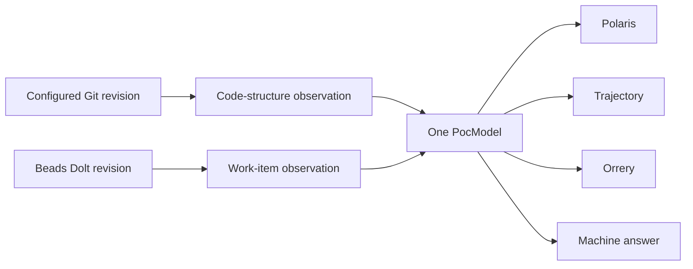

# Design — three-surface-poc-experience

The implementation extends the existing POC and keeps one `PocModel` as the
only truth store. This file is non-normative; the specification governs where
they disagree.

## Data flow

- **Code structure:** `packages/three-surface-poc-core` observes paths, sizes,
  digests and declared language classifications at an exact Git revision.
- **Work items:** the same package reads the registered prefix from Dolt,
  read-only, and records the Dolt revision.
- **Shared truth:** both observations enter the same model used by human and
  machine channels. No surface owns a second fact store.
- **Script-less backstop:** server-rendered exact tables and routes remain
  available when client enhancement is absent.

## Surfaces

- **Polaris — intent as a readable account.** Sections derive from intent
  entities. Claim markers bind every positive statement to model provenance.
- **Trajectory — work without the closure fallacy.** A declared status mapping
  places items into columns. Recorded instants drive time. Scope and excluded
  counts remain visible.
- **Orrery — observed structure without invented meaning.** A deterministic
  seeded layout projects directories and declared mappings. Its legend comes
  from the same encoding table as the renderer.

## Parity

Every rendered fact carries the parity marker used by the independent sweep.
The sweep reports its denominator and compares each value with `GET /api/poc`
for the same evaluation. Client rendering adds presentation, never facts.

## Verification seams

- **Observation boundaries:** sentinel-content sweep, induced observer failure,
  export mutation and direct Dolt comparison.
- **Determinism:** repeated structure observations, repeated time rendering and
  repeated Orrery layouts over one identified input.
- **Complete populations:** work-prefix, claim, mapping, relationship,
  accessibility and epistemic-marker sweeps with reported denominators.
- **Cause-correct failure:** missing or unreadable sources render Unknown with
  their reason; no partial or empty result is presented as complete.
- **Mutation proof:** each requirement's falsifier is exercised at its named
  seam before the corresponding check is trusted.

Stack and library choices remain implementation decisions unless a requirement
names their observable behavior.

## Amendment — P-115 observation-local governedBy wire value

The logical shared PocModel keeps one governing-intent claim per work item.
A machine-wire projection alone encodes the identical complete value once at
`workItems.governedBy`; each `workItems.items[i].governedBy` is exactly
`{"ref":"observation"}`. This literal discriminant resolves in one hop to
the value of the enclosing workItems result in the same body. It is not a
general reference language. Subject identity, source revision/capture pair
and outer evaluation remain the existing ones. In-memory sharing is not a
contract and cannot merge distinct subjects or entity/relationship records.

Before the endpoint returns 200 or 304, validation establishes the exact
three-field shared value and the exact one-key item reference for every
served item. Any differing logical item value or invalid encoding yields
the bounded POC-REQ-014 HTTP 503 wire-validation failure. No previous-body
cache, default, inline compatibility arm, recursive lookup, external read or
truncation is allowed. This fault is not RFC2-24's
reference-unresolvable reason, which has a different source/anchor meaning.
Existing authentication and response-limit refusal still precede any success;
the final encoded body is the body counted against the machine ceiling.
The encoded representation must participate in response/cache identity so
an old inline body cannot receive an incorrect not-modified answer. A fresh
consumer resolves from the received body, never an earlier response.

Human renderers continue to consume the same logical model and render the
same count region, card markings, keyboard controls and narrowed selection.
They gain no reference lookup action, extra disclosure step, new styling or
loading phase. The independent parity oracle expands only the machine wire
and compares effective item values and per-item claims to the original human
population. Representation overhead is O(1) shared value plus O(N) fixed
references; expansion is one hop per item, O(N) time and no external I/O.

Alternatives considered: inline duplication fails the owner's serve-once
motif; removing the per-item field loses self-describing claim membership;
JSON pointers/URIs or a global pool add unneeded lookup/cache/failure states;
pooling full claim records merges subjects; dual inline/reference support
adds an unrequested compatibility path. No external consumer is verified by
this candidate, so no compatibility arm is proposed. A later authorized
implementation must inventory known consumers before atomic rollout.
